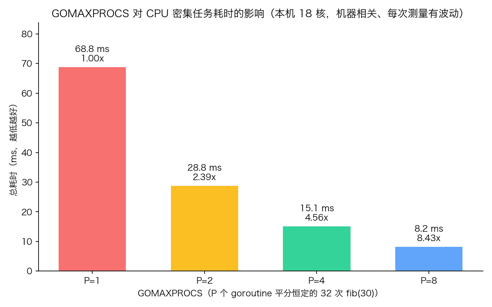

# 10 · GOMAXPROCS 与并行度控制：goroutine 多不代表跑得快

> 起 100 个 goroutine 不等于用了 100 个核。Go 运行时用 GOMAXPROCS 决定**最多用多少个 OS 线程同时执行 goroutine**——它才是"真并行"的闸门。本实验用一个固定工作量的 CPU 密集任务，把 P=1/2/4/8 的耗时真实测出来，看清并发与并行的分界线。

## 1. 为什么需要它

goroutine 是并发的**结构**，GOMAXPROCS 是并行的**执行**。很多人以为 goroutine 数量决定速度，于是在 CPU 密集任务里起几百个 goroutine，结果比单线程还慢；也有人听说"GOMAXPROCS 默认等于核数"，却说不清 P=1 时那 10 个 goroutine 到底是怎么跑的。本实验把这条闸门的真实效果测给你看：同一份固定工作量，只调 P，看耗时怎么变。

## 2. 总览：核心机制一图看懂


> 🌐 **交互版**：[在线打开（GitHub Pages）](https://<user>.github.io/<repo>/concepts/10_gomaxprocs/images/parallel.html)
> （或本地打开 [`images/parallel.html`](images/parallel.html)）。

**心智模型一句话**：任务先平分给 P 个 goroutine（结构），再由 GOMAXPROCS 决定几个 goroutine 能真正同时占用 CPU（执行）——P=1 只有交织没有并行，P 接近核数才接近线性加速。

## 3. 快速开始

```bash
cd concepts/10_gomaxprocs
go run main.go          # 实测 P=1/2/4/8
go run main.go -json    # JSON 数据（viz.py 用它真实测量画图）
python3 viz.py          # 重新生成 images/gomaxprocs.png
```

预期输出（节选，**数值机器相关**：本机 18 核；每次测量都有波动，你的数字一定不同）：

```text
========== GOMAXPROCS 并行度实测（CPU 密集：总工作量恒定 32 次 fib(30)） ==========
P=1      58.3 ms  加速比 1.00x  █
P=2      29.0 ms  加速比 2.01x  █
P=4      15.9 ms  加速比 3.66x  █
P=8       8.2 ms  加速比 7.11x  █

结论：P=1 时 goroutine 只能并发交织、不能并行，最慢；
P 增大到接近物理核数时接近线性加速；P 超过核数无收益甚至更慢。
本机 runtime.NumCPU() = 18 （GOMAXPROCS 默认值，结果与机器相关，每次测量有波动）
```

实测数据图（`viz.py` 每次真实运行 `go run main.go -json` 采集后绘制，非手工编造；核少的机器上 P=8 可能不比 P=4 快甚至更慢，图会如实反映）：



## 4. 核心概念

### 4.1 GOMAXPROCS 到底控制什么

Go 的调度是 G-M-P 模型：goroutine（G）必须挂在逻辑处理器（P）上，P 再绑定到 OS 线程（M）执行。`runtime.GOMAXPROCS(n)` 设定 P 的数量，也就是**同时执行 Go 代码的线程数上限**。默认值等于 `runtime.NumCPU()`（物理/逻辑核数），所以平时不用手动调；手动设小可以限制 CPU 占用（比如容器里配合配额），设大没有意义。

### 4.2 并发 vs 并行

并发是**结构**：多个 goroutine 交替推进，P=1 时运行时在线程里快速切换它们（交织），总耗时不会比串行短。并行是**执行**：P>1 时多个线程真的同时在不同核上算。CPU 密集任务只有拿到并行才有加速；IO 密集任务（网络、文件）在等待时会**让出 P**，所以少量 P 也能撑起大量 goroutine——两类任务的调优思路完全不同。

### 4.3 实验设计：恒定总工作量

总工作量固定为 32 次 `fib(30)`（纯 CPU 递归、无 IO 无锁），P 个 goroutine 平分（各做 32/P 次），`WaitGroup` 等待全部完成后用 `time.Since` 记时。**总工作量不随 P 变**，否则测出来的"加速比"没有意义。这是测并行度的标准姿势。

### 4.4 为什么 P=8 在核少的机器上可能更慢

P 超过物理核数后，多个 P 共享核，不但没有额外算力，还多了调度切换与缓存争用开销；核越少越明显。此外笔记本省电模式、云主机 CPU 配额、超线程的"假核"都会让实测偏离线性——所以图标题注明机器相关，结论以你自己跑出来的数字为准。

## 5. 关键字段与坑清单

| API / 写法 | 含义 | 为什么重要 |
|---|---|---|
| `runtime.GOMAXPROCS(n)` | 设置同时执行 Go 代码的线程数上限 | 并行度的总闸门，返回旧值 |
| `runtime.NumCPU()` | 本机逻辑核数 | GOMAXPROCS 的默认值与调优参考 |
| `n := runtime.GOMAXPROCS(0)` | 传 0 = 只查询不修改 | 探测当前并行度 |
| `go func(){...}()` + `wg.Wait()` | 平分工作量再汇合 | 测并行耗时的基本骨架 |
| `time.Since(start)` | 计时到汇合为止 | 放在 `wg.Wait()` 之后 |

坑清单：

- P=1 时起再多 goroutine 也不会快：只有交织（并发），没有并行——本实验 P=1 是最慢一档
- 在 CPU 密集任务里把 goroutine 数远超核数不会加速，只会增加调度开销
- `GOMAXPROCS(n)` 影响的是"同时执行的线程数"，不是 goroutine 数量上限（goroutine 可以成千上万）
- 容器环境下 `NumCPU()` 读到的是宿主机核数，CPU 配额受限时应按配额调小 GOMAXPROCS（Go 1.25+ 已默认尊重 cgroup 配额）
- 计时记得包住 `wg.Wait()`，否则测的是"派活时间"而不是"干完时间"

## 6. 文件结构

```text
concepts/10_gomaxprocs/
├── README.md                    # 本文件：原理 + 运行指引 + 实测解读
├── main.go                      # 演示程序：恒定工作量下测 P=1/2/4/8，支持 -json
├── viz.py                       # 真实运行 main.go -json 采集数据，画耗时柱状图
└── images/
    ├── parallel.workflow.json   # 图源：单队列串行 vs P 路并行（Typed JSON IR）
    ├── parallel.html            # 交互版：自包含单文件，可缩放/切换主题
    ├── parallel.svg             # README 内嵌双主题矢量图
    └── gomaxprocs.png           # 实测数据柱状图（由 viz.py 真测真画）
```

## 7. 深入要点

**Q：P=1 时 10 个 goroutine 是怎么"同时"跑的？**
A：不是同时。运行时在一个 OS 线程里快速切换它们（每个跑约 10ms 就让出），宏观上都在推进，微观上串行。这就是并发与并行的分界：并发保证"都能跑"，并行才保证"同时跑"。

**Q：为什么 goroutine 数量对 CPU 密集任务的最优值 ≈ 核数，而不是越多越好？**
A：CPU 密集任务没有等待期，每个 goroutine 都想占满一个核；数量超过核数只会带来上下文切换和缓存失效。IO 密集任务相反——等待时让出 P，goroutine 数可以远大于 P。

**Q：为什么本实验要"总工作量恒定"？**
A：若每个 goroutine 都做固定次数，P 越大总工作量越大，测出来的是"更重的活花了多久"，不是加速比。恒定总量 + 平分，耗时变化才只归因于并行度。

**Q：什么时候需要手动调 GOMAXPROCS？**
A：默认值（核数）在裸机上是 opt 的。手动调小的场景：容器 CPU 配额小于宿主机核数（或 Go < 1.25）、需要给同机其他进程让出算力、调试调度问题。调大没有收益——超过核数的 P 只是排队等核。

## 8. 总结

GOMAXPROCS 是并发通往并行的唯一闸门：任务结构再并发，P=1 也只有交织；P 接近核数，CPU 密集任务才拿到接近线性的加速。把 §3 的数字和 §4.2 的分界对上，"goroutine 多 ≠ 快"就刻进直觉了。

下一篇 [../11_worker_pool/](../11_worker_pool/) 看任务池：固定 worker 数 + channel 扇出，是本实验"并行度控制"思想在工程里最常用的形态。G-M-P 调度器的底层原理深入见 internals 线。
