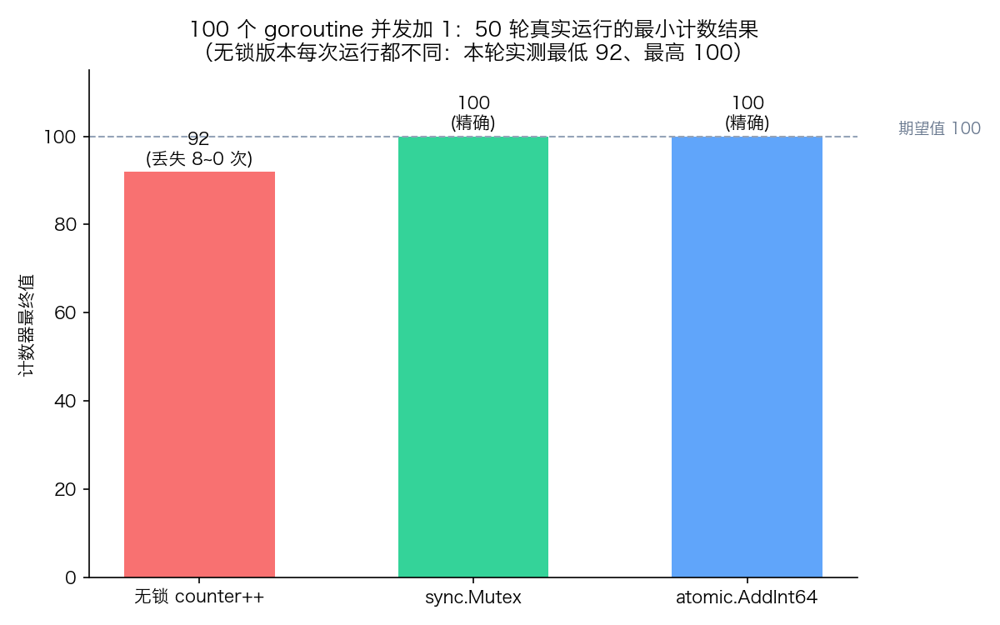

# 21 · 竞态与锁：`counter++` 丢的不是一次加法，是整个更新

> 100 个 goroutine 给同一个计数器各加 1，答案"显然"是 100——但 `counter++` 不是原子操作，无锁并发跑出来的结果往往小于 100，而且每次运行都不同。这就是数据竞态（data race）导致的**丢失更新**。本实验用三方对比（无锁 / sync.Mutex / atomic）把这个 bug 真实跑出来，再用锁与原子指令两条路修复它。

## 1. 为什么需要它

`counter++` 看着是一行代码，CPU 上却是"读 → 加 1 → 写回"三步。两个 goroutine 同时读到 42、各自加 1、先后写回 43——两次加法只剩一次的效果。这类 bug 的阴险之处在于：本地小并发测试经常"碰巧通过"，上了生产高并发才偶发爆雷，且无法稳定复现。Go 给了三件武器：`go run -race` 竞态检测器把竞态暴露出来，`sync.Mutex` 把临界区串行化，`sync/atomic` 用硬件原子指令消灭中间态。本实验三者都用上。

## 2. 总览：核心机制一图看懂


> 🌐 **交互版**：[在线打开（GitHub Pages）](https://<user>.github.io/<repo>/concepts/21_mutex_race/images/lock.html)
> （或本地打开 [`images/lock.html`](images/lock.html)）。

**心智模型一句话**：上半区是无锁竞争——三个 goroutine 的"读改写"交错执行、写回互相覆盖，计数器停在 96；下半区是加锁串行化——Mutex 一次只放一个 goroutine 进临界区，结果是精确的 100，而 atomic 用单条 CPU 指令做到同样的事且更轻。

## 3. 快速开始

```bash
cd concepts/21_mutex_race
go run main.go          # 普通运行：三方对比
go run -race main.go    # 竞态检测器：对无锁版本报 DATA RACE
go run main.go -json    # 输出三方计数的 JSON（供 viz.py 画图）
```

真实输出节选（**注意：无锁结果每次运行都不同**，下面 96 与"丢失 4 次"只是本机某一次的实测，你跑出来大概率是另一个数）：

```text
========== 100 个 goroutine 并发加 1，期望值 100 ==========
① 无锁 counter++      结果 =  96  丢失更新 4 次（每次运行都不同！）
② sync.Mutex 加锁     结果 = 100  精确
③ atomic.AddInt64     结果 = 100  精确
```

`go run -race main.go` 的真实运行节选（检测器对 main.go:34 的 `counter++` 报出读-写冲突，一次运行报告了多组竞态，节选其一）：

```text
==================
WARNING: DATA RACE
Read at 0x00c000012168 by goroutine 7:
  main.incUnlocked.func1()
      .../concepts/21_mutex_race/main.go:34 +0x68

Previous write at 0x00c000012168 by goroutine 8:
  main.incUnlocked.func1()
      .../concepts/21_mutex_race/main.go:34 +0x78
==================
```

## 4. 核心概念

### 4.1 竞态：`counter++` 的三步被 interleaving 打断

`counter++` 编译后是三条指令：读内存到寄存器、寄存器加 1、写回内存。调度器可以在任意两条指令之间切走 goroutine。两个 goroutine 都在"读 42"之后才写回时，后写的覆盖先写的，一次加法凭空消失。**只要两个 goroutine 同时访问同一变量、至少一个是写、且没有同步——竞态就成立**，与结果"看起来对不对"无关。

### 4.2 修复一：sync.Mutex 把临界区串行化

`mu.Lock()` 到 `mu.Unlock()` 之间的代码是临界区，同一时刻只允许一个 goroutine 进入，其余在 Lock 上排队。"读改写"不再交错，结果精确。代价是排队带来的串行化开销，以及**忘记加锁就是白加**——锁靠约定，不靠强制。

### 4.3 修复二：atomic 用硬件原子指令

`atomic.AddInt64(&counter, 1)` 把"读改写"折叠成一条 CPU 原子指令（arm64/x64 的 LOCK 前缀或 LL/SC），中间态根本不存在，不需要排队。对单个整数的计数场景，atomic 比 Mutex 更轻；但它只适合孤立变量的简单运算，多个变量要保持一致还得靠锁。

### 4.4 数据图：三方对比的真实测量



viz.py 真实运行 `go run main.go -json` 50 轮，取三方各自的最小值作图。无锁版本的丢失是概率性的——单次运行可能碰巧得到 100，50 轮里实测最低 92（丢失 8 次）、最高 100（碰巧没丢）；Mutex 与 atomic 在全部 50 轮中始终精确为 100。

## 5. 关键字段与坑清单

| 语法 | 含义 | 为什么重要 |
|---|---|---|
| `counter++` | 读→加1→写回，三条指令 | 不是原子操作，并发写就是数据竞态 |
| `var mu sync.Mutex` | 互斥锁（值类型，勿拷贝） | `Lock/Unlock` 之间的代码串行执行 |
| `mu.Lock(); defer mu.Unlock()` | 加锁 + 延迟解锁 | 防止临界区提前 return / panic 忘解锁 |
| `atomic.AddInt64(&c, 1)` | 原子加，返回新值 | 单条指令完成读改写，无锁 |
| `go run -race` | 竞态检测器 | 发现"同时访问、一写、无同步"，运行时开销约 5~10 倍 |

坑清单：

- 无锁结果每次运行都不同：丢失更新是概率性的，"我这没复现"不等于没有竞态，用 `-race` 说话
- `-race` 只报"被真正触发的竞态"：没跑到的代码路径不报，所以要在测试里真并发
- 锁的粒度：锁住的是"代码区间"不是"变量"，保护哪些全靠团队约定，漏加锁就漏保护
- `sync.Mutex` 是值类型，**拷贝一个已使用的锁是 bug**（`go vet` 会报 copylocks）
- atomic 不能保护"一组变量"：各字段分别原子、整体却不一致，需要一致性时用锁或 channel

## 6. 文件结构

```text
concepts/21_mutex_race/
├── README.md                    # 本文件：原理 + 运行指引 + 深入要点
├── main.go                      # 三方对比 demo：无锁 / Mutex / atomic，支持 -json
├── viz.py                       # 真实运行 main.go -json 50 轮，画三方对比柱状图
└── images/
    ├── lock.architecture.json   # 图源：无锁竞争 vs 加锁串行化（Typed JSON IR）
    ├── lock.html                # 交互版：自包含单文件，可缩放/切换主题
    ├── lock.svg                 # README 内嵌双主题矢量图
    └── race.png                 # 数据图：50 轮实测三方计数对比（viz.py 生成）
```

## 7. 深入要点

**Q：为什么本地测试经常"碰巧通过"，上了生产才出事？**
A：竞态是否表现取决于调度时机。goroutine 少、核少、执行快时，交错往往来不及发生；生产环境高并发、核多、持锁时间长，交错概率骤增。所以竞态是"概率性 bug"，复现不能靠多跑几次，要靠 `-race` 的 happens-before 分析。

**Q：`-race` 是怎么发现竞态的？它靠运行结果判断吗？**
A：不靠结果。它基于 happens-before：记录每次内存访问的时钟向量，发现两次访问没有先后顺序约束、且一读一写就报 WARNING——哪怕最终数值恰好是 100。所以 `-race` 报了就是真竞态，与本次运行结果无关。

**Q：Mutex 和 atomic 怎么选？**
A：保护单个计数器/标志位 → atomic（`atomic.Int64`、`CompareAndSwap`）；保护"一组变量的一致性"或复杂不变量 → Mutex。Mutex 更通用但有排队开销与忘加锁风险；atomic 更快但表达能力有限。拿不准时用锁， profiling 证明热点后再换 atomic。

**Q：`go run -race` 能放进 `go run main.go -json` 的数据里吗？**
A：不能，也无需。race 检测器的输出走 stderr、且开销大，会把时序搅乱；-json 数据只采集普通运行的三方计数。本实验里 race 输出只用于 README 的如实记录与教学演示，两者分离。

## 8. 总结

竞态的本质是"共享 + 可变 + 无同步"三者同时成立。修复有三条路：加锁串行化（Mutex）、原子指令（atomic）、以及更 Go 的方式——不共享内存、用 channel 传数据。先让 `-race` 替你说真话，再选修复手段。

下一篇 [22_context](../22_context/) 看取消传播：用 context 把"该停了"沿 goroutine 树传下去，解决并发任务的优雅退出问题。底层锁的实现原理（Mutex 的自旋与饥饿模式）见 internals 深入篇。
