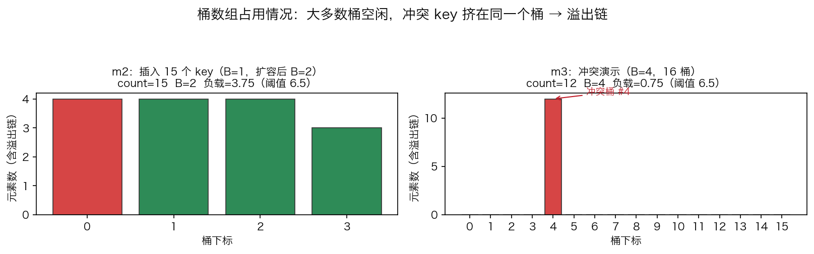

# 02 · Map 底层实现：tophash 预筛、溢出链与负载因子扩容

> map 是 Go 里"用起来最简单、内部最复杂"的容器，且不可 `unsafe` 直读——内部布局是实
> 现细节而非稳定契约，Go 1.24 起已改用 Swiss Table。本实验用纯 Go 结构模拟经典
> hmap/bmap 设计（Go 1.23 及更早），把整条查找路径变成看得见的打印。

## 1. 为什么需要它

为什么遍历无序、什么时候扩容、哈希冲突怎么解决——答案全在"hmap + 桶数组"的布局里。
旧版代码曾用 `unsafe` 硬读运行时 hmap，结果读到的是哈希种子的随机字节：map 的布局不
是官方承诺的稳定结构（与 slice/string 不同），Go 1.24 起 hmap/bmap 已被 Swiss Table 取代，本实验改用纯 Go 结构复刻经典设计。

## 2. 总览：核心机制一图看懂


> 🌐 **交互版**：[在线打开（GitHub Pages）](https://<user>.github.io/<repo>/internals/02_map/images/chain.html)
> （或本地打开 [`images/chain.html`](images/chain.html)）。

**心智模型一句话**：哈希的低 B 位选桶（位与替代取模），高 8 位存成 tophash 预筛；
桶内 8 槽逐格比对，全不中才沿 `next` 走溢出桶。图中主桶 8 格 tophash 没有一个等于要
找的 0x0f，查找下探到溢出桶第 3 槽才命中。

## 3. 快速开始

```bash
cd internals/02_map
go run main.go          # 文本演示：哈希 → 插入扩容 → 查找 → 溢出链
go run main.go -json    # 输出 JSON 状态快照（桶占用与 tophash）
python3 viz.py          # 实测数据图：桶数组占用柱状图 → images/occupancy.png
```

预期输出（节选，固定种子哈希，每次运行完全一致）：

```text
  "hello"  hash=0x21793a17  tophash(高8位)=0x21  桶下标(低2位)=3
  ▶ 触发扩容：再插 1 个就会超过 6.5×4 的负载因子，B: 1 -> 2
    重新哈希 13 个元素到 4 个桶
  [状态] 插入 15 个 key：count=15  B=2  桶数=4  负载因子=3.75（阈值 6.5）
  查找 "key_05"       hash=0xf45fbec6 tophash=0xf4 → bucket=2
  命中：bucket=2 slot=1，比较了 2 个槽位
     桶 4 已满 → 新建溢出桶，挂到链表尾部
```

扩容行打印的 6.5×4 是 B 已 +1 后的新桶数，实际阈值是 6.5×2=13；`-json` 快照供 viz.py
画实测分布图。

## 4. 核心概念

### 4.1 顶层 hmap 与桶 bmap

```go
type hmap struct {
    count   int      // 元素总数
    B       int      // 桶数 = 1 << B
    buckets []*bmap  // 桶数组
}
type bmap struct {
    tophash [8]uint8 // 每个 key 哈希的高 8 位，用于快速预筛
    keys    [8]string
    vals    [8]string
    used    int
    next    *bmap    // 溢出桶：桶满后挂到链表尾部
}
```

每桶最多 8 个键值对（与真实运行时一致），`len(m)` 读的就是 count。

### 4.2 哈希定位：低 B 位找桶、高 8 位做 tophash

```go
func (m *hmap) bucketIdx(h uint32) int { return int(h) & (len(m.buckets) - 1) }
func tophashOf(h uint32) uint8        { return uint8(h >> 24) } // 哈希高 8 位
```

桶数是 2 的幂，桶下标 = `hash & (2^B - 1)`；演示用固定种子 0x9e3779b9 的 FNV-1a 哈希，
每次运行结果一致、便于讲解。

### 4.3 冲突解决：溢出桶链

桶满后新建溢出桶挂到 `next` 链尾。m3 从 3000 个候选 key 挑出 12 个落在同一桶（B=4，
16 桶，不会触发扩容）：前 8 个填满主桶，第 9 个触发"桶 4 已满"，剩下 4 个进溢出桶
——一条最坏退化为链表的长链。

### 4.4 扩容：负载因子阈值 6.5

```go
if float64(m.count+1)/float64(m.bucketCount()) > 6.5 { m.grow() }
```

"再插 1 个就超过 6.5×桶数"就触发 grow：桶数翻倍（B+1）并把旧元素全部重新哈希。m2
插到第 14 个触发扩容，重哈希 13 个元素到 4 个桶；真实运行时为避免一次性停顿，是渐进
式搬迁，模拟版做全量重哈希只为观察。



实测分布：m2 扩容后 15 个 key 摊在 4 个桶（负载 3.75）；m3 的 12 个 key 全挤在桶 #4
（红色柱，含溢出链），其余 15 桶全空——冲突的影响一眼可见。

## 5. 关键字段与坑清单

| 字段 | 含义 | 为什么重要 |
|---|---|---|
| `count` | 元素总数 | `len(m)` 的来源；负载因子的分子 |
| `B` | 桶数的对数 | 桶数恒为 2 的幂，下标用 `& (2^B-1)` 算 |
| `tophash[8]` | 每槽 key 哈希高 8 位 | 1 字节整型预筛，挡住绝大多数字符串比较 |
| `next *bmap` | 溢出桶指针 | 冲突的兜底手段，链越长查找越慢 |
| 负载因子 | count / 桶数 | 超过 6.5 触发扩容，平衡空间利用率与链长 |

坑清单：

- map 内部布局非稳定契约：Go 1.24 起 hmap/bmap 已不存在，`unsafe` 硬读只能得到随机字节
- 哈希函数务必确定性：真实运行时种子随机，演示必须用固定种子，否则桶下标每次全变
- JSON 序列化时 `[]uint8` 会被编码成 base64，tophash 字段要用 `[]int` 才能读到数值
- 真实运行时扩容是渐进式搬迁，模拟版做全量重哈希只为讲清概念

## 6. 文件结构

```text
internals/02_map/
├── README.md                       # 本文件：原理 + 运行指引 + 深入要点
├── main.go                         # 主教材：哈希定位 → 插入扩容 → 查找 → 溢出链（-json 输出快照）
├── viz.py                          # 实测数据图：go run main.go -json → images/occupancy.png
└── images/
    ├── chain.architecture.json     # 图源：查找路径 tophash 预筛 + 溢出链（Typed JSON IR）
    ├── chain.html                  # 交互版：可缩放/高亮连线的自包含页面
    ├── chain.svg                   # README 内嵌双主题矢量图
    └── occupancy.png               # 实测数据图：桶数组占用分布（matplotlib）
```

## 7. 深入要点

**Q：map 查找一个 key 的完整过程是什么？**
A：hash(key) → 低 B 位定桶 → 逐槽比较 tophash → 相等再比 key → 不中沿溢出链继续。

**Q：map 什么时候扩容？tophash 为什么能加速查找？**
A：负载因子 count/桶数 超过 6.5 时桶数翻倍并重新哈希（真实运行时是渐进式搬迁）。
tophash 是哈希高 8 位、每槽 1 字节，比较 uint8 远比字符串便宜，不等直接跳过该槽。

**Q：为什么桶数设计成 2 的幂？不能用 unsafe 读 map 吗？**
A：桶下标 = hash & (2^B - 1)，位与替代取模，扩容 B+1 即翻倍。slice/string 头是官方
承诺的稳定布局，map 的 hmap 不是（1.24 已换 Swiss Table），只能模拟或走官方 API。

**Q：并发读写 map 会发生什么？为什么 runtime 宁可崩溃也不返回脏数据？**
A：hmap 里有 flags 位标记"有 goroutine 正在写"，并发读写会直接 `fatal error: concurrent
map read and map write`（不可 recover）。因为 map 无锁，并发写会破坏溢出链/计数，
宁可崩溃也不返回脏数据；需要并发就用 `sync.RWMutex` 包一层或分片（见 patterns/10）。

## 8. 总结

map 的全部行为都能从"桶数组 + tophash 预筛 + 溢出链 + 负载因子"推出来。验证方法——
`go run main.go` 打印每个 key 的哈希、桶下标与槽位，比背结论可靠得多。

下一篇 [03_channel](../03_channel/) 看"数组 + 游标"：channel 环形队列如何用 sendx/
recvx 两个游标实现收发、阻塞与槽位复用。
