# 05 · Interface 底层实现：eface、itab 与 nil 陷阱

> 接口是 Go 抽象的核心，但"接口变量里装了什么"常被想当然：为什么装了 nil 指针的接口
> 不等于 nil？类型断言到底比较了什么？接口的两字布局已稳定十余年、属承重结构，本实验
> 用 `unsafe` 把它读出来，再用 `reflect` 取类型名与方法集——顺带演示"何时能用 unsafe、
> 何时不能"的分界线。

## 1. 为什么需要它

`err != nil` 却进了错误处理、`interface{}` 参数一多性能就掉——这些问题的答案全在接口
的两字布局里。接口变量不是魔法盒子，就是两个指针字：空接口 `interface{}` 是
`{ _type, data }`，带方法接口是 `{ itab, data }`。看懂这两个字，类型断言、方法调用、
nil 比较的行为全部可推导。

实验谨慎使用 `unsafe`：只把接口变量当 `[2]uintptr` 读出两个字的地址，绝不解引用
`_type`/itab 内部字段（字段名随版本可能变），类型名与方法集交给 `reflect` 官方 API。

## 2. 总览：核心机制一图看懂


> 🌐 **交互版**：[在线打开（GitHub Pages）](https://<user>.github.io/<repo>/internals/05_interface/images/iface.html)
> （或本地打开 [`images/iface.html`](images/iface.html)）。

**心智模型一句话**：接口 = 类型指针 + 数据指针。`_type`/itab 按"类型"或"接口×具体
类型"组合全局唯一缓存，接口只存指向它们的指针；data 指向装箱后的数据副本。实测
`e1(int 42)` 与 `e4(int 99)` 的 `_type` 地址相同，`s1/s3`（同为 Dog）的 itab 地址
相同——类型信息进程内只有一份。

## 3. 快速开始

```bash
cd internals/05_interface
go run main.go          # 文本演示：eface → 装箱 → iface → 断言 → nil 陷阱
go run main.go -json    # 输出 JSON 地址快照（供程序化读取）
```

预期输出（节选，地址每次运行不同）：

```text
  e1   int=42      type=0x102767a40 data=0x102650480
  e4   int=99      type=0x102767a40 data=0x102650488
  s1   main.Dog  itab=0x102795058 data=0x1027d0f40 方法集=[Bite Speak]
  s3   main.Dog  itab=0x102795058 data=0x1027d0f40 方法集=[Bite Speak]
  e == nil ? false
  eface._type=0x1027735a0  data=0x0
  e.(int)     → 42, ok=true  （_type 匹配 int）
```

每一步"在看什么"都写在 `main.go` 的注释里；对比行直接给出结论：同类型 → `_type`/
itab 地址相同，不同类型 → 各不相同。

## 4. 核心概念

### 4.1 空接口 eface = { _type, data }

`efaceWords` 把接口变量当 `[2]uintptr` 读出两个字。`_type` 指向类型信息，进程内全局
唯一；`data` 指向数据。int、string、*Point 的 `_type` 地址各不相同，而两个 int 装箱
的接口共享同一份——这就是"接口只保存类型指针"的直接证据。

### 4.2 带方法接口 iface = { itab, data }

带方法接口的第一字是 itab 指针。itab 展开为三件事：接口类型（inter）、具体类型、方法
表——`Speaker`×`main.Dog` 的方法表是 `[Bite, Speak]`。runtime 按（接口, 具体类型）
组合对 itab 做全局缓存：`s1`/`s3` 同为 Dog 共用 0x…058，`s2` 是 Cat 用 0x…078。方法
调用就是查一次方法表，这也是接口调用比直接调用慢的原因。本实验的 Dog/Cat 都是
零大小结构体，装箱的值没有数据可存，`data` 一律指向 runtime 的 `zerobase` 哨兵地址
（图中 s1/s2/s3 的 data 相同、itab 不同，正是"类型有别、值共享"的直观体现）。

### 4.3 data 指针的装箱语义



> 🌐 **交互版**：[在线打开（GitHub Pages）](https://<user>.github.io/<repo>/internals/05_interface/images/trap.html)
> （或本地打开 [`images/trap.html`](images/trap.html)）。

值类型装接口会"装箱"：`x := 5; ex := interface{}(x)` 后 `ex.data=0x…7e8` 与
`&x=0x…0d0` 不同——接口里是拷贝，改 `x=100` 后 `ex` 仍是 5。指针类型则直存：
`ey := interface{}(yp)` 的 `data` 就是 `yp` 本身，不再拷贝。上图三行依次演示装箱
拷贝、指针直存、与装 `(*Dog)(nil)` 后的 nil 判定。

### 4.4 类型断言与 nil 陷阱

断言 `e.(int)` 本质是拿 `_type` 与目标类型比较，匹配才取 data；type switch 是语法糖
（`switch v := s.(type)` 命中 Dog 后可调 `Speak()`）。nil 陷阱：装了 nil 指针的接口
`_type` 非空、`data` 为 0，所以 `e == nil` 为 false；只有两字全 0 的接口才是真 nil。
判断"接口里的值是否为 nil"，必须先断言出具体类型再比较。

## 5. 关键字段与坑清单

| 字段/概念 | 含义 | 为什么重要 |
|---|---|---|
| `_type` | 空接口第一字：类型信息指针 | 全局唯一；断言就是比较它 |
| `itab` | 带方法接口第一字 | 按（接口, 具体类型）全局缓存；含方法表 |
| `data` | 第二字：数据指针 | 值类型指向副本，指针类型存原指针 |
| 装箱 | 值类型 → 副本 | 每次装接口都可能分配，热路径要留意 |
| 两字全 0 | 真 nil 接口 | 只看 data 或只看 _type 都会误判 |

坑清单：

- **err == nil 误判**：函数返回 `*MyErr` 类型的 nil 装进 error 接口后 `err != nil`；
  要么返回接口类型本身，要么先断言再判
- **图省事把参数都写成 `interface{}`**：值类型每次传参都装箱拷贝，热路径额外分配，
  且丧失编译期类型检查
- **本实验的两字布局只能当学习手段**：只读不解引用内部字段；业务代码依赖 reflect 而
  不是 unsafe 布局

## 6. 文件结构

```text
internals/05_interface/
├── README.md                        # 本文件：原理 + 运行指引 + 面试要点
├── main.go                          # 主教材：unsafe 读两字 → 装箱 → 断言 → nil 陷阱（-json 快照）
└── images/
    ├── iface.architecture.json      # 图源：eface/iface 两字布局 + itab 展开（Typed JSON IR）
    ├── iface.html                   # 交互版：可缩放/高亮连线的自包含页面
    ├── iface.svg                    # README 内嵌双主题矢量图
    ├── trap.architecture.json       # 图源：装箱语义与 nil 陷阱
    ├── trap.html                    # 交互版
    └── trap.svg                     # README 内嵌双主题矢量图
```

## 7. 面试要点

**Q：interface{} 和带方法的接口在内存里有什么区别？**
A：都是两个指针字。空接口是 `{ _type, data }`；带方法接口是 `{ itab, data }`，itab
里打包了接口类型、具体类型与方法表。

**Q：类型断言的底层原理是什么？**
A：比较接口第一字（_type 或 itab）与目标类型是否匹配，匹配则取出 data；type switch
是它的语法糖。这就是为什么断言不涉及反射、只有一次指针比较加一次取值。

**Q：为什么装了 nil 指针的接口不等于 nil？**
A：接口相等要求两个字都为 0。装 `(*Dog)(nil)` 时 `_type` 非 0（类型信息还在），只有
data 是 0，所以 `e == nil` 为 false。

**Q：为什么同一个接口装同一个具体类型，itab 地址总相同？**
A：runtime 按（接口类型, 具体类型）组合全局缓存 itab，组合不变就只此一份；实测 s1/s3
同为 Dog 共用同一 itab 地址，Cat 则是另一个。

**Q：把大结构体传给 interface{} 参数有什么代价？**
A：值类型会装箱拷贝（可能堆分配），热路径建议传指针——指针装接口时 data 直存原指针，
不再拷贝。

## 8. 总结

接口的全部行为都能从"两字布局"推出来：断言是第一字的比较，方法调用是查 itab 方法表，
nil 判定要求两字全 0，装箱决定了改原变量是否影响接口值。记住验证方法——`go run
main.go` 把每对地址打印出来，比背结论可靠得多。

下一篇 [06_array_vs_slice](../06_array_vs_slice/) 回到值语义：数组 [5]int 与切片头的
内存布局对比，以及 a[1:4] 窗口的偏移本质。
