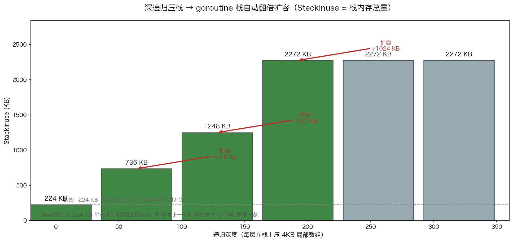
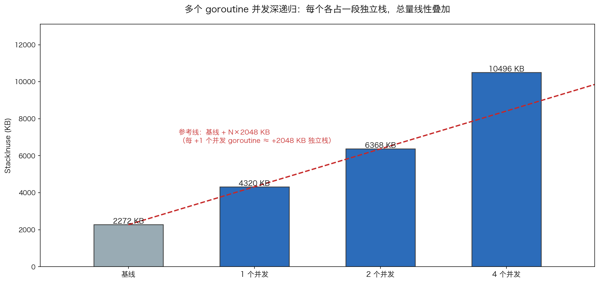

# 07 · Goroutine 栈：2KB 起步、按需翻倍、彼此隔离

> goroutine 最重要的两个内存事实是"可扩容的独立栈"与"栈隔离"，但 Go 1.26 已封禁对 `runtime.getg`/`runtime.allgs` 的 `//go:linkname` 链接，无法再直读 `g.stack.lo/hi`。本实验改用纯受支持的官方接口——`runtime.Stack` 解析 goid、`unsafe` 读帧 SP、`runtime.MemStats.StackInuse` 观察栈内存总量——把"栈从 2KB 起步、不够就翻倍、每个 goroutine 各占一段"变成看得见的数据。

## 1. 为什么需要它

"一个进程开几十万 goroutine"靠的是什么？答案就三个词：**栈小（初始 ~2KB，对比线程固定 MB 级）、可扩（runtime 自动翻倍）、隔离（每个 goroutine 一段独立栈）**。但这些结论通常只是被背诵；本实验在内部符号被封禁的时代背景下，用官方支持的手段把它们逐一实测出来：goid 有独立编号、栈向低地址生长、深递归触发台阶式扩容、N 个并发栈内存线性叠加。

## 2. 总览：核心机制一图看懂


> 🌐 **交互版**：[在线打开（GitHub Pages）](https://<user>.github.io/<repo>/internals/07_goroutine/images/stack.html)
> （或本地打开 [`images/stack.html`](images/stack.html)）。

**心智模型一句话**：goroutine 的栈不是固定大小，而是一段"随用随长"的内存——每次函数调用的序言都会拿 SP 与 stackguard 比较，越界就触发 `morestack`→`copystack`：按 2 倍分配新栈、拷贝全部旧帧、重定位指针，全程用户无感知；栈利用率过低时 GC 还会反向收缩归还内存。

## 3. 快速开始

```bash
cd internals/07_goroutine
go run main.go          # 文本演示：goid → 栈向下生长 → 扩容台阶 → 并发隔离
go run main.go -json    # 输出 JSON 状态快照（growth/baseline/goroutines）
python3 viz.py          # 数据图：生成 images/growth.png 与 images/isolation.png
```

预期输出（节选，地址与 KB 数值每次运行略有波动）：

```text
主 goroutine: goid = 1
子 goroutine: goid = 19          ← 独立编号，每次运行不同
当前帧 SP ≈ 0x…7e67
inner 帧 SP ≈ 0x…7df7（比 outer 低 → 栈向下生长）
depth=  0  StackInuse= 256 KB
depth= 64  StackInuse= 736 KB  ← 扩容 +480 KB
depth=128  StackInuse=1248 KB  ← 扩容 +512 KB
depth=192  StackInuse=2272 KB  ← 扩容 +1024 KB
depth=256  StackInuse=2272 KB   ← 平台期：栈已够用，扩容停止
基线（无深递归时）StackInuse = 2272 KB（注意：基线取自递归结束之后——
翻倍过的栈虽不再使用但尚未被 shrinkstack 归还，所以比递归前实测的 256 KB 大得多，
两个数都是"真实读数"，只是口径不同）
1 个并发深递归: StackInuse=4320 KB（每个约 +2048 KB）
4 个并发深递归: StackInuse=10496 KB（每个约 +2056 KB）
```

每一步"在看什么"都写在 `main.go` 的注释里；`-json` 快照给出与文本演示一致的机器可读数值。

## 4. 核心概念

### 4.1 goid：官方获取方式

直读 `runtime.allgs` 已被编译器封禁，代码改解析 `runtime.Stack` 输出的第一行 `goroutine N [...]`：主 goroutine 是 1，子 goroutine 每次运行编号不同（实测 19/21）。独立编号为"隔离"实验提供了身份视角。

### 4.2 栈向下生长

用 `//go:noinline` 阻止内联，取局部变量地址作为帧内 SP 探针：内层帧的 SP（0x…7df7）比外层（0x…7e67）低 0x70 字节——调用层级越深地址越低，栈向低地址方向生长。

### 4.3 深递归逼出扩容台阶

每个递归帧压入 `[4096]byte` 局部数组把栈撑爆，触发 runtime 整体复制换新栈。`stackKB()` 每 64 层记录一次 `StackInuse`，得到台阶曲线：



怎么看：绿色柱是扩容台阶（+480/+512/+1024 KB），灰色是平台期——**扩容只发生在"不够"的那一刻，之后自动停止**。注意 depth=0 时 StackInuse 已有 ~256 KB，这是全部 goroutine（含 runtime 自身）的总和，单个 goroutine 的初始栈仍是 ~2KB。

### 4.4 栈隔离：总量随 N 线性叠加

让 1/2/4 个 goroutine 同时深递归到第 300 层并上报 `StackInuse`：



红色虚线是"基线 + N × 单栈增量"的参考线，实测柱子（4320/6368/10496 KB）恰好贴合——每个并发 goroutine 各占一段独立栈，互不共享，这正是"轻量并发"的底气。

## 5. 关键字段与坑清单

| 字段/手段 | 含义 | 为什么重要 |
|---|---|---|
| `runtime.Stack(buf, false)` | 当前 goroutine 的调用栈文本 | 第一行 `goroutine N` 是 goid 的官方来源 |
| `MemStats.StackInuse` | 全部 goroutine 栈内存总量（Spans） | 唯一受支持的栈规模观测口，注意是"总和" |
| `stackguard` | 栈顶预留的警戒阈值 | 函数序言 `SP < guard` 即触发 `morestack` |
| `copystack` | 整栈复制换新 | 旧栈指针全部重定位，对用户透明 |
| `//go:noinline` | 禁止内联 | 没有它递归被优化掉，台阶曲线不会出现 |

坑清单：

- `//go:linkname` 直读 `runtime.getg`/`runtime.allgs` 在 Go 1.26 会链接失败——只能用 `runtime.Stack`/`MemStats` 间接观测
- `StackInuse` 是所有 goroutine 之和，观察单个 goroutine 会被运行时开销污染；程序用"每 64 层记录一次"与"N 倍差分"剥离噪声
- 递归函数必须 `//go:noinline` 且帧里压 `[4096]byte` 数组，否则编译器复用栈帧，栈根本不会扩容
- KB 数值每次运行有波动（如 depth=0 一回 256、一回 224），比数值更重要的是"台阶 + 平台期"的形状

## 6. 文件结构

```text
internals/07_goroutine/
├── README.md                        # 本文件：原理 + 运行指引 + 面试要点
├── main.go                          # 主教材：goid → 栈向下生长 → 扩容台阶 → 并发隔离（-json 输出快照）
├── viz.py                           # 数据图脚本：读 -json 快照画 growth/isolation 两张 PNG
└── images/
    ├── stack.lifecycle.json         # 图源：栈生命周期状态机（Typed JSON IR）
    ├── stack.html                   # 交互版：可缩放/高亮连线的自包含页面
    ├── stack.svg                    # README 内嵌双主题矢量图
    ├── growth.png                   # 数据图：StackInuse 台阶式增长（matplotlib 实测绘制）
    └── isolation.png                # 数据图：N 个并发栈总量线性叠加（matplotlib 实测绘制）
```

## 7. 面试要点

**Q：goroutine 初始栈多大？为什么这么设计？**
A：约 2KB（线程固定 MB 级）。小栈让"开几十万 goroutine"的内存成本可接受；不够用时由 runtime 的 `morestack`/`copystack` 自动翻倍扩容，用户零配置。

**Q：栈扩容是怎么触发的？对正在运行的函数有影响吗？**
A：每次函数调用序言会比较 SP 与 stackguard，越界则分配 2 倍新栈、拷贝全部旧帧并重定位指针（copystack）。正在运行的函数无感知，地址类指针由运行时统一改写。

**Q：为什么本实验读不到 `g.stack.lo/hi`？**
A：Go 1.26 封禁了对 runtime 内部符号的 `//go:linkname`。替代方案：`runtime.Stack` 解析 goid、`MemStats.StackInuse` 观测栈总量——都是受支持的官方接口。

**Q：多个 goroutine 的栈会互相覆盖吗？**
A：不会。实测 1/2/4 个并发深递归，StackInuse 按"基线 + N×单栈增量"线性叠加（4320/6368/10496 KB），每段栈独立分配、独立扩容。

**Q：栈会变小吗？**
A：会。GC 在栈利用率过低时触发 shrinkstack 收缩归还内存，所以长驻 goroutine 不会因历史峰值永久占内存。

## 8. 总结

goroutine 的轻量不是玄学：**初始 ~2KB、不够自动翻倍、彼此完全隔离**，三件事在本实验里分别对应 goid/SP 探针/StackInuse 台阶与线性叠加四组实测数据。栈扩容对用户完全透明，这正是 Go 敢把"并发单元"做得比线程小三个量级的底气。

下一篇 [08_mutex](../08_mutex/) 继续深入 runtime：`sync.Mutex` 的 state 字段如何用 1 个 int32 同时表达"锁着没有、谁在等、是否饥饿"。
