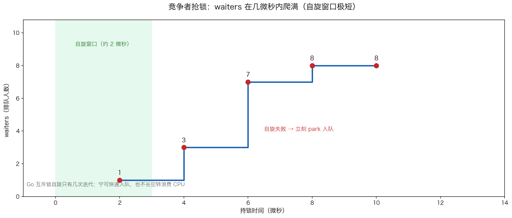
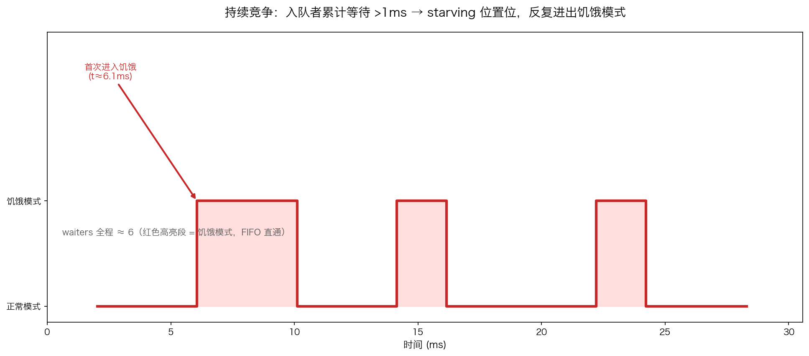

# 08 · sync.Mutex 底层：一个 int32 装下 locked、woken、starving 与 waiters

> `sync.Mutex` 的底层只有 `{ state int32, sema uint32 }` 共 8 字节，这个布局十余年未变——所以可以放心用 `unsafe` 读出真实的 state 字并逐位解码。本实验把锁内部的"位运算状态机"变成可验证的数据：state=25 怎么读出"持锁 + 3 人排队"？为什么自旋窗口只有几微秒？饥饿模式如何在 1ms 阈值后接管调度？

## 1. 为什么需要它

大多数人对 Mutex 的理解止步于"Lock/Unlock 包住临界区"，于是常见疑问无从下手：为什么高竞争下性能骤降？为什么有的等待者饿死、有的插队？**答案全部藏在 state 这一个 int32 字里**：bit0 locked / bit1 woken / bit2 starving / bits3+ waiters 计数，读写全靠位运算，一次 CAS 就能原子流转。读懂这个字，自旋、饥饿、公平性就都成了可推导的结论，而不是背下来的口诀。

## 2. 总览：核心机制一图看懂



> 🌐 **交互版**：[在线打开（GitHub Pages）](https://<user>.github.io/<repo>/internals/08_mutex/images/state.html)
> （或本地打开 [`images/state.html`](images/state.html)）。

**心智模型一句话**：state 是把"锁被谁拿着、有没有人被唤醒、是否转入饥饿、多少人在排队"四个布尔/计数信息压进 32 个 bit 的寄存器；`sema` 是配套的信号量，等待者 park 在上面，被唤醒后再回来竞争 bit0。

## 3. 快速开始

```bash
cd internals/08_mutex
go run main.go          # 文本演示：state 位解码 → 自旋窗口 → 饥饿模式
go run main.go -json    # 输出 JSON 状态快照（spin/starvation 采样）
python3 viz.py          # 数据图：生成 images/spin.png 与 images/starvation.png
```

预期输出（节选，采样数值每次运行略有波动）：

```text
新建未锁: state=0 → locked=false woken=false starving=false waiters=0
加锁后  : state=1 → locked=true woken=false starving=false waiters=0
持锁时有 3 人等待: state=25 → locked=true woken=false starving=false waiters=3
            waiters=3（bits3+ 计数），waiters = state >> 3
持锁后 t≈ 2µs  waiters=2
持锁后 t≈ 4µs  waiters=8    ← 几微秒内爬满
t=   6093µs  locked=true  starving=true  waiters=6  ← 首次进入饥饿模式
t=  10125µs  locked=true  starving=false waiters=6  ← 被服务后复位
```

每一步"在看什么"都写在 `main.go` 的注释里；`-json` 快照给出与文本演示一致的机器可读数值。

## 4. 核心概念

### 4.1 state 字的位布局与原子读取

解码规则：`locked = state&1`、`woken = state&2`、`starving = state&4`、`waiters = state>>3`（高 29 位计数）。实测三连：新建未锁 state=0；Lock() 后 state=1；持锁且 3 人排队时 state=25（= 1 | 3<<3）——一个字同时编码四种信息，原子更新只需一次 CAS。影子结构 `muShadow` 与 `sync.Mutex` 前 8 字节逐字节对应，读 state 必须用 `atomic.LoadInt32` 避免数据竞争。

### 4.2 自旋：几微秒的短窗口

竞争者先做少量自旋（空转轮询 CAS），失败立刻 park 入队。`GOMAXPROCS(2)` 下压 8 个竞争者抢锁，每 2µs 采样 waiters：



怎么看：绿色高亮段是约 2µs 的自旋窗口，红色散点是实测采样——waiters 迅速爬满说明自旋只撑几微秒。Go 宁可快速入队也不长空转浪费 CPU；自旋的价值仅在于临界区极短时（<1µs）免掉一次上下文切换。

### 4.3 饥饿模式：1ms 阈值触发 FIFO 直通

保持 2 个 P、8 个 worker、每轮临界区 60µs，让竞争永不停止，采样 30ms：



怎么看：红色高亮段即饥饿模式——当某等待者累计等待超过 1ms，starving 位置位，解锁直接把锁交接给排队最久的等待者（FIFO，不再允许插队自旋）；它被服务后立即复位。实测首次饥饿出现在约 6ms，之后随竞争反复进出。

## 5. 关键字段与坑清单

| 字段/表达式 | 含义 | 为什么重要 |
|---|---|---|
| `state & 1`（bit0 locked） | 锁是否被持有 | Lock 即 CAS 置 bit0，Unlock 清 bit0 |
| `state & 2`（bit1 woken） | 是否已唤醒等待者 | 协调"唤醒 vs 新来者插队"的竞争 |
| `state & 4`（bit2 starving） | 是否饥饿模式 | 置位后 unlock FIFO 直通，禁插队 |
| `state >> 3`（bits3+ waiters） | 排队 goroutine 计数（29 位） | 实测 3 人排队 → state=25 |
| `sema uint32` | 信号量 | 等待者 park/唤醒的挂靠点 |

坑清单：

- **影子结构必须一字不差**：`muShadow{state int32; sema uint32}` 与 Mutex 前 8 字节布局错一位，解码全错
- **读 state 必须用 `atomic.LoadInt32`**：普通解引用是数据竞争，`-race` 直接报警
- **饥饿实验必须调低 `GOMAXPROCS`**（如 2）：P 多了竞争不够激烈，starving 位可能根本不置位；结束记得 defer 恢复
- **采样数值每次运行有波动**（首次饥饿 6ms 上下、waiters 爬升 4~8 不等），确定性的是位布局与状态机逻辑，不是绝对数值

## 6. 文件结构

```text
internals/08_mutex/
├── README.md                        # 本文件：原理 + 运行指引 + 深入要点
├── main.go                          # 主教材：state 位解码 → 自旋窗口 → 饥饿模式（-json 输出快照）
├── viz.py                           # 数据图脚本：读 -json 快照画 spin/starvation 两张 PNG
└── images/
    ├── state.architecture.json      # 图源：state 位布局 + 实测解码示例（Typed JSON IR）
    ├── state.html                   # 交互版：可缩放/高亮连线的自包含页面
    ├── state.svg                    # README 内嵌双主题矢量图
    ├── spin.png                     # 数据图：waiters 微秒级爬升（matplotlib 实测绘制）
    └── starvation.png               # 数据图：饥饿模式反复进出（matplotlib 实测绘制）
```

## 7. 深入要点

**Q：sync.Mutex 的 state 字是怎么布局的？**
A：bit0 locked、bit1 woken、bit2 starving、bits3+ 是 waiters 计数（高 29 位）。四个信息压进一个 int32，任何状态流转都是一次位运算 CAS，实测 state=25 即"locked + 3 个等待者"。

**Q：Mutex 的自旋发生在什么时候？为什么只自旋几次？**
A：锁被持有且满足条件（多核、P 在跑、本地队列不忙等）时先自旋轮询 CAS。窗口只有几微秒——实测 8 个竞争者约 4µs 内全部入队；长自旋浪费 CPU，收益只在临界区极短时免一次上下文切换。

**Q：什么是饥饿模式？如何触发与退出？**
A：某等待者累计等待超过 1ms，starving 位置位进入饥饿模式：unlock 直接把锁 FIFO 交接给队头，新来者和自旋被禁止插队；队头被服务后立即复位。高竞争下实测反复进出（约 6ms 首次触发）。

**Q：正常模式和饥饿模式各牺牲什么、得到什么？**
A：正常模式允许新到达的 goroutine 在自旋后直接抢锁（吞吐高，但队头可能一直抢不到）；饥饿模式牺牲吞吐换公平，保证最老等待者直达。

**Q：为什么能直接读 Mutex 内部字段？生产代码该这么做吗？**
A：`{state int32, sema uint32}` 布局十余年未变且无指针，影子结构 + `atomic.LoadInt32` 可安全读取，适合学习与观测；生产代码请依赖 `sync` 公开 API，不要依赖内部布局。

## 8. 总结

Mutex 的全部行为都能从 state 字推出：**位运算状态机 + sema 停车场**——bit0 是门闩、bits3+ 是排队人数、bit2 是"排队太久开始讲先来后到"的开关。自旋与饥饿是这同一个字上两种时间尺度的策略：微秒级省一次切换，毫秒级保一次公平。记住验证方法——`go run main.go` 把 state 整数逐位解码打印出来。

下一篇 [09_atomic](../09_atomic/) 看更细粒度的同步原语：`atomic.CompareAndSwap` 如何用一条 CPU 指令完成无锁重试，以及 Store/Load 的 happens-before 屏障语义。
