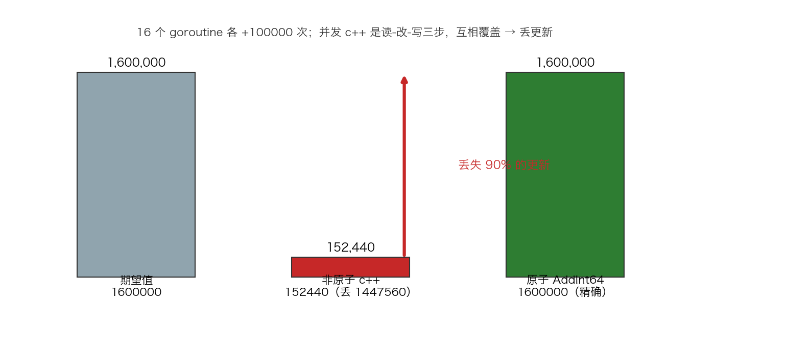

# 09 · Atomic 原子操作：CAS 重试循环与 release/acquire 内存屏障

> 并发自增为什么丢更新？CAS 失败后该干什么？"先写数据、再置就绪"凭什么不被 CPU 重排？本实验用三组可复现的数据回答：非原子 `c++` 丢失约 90% 的更新、CAS 靠重试做到 160 万次精确无一丢失、release/acquire 握手 20000 轮脏读 0 次。原子操作不是"加了锁的变量"，而是硬件直接支持的不可分割指令。

## 1. 为什么需要它

`c++` 看着是一行代码，实际是"读-改-写"三步：多个 goroutine 读到同一个旧值后各自 +1，只有最后一次写回生效。补上 `atomic.AddInt64` 就精确了，但为什么？本实验把答案拆成三层：**丢更新的根因（非原子读改写）、无锁并发的通用解法（CAS 失败重读重试）、以及顺序可见性的保证（原子操作自带的 release/acquire 屏障）**。理解了这三层，无锁队列、自旋锁、双检索单例的正确性都能自己推导。

## 2. 总览：核心机制一图看懂


> 🌐 **交互版**：[在线打开（GitHub Pages）](https://<user>.github.io/<repo>/internals/09_atomic/images/cas.html)
> （或本地打开 [`images/cas.html`](images/cas.html)）。

**心智模型一句话**：CAS 把"读-改-写"压缩成一条不可分割的 CPU 指令——比较旧值，一致才写入；不一致说明被人抢先，重读新值再来一轮。不加锁、不阻塞，用重试换正确。

## 3. 快速开始

```bash
cd internals/09_atomic
go run main.go          # 文本演示：丢更新对比 → CAS 循环 → 屏障握手
go run main.go -json    # 输出 JSON 数据（exp1/exp2/exp3）
go run -race main.go    # 在非原子版本报告数据竞争（原子版无告警）
python3 viz.py          # 数据图：生成 images/atomic_vs_plain.png
```

预期输出（节选，非原子结果与重试次数每次运行不同）：

```text
期望值              : 1600000
非原子  c++         : 180391    （丢了 1419609）
原子    AddInt64    : 1600000    （精确）
CAS 无锁计数: 1600000（精确）  CAS 失败重试 3075779 次
自旋锁保护计数: 1600000（精确，临界区不长，自旋比休眠划算）
release/acquire 握手 20000 轮，消费者读到脏数据 0 次
```

每一步"在看什么"都写在 `main.go` 的注释里；`-json` 快照给出与文本演示一致的机器可读数值。

## 4. 核心概念

### 4.1 丢更新的根因：非原子读-改-写

16 个 goroutine 各自 `++` 十万次，期望 1600000，实测非原子版只落地十几万（丢失约 90%）。用 `go run -race` 运行会在 `c++` 处报告数据竞争——丢更新不是玄学，是可检测的竞争。



怎么看：三根柱分别是期望值、非原子实测（红色，箭头标注丢失比例）、原子 AddInt64（精确命中期望）。注意非原子结果每次运行都不同——唯一稳定的是"必然丢失"。

### 4.2 CAS 重试循环：乐观并发

```go
for {
    old := atomic.LoadInt64(&v)
    if atomic.CompareAndSwapInt64(&v, old, old+1) {
        break
    }
    atomic.AddInt64(&retries, 1) // 失败：别人抢先改了 old
}
```

实测 160 万次递增背后是约 300 万次 CAS 失败重试（每次运行不同）——高竞争下重试代价可见，但全程无阻塞。同一套路还能拼出自旋锁：拿锁 = `CAS(0→1)` 成功，放锁 = `Store(0)`，失败路径加 `runtime.Gosched()` 让出调度。

### 4.3 release/acquire 内存屏障


> 🌐 **交互版**：[在线打开（GitHub Pages）](https://<user>.github.io/<repo>/internals/09_atomic/images/barrier.html)
> （或本地打开 [`images/barrier.html`](images/barrier.html)）。

生产者先写 `data = 42` 再 `Store ready=1`（release 屏障：之前的写入必须先对外可见）；消费者轮询 `Load ready==1`（acquire 屏障：之后的读取不得提前）再读 data。一送一收，"写 data happens-before 读 data"，实测 20000 轮握手脏读 0 次。若 `ready` 换成普通变量，编译器/CPU 有权重排，消费者可能读到 0。

### 4.4 arm64 上的真实指令

原子操作在 arm64 编译为带屏障语义的单条指令：`AddInt64 → LDADDAL`（自带 acquire+release）、`CAS → LDAXR + STLXR` 独占对、`Load → LDAR`、`Store → STLR`。所以 Go 的原子操作无需手写栅栏指令。

## 5. 关键字段与坑清单

| API / 指令 | 含义 | 为什么重要 |
|---|---|---|
| `atomic.AddInt64` | 原子读-改-写 | 硬件保证不可分割，计数器正确姿势 |
| `atomic.CompareAndSwapInt64` | 比较并交换（一条指令） | 全部无锁结构的基石 |
| `atomic.StoreInt32` / `LoadInt32` | release / acquire 屏障 | 建立跨 goroutine 的 happens-before |
| `retries` 计数 | CAS 失败次数（实测 ~300 万） | 乐观并发的代价标尺 |
| `LDAXR + STLXR` | arm64 独占加载/存储对 | CAS 的真实硬件形态 |

坑清单：

- **非原子丢更新不可复现**：每次跑丢的数都不同，必须显式打印"期望值"对比，否则容易误判"差不多对了"
- **CAS 重试在高竞争下空转烧 CPU**：掂量临界区长度；自旋锁失败路径务必 `runtime.Gosched()`，避免饿死其他 goroutine
- **屏障实验的 `data` 是普通变量**：顺序全靠原子 `ready` 提供；把 `ready` 也改成普通读写，重排后消费者可能读到 0，`-race` 会报竞争
- **重试次数每次运行不同**：稳定的是"精确结果 + 重试机制"，不是具体数字

## 6. 文件结构

```text
internals/09_atomic/
├── README.md                        # 本文件：原理 + 运行指引 + 面试要点
├── main.go                          # 主教材：丢更新对比 → CAS 循环 → 屏障握手（-json 输出数据）
├── viz.py                           # 数据图脚本：读 -json 快照画 atomic_vs_plain 柱状图
└── images/
    ├── cas.workflow.json            # 图源：CAS 重试循环（Typed JSON IR）
    ├── cas.html                     # 交互版：可缩放/高亮连线的自包含页面
    ├── cas.svg                      # README 内嵌双主题矢量图
    ├── barrier.sequence.json        # 图源：release/acquire 握手时间线（Typed JSON IR）
    ├── barrier.html                 # 交互版
    ├── barrier.svg                  # README 内嵌双主题矢量图
    └── atomic_vs_plain.png          # 数据图：期望/非原子/原子实测柱状（matplotlib 绘制）
```

## 7. 面试要点

**Q：为什么并发 `i++` 会丢更新？**
A：`i++` 是读-改-写三步，两个 goroutine 读到同一旧值后各自写回，后写覆盖先写。实测 160 万次只落地十几万；`-race` 能直接检出该竞争。

**Q：CAS 是什么？"无锁"的代价是什么？**
A：CompareAndSwap 一条指令完成"比较旧值，一致才写入"。失败后重读重试即乐观并发——不阻塞任何 goroutine，但高竞争下重试烧 CPU（实测 160 万次递增伴随约 300 万次失败）。

**Q：atomic 的 Store/Load 除了原子性还提供什么？**
A：内存屏障语义：Store 是 release（之前的写入先对外可见），Load 是 acquire（之后的读取在后发生）。配合使用即建立 happens-before，实测 20000 轮"写 data→置 ready→看 ready→读 data"握手脏读 0 次。

**Q：CAS 能实现锁吗？**
A：能。拿锁 = `CAS(0→1)`，放锁 = `Store(0)`，失败自旋重试。本实验的自旋锁版本同样精确计数；临界区短时自旋比休眠切换划算，失败路径要 `Gosched()` 防饿死。

**Q：原子操作需要手写内存栅栏指令吗？**
A：不需要。Go 的原子读写映射到带 acquire/release 语义的硬件指令（arm64 上 Load→LDAR、Store→STLR、Add→LDADDAL），屏障已包含在内。

## 8. 总结

原子操作的全部价值可以浓缩成两句话：**一条指令完成读-改-写（CAS/ADD），一对屏障保证先后可见（release/acquire）**。丢更新对比说明"为什么需要它"，CAS 重试说明"无锁怎么做"，屏障握手说明"顺序谁保证"。`go run -race main.go` 是检验这三件事的统一工具。

下一篇 [10_waitgroup](../10_waitgroup/) 看 `sync.WaitGroup`：它同样把计数器和等待者塞进一个 64 位字，用信号量让 main 精确等到所有 goroutine 收工。
