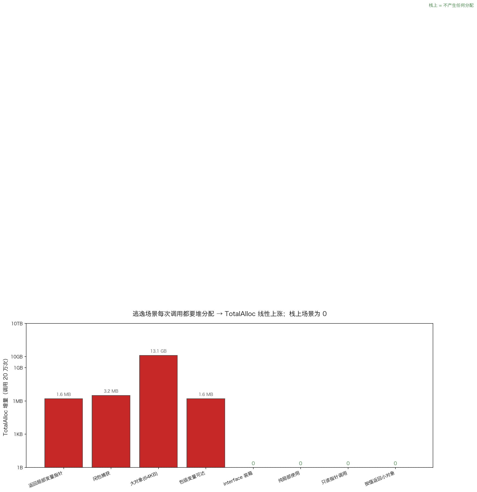

# 13 · 逃逸分析：编译器到底把变量放栈还是放堆

> Go 变量的分配位置不由程序员决定，而由**逃逸分析**判定：指针若"逃出"当前作用域，对象就上堆；否则留在栈帧里零 GC 压力。可 `go build -gcflags=-m` 的判定有时和运行时实测"打架"——最典型的是 interface 装箱：编译器说 `escapes to heap`，`TotalAlloc` 却纹丝不动。本实验用 8 个场景双管齐下，把"它说"和"它做"对齐。

## 1. 为什么需要它

栈分配几乎免费（栈帧复用、函数返回即回收），堆分配则要newobject、给 GC 添负担。写热路径代码时，"这个变量上没上堆"直接决定性能上限。逃逸分析的规则可以背，但编译器经常帮你内联、栈上化，结论会变——只有学会用 `-gcflags=-m` 看"它说"、用 `TotalAlloc` 增量看"它做"，两相印证，才算真正掌握。

## 2. 总览：核心机制一图看懂


> 🌐 **交互版**：[在线打开（GitHub Pages）](https://<user>.github.io/<repo>/internals/13_escape/images/escape.html)
> （或本地打开 [`images/escape.html`](images/escape.html)）。

**心智模型一句话**：判据是"指针逃多远"——返回局部指针、闭包捕获、超大对象、包级变量可达、接口值转手逃出，统统上堆；值不出函数、只读传指针、按值返回小对象，留在栈上。

## 3. 快速开始

```bash
cd internals/13_escape
go run main.go                      # 文本演示：8 场景 × 20 万次调用的 TotalAlloc 增量
go run main.go -json                # 输出 JSON 快照
go build -gcflags=-m main.go        # 编译器逐行的分配决策（与实测对照）
python3 viz.py                      # 重新生成 images/alloc_delta.png
```

预期输出（节选，Go 1.26.5 实测，增量数值每次运行微漂）：

```text
========== 运行时佐证：调用 20 万次后 TotalAlloc 增量 ==========
   返回局部变量指针       逃逸(heap)    TotalAlloc +1600000 B
   闭包捕获           逃逸(heap)    TotalAlloc +3200000 B
   大对象(64KB)      逃逸(heap)    TotalAlloc +13107538752 B
   包级变量可达         逃逸(heap)    TotalAlloc +1600128 B
   interface 装箱   栈上          TotalAlloc +0 B
   纯局部使用          栈上          TotalAlloc +0 B
   只读指针调用         栈上          TotalAlloc +0 B
   按值返回小对象        栈上          TotalAlloc +0 B
```

## 4. 核心概念

### 4.1 逃逸组：每次调用都是一次堆分配

4 个场景实测线性上涨：返回局部变量指针每次 8 B（×20 万 = 1.6 MB）、闭包捕获每次 16 B（+3.2 MB）、64KB 大对象每次 65536 B（累计约 **13.1 GB**）、包级变量可达 +1.6 MB。注意 `TotalAlloc` 是"毛账"——只增不减，量的是分配频率，不是当前占用。

### 4.2 栈上组：零分配

纯局部使用、只读指针调用（编译器标注 `p does not escape`）、按值返回小对象，20 万次调用 `TotalAlloc` 全部 +0 B。这就是"栈上才是零成本"的实证：不产生任何垃圾，不给 GC 添任何工作。

### 4.3 反直觉：interface 装箱 ≠ 堆分配

编译器对 `makeIface` 明确打了 `[16]int{...} escapes to heap`，但运行时 +0 B。原因：接口值是"类型指针 + 数据"两个字段，当装箱对象**没逃出调用者栈帧**（本实验里立即类型断言消费）时，编译器把装箱数据放在调用者帧上——根本没有 newobject。`-m` 说的是"这个值需要存储介质"，栈还是堆的**最终分派**由它逃多远决定。只有接口值被存出去/传出去（动态派生逃逸），才真上堆。



### 4.4 内联会收窄逃逸面

所有场景函数都标了 `//go:noinline`。初版没标时，返回局部指针的场景被内联进测量函数，指针只在调用者帧内存活，硬生生变回栈上——5 个"逃逸"几乎全是 0。这不是 bug，是编译器在帮你省内存；但要测"场景本身"就得先禁内联。

## 5. 关键字段与坑清单

| 场景 | 编译器判定（-m） | 运行时（20 万次） |
|:---|:---|:---|
| 返回局部变量指针 | `moved to heap: x` | +1.6 MB |
| 闭包捕获 | `func literal escapes to heap` | +3.2 MB |
| 大对象 (64KB) | `&[8192]int64{} escapes to heap` | +13.1 GB |
| 包级变量可达 | `moved to heap: x` | +1.6 MB |
| interface 装箱（直接消费） | `[16]int{...} escapes to heap` | **+0 B**（装箱留在调用者帧） |
| 纯局部使用 / 只读指针 / 按值小对象 | 无提示 / `p does not escape` | +0 B |

坑清单：

- **`-m` 与运行时可能"打架"**：编译器说逃逸、实测 0，先看接口数据有没有真逃出调用者帧；最终以 `TotalAlloc` 实测为准
- **内联毁了测量**：先 `//go:noinline` 再测，否则场景函数被内联后逃逸面全变
- **`TotalAlloc` 是毛账**：看"涨不涨"判断分配频率，别拿它判断当前占用（那是 `HeapAlloc`）
- **闭包捕获按"逃逸链"看**：闭包本身不逃逸时，被捕获变量可以留在栈上（配合内联常常成立）
- **超大临时数组**：64KB 直接上堆的代价是每次调用一次分配；改 `sync.Pool` 或按值小片处理

## 6. 文件结构

```text
internals/13_escape/
├── README.md                        # 本文件：原理 + 运行指引 + 深入要点
├── main.go                          # 主教材：8 场景 + TotalAlloc 实测（-json 输出快照）
├── viz.py                           # 数据图脚本：TotalAlloc 增量 → images/alloc_delta.png
└── images/
    ├── escape.architecture.json     # 图源：逃逸/栈上分诊两组边界框
    ├── escape.html                  # 交互版：可缩放/高亮连线的自包含页面
    ├── escape.svg                   # README 内嵌双主题矢量图
    └── alloc_delta.png              # 实测数据图：8 场景 TotalAlloc 增量（log 轴）
```

## 7. 深入要点

**Q：什么情况下局部变量会逃逸到堆？**
A：判据是"指针逃多远"：返回局部指针、被闭包捕获、存进包级变量、装进接口后转手逃出，以及栈帧放不下的大对象。口诀：指针出函数/闭包/大对象/全局可达 → 堆。

**Q：编译器说 escapes to heap，运行时却 0 分配，可能吗？**
A：可能。interface 装箱就是典型：装箱数据没逃出调用者帧时被栈上化。`-m` 的输出是"需要存储介质"的线索，不是最终判决，以 `TotalAlloc` 实测为准。

**Q：逃逸分析对性能意味着什么？**
A：栈分配≈零成本（复用栈帧，无 GC 负担）；堆分配每次 newobject 且给 GC 添活。热路径上消灭逃逸（值传递、预分配、sync.Pool）是常见优化手段。

**Q：为什么加了 `//go:noinline` 测量结果才准？**
A：内联会把被调函数的局部变量并入调用者帧，原本"返回指针"的场景在调用者帧内就不逃逸了。禁内联才能测到场景本身的行为——同时也说明内联本身就是一种逃逸优化。

**Q：`TotalAlloc` 和 `HeapAlloc` 有什么区别？**
A：`TotalAlloc` 累计历史堆分配字节，只增不减，适合看分配频率；`HeapAlloc` 是当前堆上的活对象字节，看占用。测"逃逸了没有"用前者。

## 8. 总结

逃逸分析的全部规则都围绕"指针逃多远"；而验证它只有一条正道——`-gcflags=-m` 看"它说"，`TotalAlloc` 增量看"它做"，两者打架时信实测。interface 装箱的 +0 B 就是最好的教训：编译器的每条提示都有精确语义，别凭直觉脑补。

下一篇 [14_allocator](../14_allocator/) 钻进堆的内部：mcache/mcentral/mheap 三级分配网怎么用地址分布实证，tiny/small/large 三类对象各自走哪条路。
