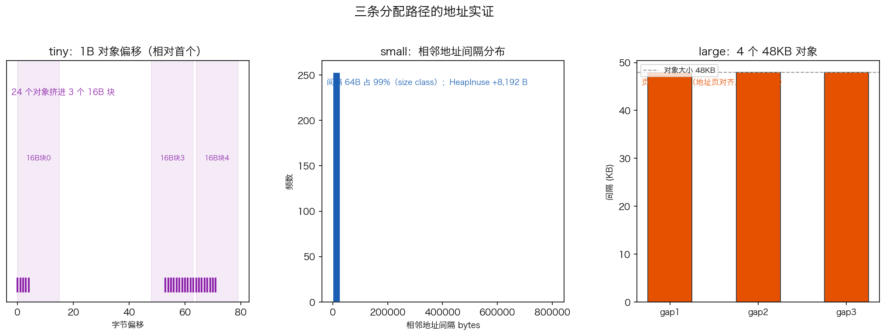

# 14 · 内存分配器：mcache / mcentral / mheap 三级结构

> Go 用 67 个 size class 支撑起一套三级分配网：热路径上的 mcache 无锁现取，miss 再逐级上溯到带锁的 mcentral、再到全局协调的 mheap，大对象（>32KB）干脆绕过前两级。这套结构背下来不难，但"凭什么说它快"需要证据。本实验用三类对象的**堆地址分布**加 `HeapInuse` 增量，把三条路径实实在在拍出来（`14_allocator/main.go`，Go 1.26.5）。

## 1. 为什么需要它

堆分配是 Go 程序最频繁的操作之一，每秒可能发生几十万次。为什么 Go 敢说它"够快"？答案不在单点技巧，而在结构：**无锁优先，锁只存在于 miss 上溯的路径**。理解三级结构之后，你才能解释 `sync.Pool` 为什么快、为什么小对象要多小有多小才好、为什么大对象分配天然贵。

## 2. 总览：核心机制一图看懂


> 🌐 **交互版**：[在线打开（GitHub Pages）](https://<user>.github.io/<repo>/internals/14_allocator/images/tiers.html)
> （或本地打开 [`images/tiers.html`](images/tiers.html)）。

**心智模型一句话**：分配请求按大小分诊——<16B 无指针走 tiny 合并；16B~32KB 按 size class 从本 P 的 mcache 无锁拿，miss 才加锁上溯 mcentral、mheap；>32KB 直通 mheap 独占 span。

## 3. 快速开始

```bash
cd internals/14_allocator
go run main.go          # 文本演示：tiny/small/large 三组地址分布
go run main.go -json    # 输出 JSON 快照
python3 viz.py          # 重新生成 images/addr_density.png
```

预期输出（节选，地址与增量数值每次运行不同，看模式）：

```text
========== A. tiny：24 个 1B 对象 ==========
   相对首个对象偏移(bytes)：[0 1 2 3 4 53 54 55 ... 71]
   → 5/24 落在头一个 16B 块里（tiny allocator 合并分配）

========== B. small：64B 对象 ==========
   排序后相邻地址间隔：[64 64 64 64 64 64 64 64 64 64] ...
   → 间隔基本是 64B（size class）的倍数；HeapInuse +8192 B

========== C. large：48KB 对象 ==========
   相邻地址间隔(bytes)：[49152 49152 49152]
   页内偏移（期望对齐到页首，≈0）：[0 0 0 0]
   → 每个大对象独占一个 span；HeapInuse +196608 B
```

## 4. 核心概念

### 4.1 tiny：无指针小对象合并进 16B 块

`<16B 且不含指针`的对象走 tiny allocator：多个对象挤进同一个 16B 块，分配调用次数≈块数而不是对象数。实测 24 个 1B 对象的偏移只跨约 72 B——本例偏移 `[0..4] + [53..71]` 分两簇（**簇形每次运行不同**，不变的规律是"挤进极少数 16B 块"）。注意含指针字段的对象不走 tiny，直接进对应 size class。

### 4.2 small：size class 的 64B 平铺

256 个 64B 对象排序后相邻间隔**全部是 64**——同 class 的对象在 span 里按固定步长紧凑平铺，地址天然 64 对齐，CPU 缓存友好。这就是 size class 的直接证据。`HeapInuse` 增量（本例 +8192 B）只在触发新 span 分配时才有参考价值，每次运行不同。

### 4.3 large：直通 mheap，独占 span、页对齐

4 个 48KB 对象相邻间隔全部 **49152（=48KB）**，`地址 & 0xfff == 0` 全部成立——每个大对象独占一条 span、页对齐，绕过 mcache/mcentral 两级缓存。`HeapInuse` +196608 B = 4×49152，分毫不差。



## 5. 关键字段与坑清单

| 路径 | 条件 | 机制 | 实测证据 |
|:---|:---|:---|:---|
| tiny | <16B 且无指针 | 合并进 16B 块 | 24×1B 只跨 ~72B |
| small | 16B~32KB | mcache 无锁现取 | 间隔恒 64B |
| large | >32KB | 直通 mheap | 间隔=48KB、页对齐、+196608 B |

| 层级 | 锁 | 角色 |
|:---|:---|:---|
| mcache | 无（每 P 一份） | 热路径现拿，计数器加减 |
| mcentral | 有（每 size class 一个） | 跨 P 借还 span |
| mheap | 全局 | 页堆协调，缺页向 OS 要内存 |

坑清单：

- **地址要排序再算间隔**：分配顺序和地址顺序不一致，不排序得出乱糟糟的间隔
- **「大对象间隔≈64KB」的直觉是错的**：实测间隔=对象大小 48KB（跨度即 span 大小）
- **tiny 对象别放指针字段**：`struct{ p *int }` 直接进 16B class，实验就失败了
- **MemStats 前后各读一次取增量**：比读一次绝对值可靠得多
- **HeapInuse 不涨 ≠ 没分配**：mheap 里常有空闲 span 直接复用，地址间隔才是可靠证据

## 6. 文件结构

```text
internals/14_allocator/
├── README.md                        # 本文件：原理 + 运行指引 + 面试要点
├── main.go                          # 主教材：tiny/small/large 三组地址实测（-json 输出快照）
├── viz.py                           # 数据图脚本：地址分布 → images/addr_density.png
└── images/
    ├── tiers.architecture.json      # 图源：三级分配网与旁路
    ├── tiers.html                   # 交互版：可缩放/高亮连线的自包含页面
    ├── tiers.svg                    # README 内嵌双主题矢量图
    └── addr_density.png             # 实测数据图：三类对象地址分布
```

## 7. 面试要点

**Q：Go 的小对象分配为什么快？**
A：三级结构把锁从热路径上拿掉了——每个 P 的 mcache 私有，拿对象只是内存读写；只有 miss 才加锁上溯 mcentral、mheap。TCMalloc 同款思想。

**Q：size class 是什么，为什么需要？**
A：把任意大小向上取整到 67 个固定档位（16B、32B、…、32KB）。同 class 的 span 按固定步长平铺对象（实测 64B 对象间隔恒 64），碎片可控、对齐免费、复用简单。

**Q：tiny allocator 是干嘛的？**
A：<16B 且不含指针的对象合并进同一个 16B 块分配，把分配次数从"对象数"压到"块数"。实测 24 个 1B 对象只跨 ~72B。含指针对象不参与（GC 需要精确指针对齐）。

**Q：>32KB 的大对象走什么路径？**
A：直通 mheap，绕过 mcache/mcentral，每个对象独占一条 span、天然页对齐。实测 48KB 对象间隔 49152、页内偏移全 0。

**Q：怎么用实验证明三条路径不同？**
A：地址分布：tiny 挤块、small 64B 步进、large 48KB 大步加页对齐；配合 `HeapInuse` 增量（large +196608 B 分毫不差）。地址会说话。

## 8. 总结

三级分配网的全部证据都在地址里：tiny 的挤块、small 的等距平铺、large 的独占页对齐，分别对应三条路径的设计取舍。核心哲学一句话——**无锁优先，代价逐级上升，绝不让热路径碰锁**。

下一篇 [15_gc](../15_gc/) 看堆回收的一面：三色标记状态机怎么转，写屏障为什么是并发 GC 的生死线。
