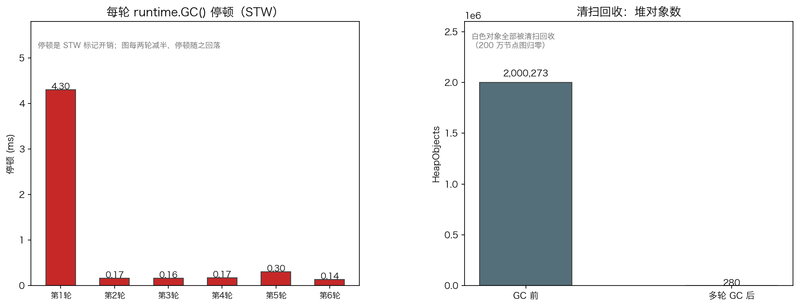

# 15 · GC 三色标记与写屏障：并发变异为什么不能裸奔

> Go 的 GC 是并发标记-清扫：标记的大部分工作与你的业务 goroutine 并行跑。那问题来了——标记进行中你还在改指针，怎么保证活对象不被误收？答案藏在**三色抽象**和**写屏障**里。本实验用自研的最简标记-清扫仿真复现"无写屏障丢对象"的经典事故，再用真实运行时在 200 万节点图上量出停顿与回收量（`15_gc/main.go`，Go 1.26.5）。

## 1. 为什么需要它

"Go GC 停顿低"是结果，不是原理。原理是：标记阶段允许业务代码同时修改指针，这天然危险——刚标记完"黑色"的对象可能新增一条指向"白色"对象的引用，没有保护的话这个白对象会在清扫时被回收，留下悬垂引用。理解三色状态机和写屏障，你才能回答"STW 到底停在哪儿""为什么堆越大停顿也不涨"这类真问题。

## 2. 总览：核心机制一图看懂


> 🌐 **交互版**：[在线打开（GitHub Pages）](https://<user>.github.io/<repo>/internals/15_gc/images/tricolor.html)
> （或本地打开 [`images/tricolor.html`](images/tricolor.html)）。

**心智模型一句话**：标记就是"灰→黑"的推进——从灰色队列取出对象变黑、把它的白色子对象染灰；全程靠写屏障堵住唯一漏洞"黑→白"，标记结束仍白的对象交给清扫回收。

## 3. 快速开始

```bash
cd internals/15_gc
go run main.go          # 文本演示：三色仿真 → 真实 GC 停顿与回收
go run main.go -json    # 输出 JSON 快照
python3 viz.py          # 重新生成 images/gc_pause.png
```

预期输出（节选，停顿数值随机器漂移，看量级）：

```text
========== 1. 三色标记：写屏障的救场 ==========
   对象：root→A→B，标记进行中 B 新增指向 C 的引用
   有写屏障 : 幸存 = [root A B C]（C 被染灰救下），标记步数=4
   无写屏障 : 幸存 = [A B root]（C 丢失被误回收！），标记步数=3

========== 2. 真实 GC：停顿与堆回收量 ==========
   每轮 runtime.GC() 停顿(ms)：[0.449 0.109 0.242 0.154 0.145 0.136]
   HeapObjects：2000231 → 230（清扫回收）
```

## 4. 核心概念

### 4.1 三色抽象

| 颜色 | 含义 | 结局 |
|:---|:---|:---|
| 白 | 还没确认可达 | 清扫阶段被回收（即"垃圾"） |
| 灰 | 已知可达，子指针还没扫完 | 排在灰色工作队列里等扫描 |
| 黑 | 扫描完成，确认存活 | 绝对不回收 |

标记就是"灰→黑"的推进：灰色队列耗尽、无白可染时标记结束；随后把所有仍白的对象清扫掉。多标一点只是浪费，少标一点就崩——**三色不变式**（不允许黑→白的边）是底线。

### 4.2 并发变异的危险与写屏障

仿真把事故逐帧跑了一遍：对象图 root→A→B，标记进行中 B（已黑）新增指向 C（仍白）的引用——

- **无写屏障**：标记结束 C 还是白的 → 被清扫回收，但 B 还指着它 → 悬垂引用。实测幸存 `[A B root]`，标记步数 3；
- **有写屏障**：堆写入的瞬间把新指向的白对象染灰 → 进灰色队列 → 扫成黑。实测幸存 `[root A B C]`，标记步数 4。

一个仿真细节：变异必须发生在 B **扫描完之后**（其 refs 不会再被扫），否则无屏障时 C 也会在扫 B 时被顺手染灰，复现不出事故。真实并发场景里变异随时发生，无从保证"扫描前"，所以屏障不可省。

### 4.3 真实 GC：停顿两段与清扫回收



200 万节点的指针图上连跑 6 轮 `runtime.GC()`，每两轮把图减半：停顿 0.10~0.45 ms（STW 时间，数值随机器漂移），`HeapObjects` 从 2000231 回落到 230。停顿看的是**标记工作量**（STW 只在标记起止两小段），回收量是**清扫的战果**（并发进行，不进停顿）——两个指标要分开看，垃圾多才贵。

## 5. 关键字段与坑清单

| 概念 | 含义 | 为什么重要 |
|---|---|---|
| 白/灰/黑 | 待定 / 待扫 / 确认存活 | 标记进度的最小完备描述 |
| 灰色工作队列 | 待扫描对象列表 | 队列空 = 标记结束 |
| 写屏障（WB） | 堆写入时把新指向的白对象染灰 | 堵住"黑→白"，并发标记的地基 |
| STW | 标记起止两段短暂暂停 | 停顿毫秒级且与堆大小基本无关 |
| `MemStats.HeapObjects` | 堆活对象计数 | 量化清扫回收效果 |

坑清单：

- **仿真里变异时机要放在"对象已扫完"之后**：放扫描前，无屏障时 C 也会被顺手染灰，事故复现失败
- **别把 `GCStats.Pause` 当"标记耗时"**：那只是 STW 段；标签要诚实，写"停顿"别写"标记耗时"
- **`runtime.GC()` 手动拉一轮**：配合 `MemStats.HeapObjects` 前后差值，才能"看见"垃圾量
- **200 万节点要挂进 `[]*obj`**：否则图被提前回收，量出来的是空壳
- **图要减半制造清扫压力变化**：停顿序列才有对比度（大→小→大）

## 6. 文件结构

```text
internals/15_gc/
├── README.md                        # 本文件：原理 + 运行指引 + 面试要点
├── main.go                          # 主教材：三色仿真 + 真实 GC 停顿/回收（-json 输出快照）
├── viz.py                           # 数据图脚本：停顿与回收 → images/gc_pause.png
└── images/
    ├── tricolor.lifecycle.json      # 图源：三色标记状态机 + GC 停顿两段
    ├── tricolor.html                # 交互版：可缩放/高亮连线的自包含页面
    ├── tricolor.svg                 # README 内嵌双主题矢量图
    └── gc_pause.png                 # 实测数据图：每轮停顿与 HeapObjects 回落
```

## 7. 面试要点

**Q：三色标记为什么能支持并发？**
A：标记进度被编码成对象颜色：黑色确认存活、灰色待扫、白色待定。灰色队列耗尽即标记完成。并发带来的唯一风险是"黑→白"引用边，写屏障在堆写入时把白对象染灰即可堵住。

**Q：没有写屏障会发生什么？**
A：已扫完的黑对象新增指向白对象的引用，这个白对象不会被标记，清扫时被回收——但业务还持有引用，悬垂访问直接崩溃。仿真实测：无屏障时 C 丢失，幸存集合少一个。

**Q：Go GC 的停顿发生在什么时候，为什么那么短？**
A：STW 只出现在标记开始（开启写屏障、扫根）和标记终止（重扫、关屏障）两个小段，标记和清扫都与业务并发。停顿是毫秒级（实测 0.10~0.45 ms），且主要看标记工作量而非堆大小。

**Q：堆对象从 200 万降到 230，停顿为什么不跟着涨？**
A：清扫是并发的，不进停顿；停顿只覆盖标记起止的两小段 STW。所以"回收了多少"和"停了多久"是两个独立指标。

**Q：怎么在代码里观察 GC 行为？**
A：`runtime.GC()` 手动触发一轮；`runtime.ReadMemStats` 前后取 `HeapObjects`/`NumGC`/`PauseTotalNs` 差值；`GODEBUG=gctrace=1` 看逐轮轨迹。先能"看见"，再谈调优。

## 8. 总结

三色抽象把"找出所有活对象"变成一台状态机：白→灰→黑的推进由灰色队列驱动，写屏障守住黑→白的缺口，停顿被压缩到标记起止两段。理解到这一层，"Go GC 低停顿"就不再是玄学，而是可以亲手验证的机制（`go run main.go`）。

下一篇 [16_alloc_bench](../16_alloc_bench/) 沿着分配路径跑一次基准：一个小对象的分配要经过 size class → mcache → mcentral → mheap 的哪些关卡，每关多少钱。
