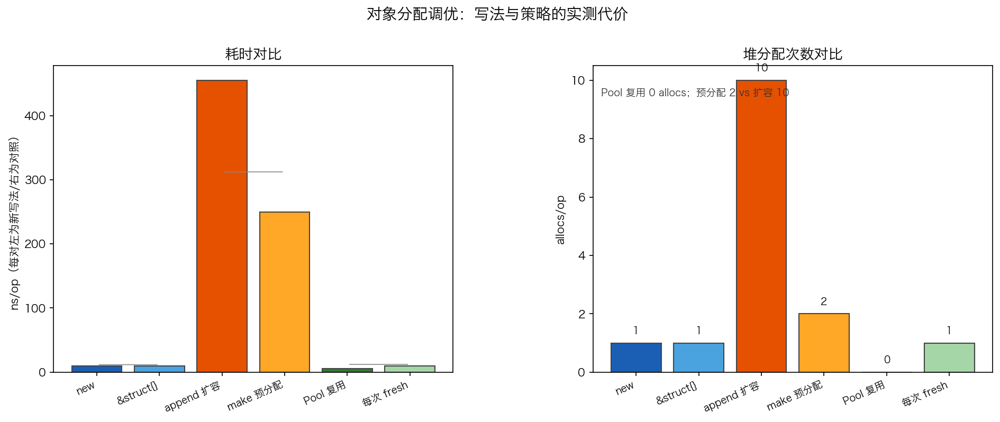

# 16 · 对象分配性能调优：ns/op 与 allocs/op 的实测账本

> "少分配"是 Go 性能优化的第一口诀，但差别到底有多大？本实验用三组对照实测出数字：`new(T)` vs `&T{}`、切片 append 扩容 vs 预分配、`sync.Pool` 复用 vs 每次新建。同时借一次分配在 runtime 里的"逐层下探"，解释为什么省下的每一次分配都这么值钱——它省掉的不只是几十纳秒，而是可能在 mheap/OS 层走完的整条慢路径。

## 1. 为什么需要它

性能优化最怕凭感觉。`new` 换成 `&T{}`、切片加个 `make` 预分配、热点对象丢进 `sync.Pool`——这些口诀人人会背，但每条到底值多少，得用数字说话。本实验的 `main.go` 内建计时器（等价于 `go test -bench=. -benchmem` 的 ns/op 与 allocs/op），同目录的 `bench_test.go` 让你亲手跑官方基准复核。

实测同时回答两个问题：**哪类优化有真实收益**（预分配、Pool），**哪类只是心理安慰**（`new` vs `&T{}` 写法差异）；以及为什么 **allocs/op 是比 ns/op 更值得盯的指标**。

## 2. 总览：核心机制一图看懂


> 🌐 **交互版**：[在线打开（GitHub Pages）](https://<user>.github.io/<repo>/internals/16_alloc_bench/images/sizeclass.html)
> （或本地打开 [`images/sizeclass.html`](images/sizeclass.html)）。

**心智模型一句话**：每次堆分配先由 `mallocgc` 把对象大小向上对齐到 size class，然后从 mcache（每 P 私有、无锁）取货；只有缺货才逐层下探 mcentral（按 class 全局加锁）→ mheap（8KB 页堆）→ OS 缺页，拿到货后逐层回填。三组对照的差距，本质都是"少走下探路 + 少喂 GC"。

## 3. 快速开始

```bash
cd internals/16_alloc_bench
go run main.go          # 文本演示：三组对照的 ns/op 与 allocs/op
go run main.go -json    # 输出 JSON 快照（viz.py 画图用）
GO111MODULE=off go test -bench=. -benchmem -run='^$' main.go bench_test.go   # 官方基准
```

`go run main.go` 预期输出（Apple M5 Pro · go1.26.5 实测，**ns 每次运行都不同，allocs/op 稳定**）：

```text
对照 1: new(T) vs &T{}（语义完全相同，耗时/分配一致）
对照 2: 预分配避免扩容搬移，更省分配
对照 3: Pool 复用基本零分配
   new vs &struct{} new                 19.65 ns/op    1.00 allocs/op
   new vs &struct{} &struct{}           16.40 ns/op    1.00 allocs/op
   append vs 预分配  append 扩容          488.39 ns/op   10.00 allocs/op
   append vs 预分配  make 预分配           239.78 ns/op    2.00 allocs/op
   Pool vs fresh  Pool 复用              6.36 ns/op    0.00 allocs/op
   Pool vs fresh  每次 fresh             9.56 ns/op    1.00 allocs/op
```

官方基准（同机同轮，注意 `B/op` 与 `allocs/op` 和上表完全一致）：

```text
BenchmarkNew-18           22182136    49.97 ns/op    32 B/op   1 allocs/op
BenchmarkPrealloc-18        946934  1476   ns/op  2072 B/op   2 allocs/op
BenchmarkAppendGrow-18       399171  2775 ns/op  4112 B/op  10 allocs/op
```

两轮 ns 差异很大不是误差：`go test` 把迭代数推到千万级，累计垃圾触发 GC 并发参与，ns/op 被拉高——这恰好现场演示了"分配速率 = GC 压力"。这也是为什么跨机器、跨负载比较性能要看 allocs/op，不要背 ns。

## 4. 核心概念

### 4.1 size class 与分配下探路径

`mallocgc` 拿到字节数后查 size class 表：本实验的 `Payload` 是 32B（`data [32]byte`），正好命中 class 32，**无 padding**（基准里 32 B/op 佐证）。取货顺序见第 2 节图：mcache 是每 P 私有的无锁缓存，绝大多数分配在这里结束（实测 `new` 恰好 1 allocs/op、Pool 0 allocs/op）；span 缺了才找按 class 全局加锁的 mcentral，再缺找按 8KB 页管理的 mheap，最后缺页向 OS 要内存（darwin/arm64 物理页实测 16KB，`os.Getpagesize()`）。

三条旁路要记住：**> 32KB 的大对象绕过 mcache/mcentral 直达 mheap**；**< 16B 的无指针对象走 tiny 合并**共享 16B 块；**没逃逸的对象在栈上分配**，根本不进这条链（见 [13_escape](../13_escape/) 与 [14_allocator](../14_allocator/)）。

### 4.2 对照 1：`new(T)` 和 `&T{}` 是同一个操作

编译器把它俩编成同一段代码。实测两者的 ns/op 与 allocs/op（1.00）都相同——写哪个都行，别在写法上做性能文章。真正影响分配的是**结构**：数据是否逃逸、是否频繁扩容。

### 4.3 对照 2：预分配让扩容搬移归零



数据图怎么看：左图 ns/op 注意对数轴、且随负载漂移；右图 allocs/op 才是每轮都一模一样的硬数字——预分配 2 vs 扩容 10、Pool 0。

从 `nil` 开始 append 256 个 int，cap 按"cap < 256 翻倍"规则走 **1→2→4→…→128→256**，共 9 次数组重分配（每次都要分配新数组 + 拷贝旧数据），外加 1 次 slice 头逃逸包装 = **10 allocs/op**；字节数 4112 B/op = 8×(1+2+…+256) + 24。`make([]int, 0, 256)` 一次性拿到 2048B（命中 class 2048）加 24B 头 = **2072 B/op、2 allocs/op**，耗时省一半（488→240 ns）。一行 `make(cap)` 换 5 倍分配次数下降，无并发风险，是最省事的优化。

### 4.4 对照 3：`sync.Pool` 把分配压到 0

`Get` 优先从本 P 的 private 槽取，再试 shared/victim 缓存，只有池空才调 `New`——实测 0.00 allocs/op，~6 ns vs 每次 `new` 的 ~10 ns。复用 vs 再造的差是小头，大头是两个数量级之外的 GC 压力。注意 Pool 的对象跨两轮 GC 会被清掉，只能当短期缓存用（细节见 [11_pool](../11_pool/)）。

## 5. 关键字段与坑清单

| 指标/字段 | 含义 | 为什么重要 |
|---|---|---|
| `ns/op` | 每次操作耗时 | 依赖机器与负载，同机两轮都能差 2 倍以上，只做参考 |
| `allocs/op` | 每次操作堆分配次数 | 完全稳定、直接反映 GC 负担，跨平台比较靠它 |
| `B/op` | 每次操作分配字节数 | 佐证 size class：32 B/op 说明无 padding，2072 = 2048+24 |
| `MemStats.Mallocs` | 累计分配次数 | `main.go` 用前后两次 `ReadMemStats` 的差值算 allocs/op |
| `sink` | 防优化引用 | 结果若无人引用，编译器直接删掉分配，测量全失真 |

坑清单：

- **无 go.mod 时 `go test` 报 "no main module"**：单文件目录加 `GO111MODULE=off`，并把包文件显式传进去：`go test -bench=. -benchmem -run='^$' main.go bench_test.go`
- **别把线程类计数当内存指标**：统计分配次数用 `MemStats.Mallocs`；`TotalAlloc` 是累计字节数，拿它除以 op 数当 allocs/op 会全错
- **`sink` 必须真的引用对象**：测量时若编译器发现结果没用，会把分配删掉 → allocs 全 0，全部失真。`sink = p` 保引用是底线
- **每种写法各写一次 `sink` 赋值**：`new` 与 `&T{}` 若有一个没保引用，会把"相同"证成"不同"
- **预热 + GC 清零再计时**：`bench()` 先 `runtime.GC()` 再读 `MemStats`，初代分配/页面映射不污染测量窗口

## 6. 文件结构

```text
internals/16_alloc_bench/
├── README.md                     # 本文件：原理 + 运行指引 + 深入要点
├── main.go                       # 主教材：三组对照 + MemStats 计数（-json 输出快照）
├── bench_test.go                 # 官方基准：go test -bench=. -benchmem 复测
├── viz.py                        # 数据图：读 -json 快照，生成 images/alloc_bench.png
└── images/
    ├── sizeclass.workflow.json   # 图源：一次小对象分配的下探路径（Typed JSON IR）
    ├── sizeclass.html            # 交互版：可缩放/高亮连线的自包含页面
    ├── sizeclass.svg             # README 内嵌双主题矢量图
    └── alloc_bench.png           # 数据图：ns/op 与 allocs/op 实测对比（matplotlib）
```

## 7. 深入要点

**Q：`new(T)` 和 `&T{}` 有性能差别吗？**
A：没有。编译器生成同一段代码，实测 ns/op、allocs/op、B/op 完全一致。分配优化要看结构（逃逸、扩容、复用），不是写法。

**Q：为什么性能报告更该看 allocs/op 而不是 ns/op？**
A：ns 依赖机器与负载（本实验同机两轮差 2 倍以上），allocs/op 每轮完全一致，且每次堆分配都是 GC 的标记/回收负担——它才是可移植的优化目标。

**Q：256 次 append 为什么正好 10 次分配？预分配为什么是 2 次？**
A：cap 从 nil 起 1→2→4→…→128→256 共 9 次数组分配，加 1 次 slice 头逃逸 = 10；`make(0,256)` 一次拿到 2048B 数组 + 1 次头 = 2。B/op 分别 4112 与 2072，都能按 8×Σcap+24 精确对账。

**Q：`sync.Pool` 为什么能 0 分配？有什么坑？**
A：Get 优先命中本 P 的 private 槽，再 shared/victim，只有池空才 New，所以稳态 0 allocs。坑：对象在两轮 GC 后会被清除，Pool 只能做短期复用缓存，不能当持久存储。

**Q：怎么测量一段代码的分配次数才不失真？**
A：前后各一次 `runtime.ReadMemStats` 取 `Mallocs` 差值并除以 op 数；结果必须赋给包级 `sink` 防编译器删分配；计时前 `runtime.GC()` 清场；字节与次数别混用（`TotalAlloc` ≠ `Mallocs`）。

## 8. 总结

三组对照归一句话：**写法不能优化，结构才能**。`new` vs `&T{}` 是同一操作；预分配把扩容搬移归零（10→2 allocs）；`sync.Pool` 在热路径把分配压到 0。而分配之所以贵，是因为每次都可能在 size class→mcache→mcentral→mheap→OS 这条链上走到底——allocs/op 就是这条链的行走次数，也是喂给 GC 的口粮。记住验证方法：`go run main.go` 与 `go test -benchmem` 随时可复跑，数字比背口诀可靠。

下一篇 [17_align](../17_align/) 继续抠内存账：struct 字段的排列顺序为什么会让 `{bool,int16,int64}` 平白多出 padding，怎么重排就把 size 缩下来。
