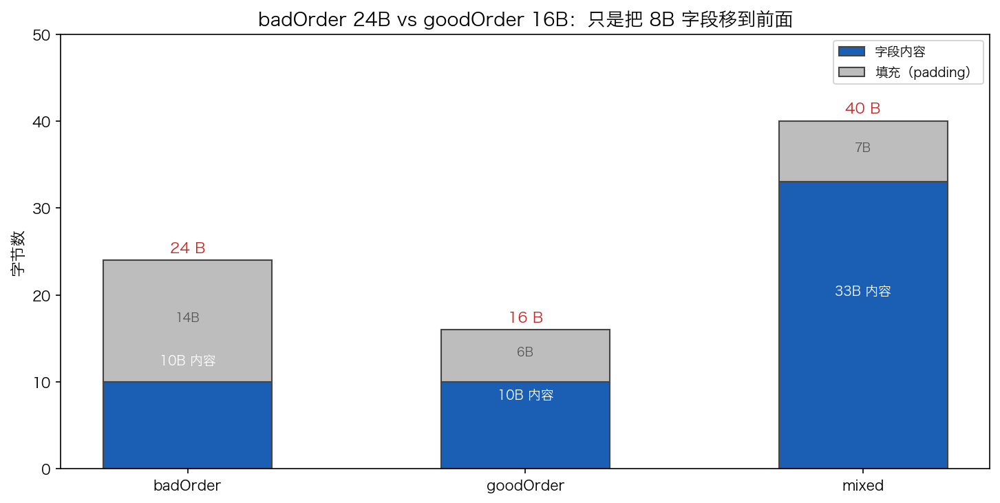

# 17 · 内存对齐与 struct 优化：只改声明顺序，省下 1/3 内存

> 同一组字段，`{int8, int64, int8}` 顺序排出来 24 字节，换成 `{int64, int8, int8}` 只要 16 字节——逻辑一字未改，只动了**声明顺序**。本实验用 `unsafe.Sizeof / Alignof / Offsetof` 把三个结构体的逐字段偏移与填充（padding）打印出来，看清对齐规则落在内存里的真实位置，并给出能直接落地的字段排序口诀。

## 1. 为什么需要它

CPU 按字长对齐地访问内存最快，不少架构上不对齐的访问会变慢甚至出错，所以 Go 编译器会在字段之间和结构体尾部**悄悄插入填充字节**。填充不可见、不报错，唯一的痕迹是 `unsafe.Sizeof` 大于字段字节和：badOrder 三个字段 1+8+1=10 字节，`Sizeof` 却是 24。

填充还会随对象数量放大：100 万元素的 `[]badOrder` 比 `[]goodOrder` 多吃约 8 MB 内存，每个缓存行装的对象也更少。这种浪费完全由声明顺序决定，code review 时肉眼很难看出来，值得用一次实验把规则看穿。

## 2. 总览：核心机制一图看懂


> 🌐 **交互版**：[在线打开（GitHub Pages）](https://<user>.github.io/<repo>/internals/17_align/images/layout.html)
> （或本地打开 [`images/layout.html`](images/layout.html)）。

**心智模型一句话**：每个字段的偏移必须是它自身对齐值的倍数，放不下就垫填充——`int8` 插在 `int64` 前面会把 8 对齐位顶走 7 字节；把 8B 大字段放最前、小字段收尾，填充就只剩尾部补齐。图中上下两条链是同一组字段（内容同为 10B）的两种排法：24B vs 16B。

## 3. 快速开始

```bash
cd internals/17_align
go run main.go          # 文本演示：三个结构体的偏移与 pad
go run main.go -json    # 输出 JSON 快照，供 viz.py 画数据图
```

预期输出（节选；偏移与大小由编译器和平台 ABI 决定，64 位平台结果一致，实测于 go1.26.5 darwin/arm64）：

```text
== badOrder(a int8, b int64, c int8) : 大小=24 对齐=8
     a  int8      偏移=0  (pad=0)
     b  int64     偏移=8  (pad=7)
     c  int8      偏移=16 (pad=0)

== goodOrder(b int64, a int8, c int8) : 大小=16 对齐=8
     b  int64     偏移=0  (pad=0)
     a  int8      偏移=8  (pad=0)
     c  int8      偏移=9  (pad=0)

== mixed(p *int, f float64, b bool, s string) : 大小=40 对齐=8
     p  *int      偏移=0  (pad=0)
     f  float64   偏移=8  (pad=0)
     b  bool      偏移=16 (pad=0)
     s  string    偏移=24 (pad=7)
```

## 4. 核心概念

### 4.1 两条对齐规则

- **字段规则**：每个字段的偏移必须是它自身对齐值的倍数（`int64`→8 的倍数，`int8`→任意位置）
- **整体规则**：结构体总大小是最大成员对齐值的倍数——这是为了保证 `[]T` 数组里每个元素的首地址都对齐

### 4.2 三结构体实测对照

| 结构体 | 字段顺序 | 字段内容 | 间填充 | 尾填充 | 总大小 |
|:---|:---|:---:|:---:|:---:|:---:|
| badOrder | a int8 → b int64 → c int8 | 10B | 7B（a、b 之间） | 7B | **24B** |
| goodOrder | b int64 → a int8 → c int8 | 10B | 0 | 6B | **16B** |
| mixed | p *int → f float64 → b bool → s string | 33B | 7B（b、s 之间） | 0 | **40B** |



柱状图三根柱子的"内容"段来自 `-json` 快照的逐字段 size 求和，灰色段是总大小减内容的填充——badOrder 与 goodOrder 内容完全相同，差的全部是填充。

### 4.3 badOrder：int8 插队的代价

`a int8` 占了偏移 0，`b int64` 要求 8 的倍数，只能从偏移 8 开始——中间硬塞 7 字节填充；`c` 结束于 17，尾部再补 7 字节凑到 8 的倍数。10B 的内容膨胀成 24B。

### 4.4 goodOrder：填充挤到尾部

`b int64` 先占 0~8，两个 `int8` 自然贴在 @8、@9，字段到 10 就结束了；尾部补 6 字节凑成 16。**同样的字段，顺序对了填充只剩尾部一处**。

### 4.5 mixed：大小与对齐是两回事

`string` 的 `Sizeof` 是 16（指针+长度），但 `Alignof` 只有 8——大小和对齐是两个维度。`b bool` 结束于 17，16B 的 `s` 仍要等 8 的倍数，于是前面垫 7B、尾部刚好齐平。指针/`string`/`slice`/map 在 64 位平台都是 8 对齐。

## 5. 关键字段与坑清单

| 工具 | 含义 | 用法 |
|---|---|---|
| `unsafe.Sizeof(x)` | 变量总字节数（含填充） | 传**值**或解引用，别传指针变量 |
| `unsafe.Alignof(x)` | 对齐值 | 决定字段能落在哪些偏移上 |
| `unsafe.Offsetof(s.f)` | 字段偏移 | 与"上一字段偏移+大小"的差就是填充 |

优化口诀（批量场景才值得折腾，单对象 8B 无关痛痒）：

1. **大字段放前，小字段收尾**：8B 字段先占对齐位，小字段自然贴上去
2. **别让小字段插队**：`int8` 垫在 `int64` 前 = 白送 7B 间填充；插队排布是 24B，大字段在前是 16B
3. **批量才显著**：100 万个元素差 8 MB；slice-of-struct 的紧凑度直接影响缓存命中
4. **工具兜底**：`go vet` 的 `fieldalignment`（`golang.org/x/tools/go/analysis/passes/fieldalignment`）能自动报出可优化的顺序

坑清单：

- **`unsafe.Sizeof(ptr)` 永远是 8**：指针变量的大小就是指针本身，要用 `unsafe.Sizeof(*ptr)` 或值类型
- **填充要按"偏移+大小"推算，别只算字节和**：badOrder 的 24 = 10B 内容 + 中间 7B + 尾部 7B，只看字段和会算成 10
- **对齐值看成员类型，不看你写的顺序**：`string` 虽 16B 但 Alignof=8，混合体里它落在 8 的倍数处
- **画逐字节栅格图注意 matplotlib 溢出**：x 用"数据单位"后必须手动 `set_xlim/set_ylim` 固定范围，否则 `bbox_inches='tight'` 会把超界内容拉爆成超大图

## 6. 文件结构

```text
internals/17_align/
├── README.md                      # 本文件：原理 + 运行指引 + 面试要点
├── main.go                        # 主教材：unsafe 三件套打印三个结构体的偏移与填充（-json 输出快照）
├── viz.py                         # 数据图脚本：读 -json 快照画 align_sizes.png
└── images/
    ├── layout.architecture.json   # 图源：对齐布局对照（Typed JSON IR）
    ├── layout.html                # 交互版：可缩放/高亮连线的自包含页面
    ├── layout.svg                 # README 内嵌双主题矢量图
    └── align_sizes.png            # 实测数据图：内容 vs 填充 柱状图
```

## 7. 面试要点

**Q：什么是内存对齐？Go 为什么要填充？**
A：字段偏移必须是其对齐值的倍数，结构体总大小是最大对齐值的倍数。这是硬件约束：不对齐访问在部分架构上变慢甚至 fault，编译器插 padding 换取每次访问都安全高效。

**Q：同样的字段，为什么换个顺序就从 24B 变 16B？**
A：badOrder 里 `int8` 排在 `int64` 前，把 8 对齐位顶走 7 字节（间填充 7B + 尾部 7B）；goodOrder 把 `int64` 放最前、两个 `int8` 贴后，只剩尾部 6B。内容同为 10B，差的全是填充。

**Q：struct 总大小为什么必须是最大对齐值的倍数？**
A：为了数组。`[]goodOrder` 中每个元素 16B（8 的倍数），下一个元素的首地址天然 8 对齐；若元素大小是 10，第二个元素就会落在不对齐的地址上。

**Q：string 占 16 字节，它的对齐值是多少？**
A：8。`Sizeof=16`（ptr+len 两个 8B），`Alignof=8`——大小与对齐是独立属性，这也是 mixed 里 `s` 前面只垫 7B 的原因。

**Q：怎么发现并消除对齐浪费？**
A：`unsafe.Offsetof` 逐字段核对偏移；`go vet` 的 fieldalignment 直接报出建议顺序；编码时按"大字段在前、小字段收尾"排布，批量/高频对象（缓存、slice-of-struct）优先处理。

## 8. 总结

对齐布局的全部结论都能从两条规则推出来：**字段偏移对齐到自身对齐值，总大小对齐到最大对齐值**。badOrder 与 goodOrder 的对照说明填充是"顺序税"——同样 10B 内容，24B 与 16B 只隔一次字段重排。下次定义高频 struct 时，先用 `go run main.go` 把偏移打印出来，比背口诀可靠。

下一篇 [18_gmp](../18_gmp/) 看调度器的三层模型：G/M/P 如何配合，为什么 P 的本地队列能让 goroutine 调度快过线程。
