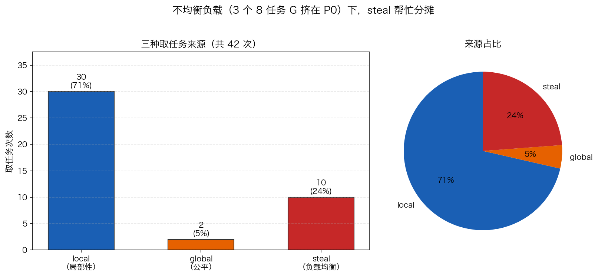

# 18 · GMP 调度模型：本地 runq、全局兜底与 work stealing

> Go 能撑起百万并发，靠的不是百万条 OS 线程，而是 **G（goroutine）+ M（OS 线程）+ P（处理器）** 三层调度。G 怎么排队、谁先谁后、谁闲着帮忙，由三条朴素规则决定：**本地队列优先、全局队列兜底、work stealing 均衡**；再加上一条保命规则——G 阻塞在 syscall 时，M 与 P 分离移交。本实验写一个迷你调度器把前三条规则原样建模，用真实运行数据看 steal 和全局队列什么时候登场。

## 1. 为什么需要它

如果一条 goroutine 对应一条 OS 线程，百万并发就是百万线程——内核调度与栈内存都会先崩。Go 的做法是把"任务"（G）与"执行流"（M）解耦，中间插入数量受限的 P（`GOMAXPROCS` 个）：M 必须占到一个 P 才能跑 G，G 只在 P 的队列里挪动。于是 **G 的切换 ≈ 出队 + 入队**，全程用户态、没有系统调用。

这个模型好不好，要看三条队列规则是否真的各司其职。本项目（`18_gmp/`）用 `main.go` 建模：P 固定 4 个、12 个 G 负载故意不均（3 个重 G 各 8 个任务全挤在 P0），每步记录每个 P 从哪里取到了 G（`local` / `global` / `steal`），验证三级水位与 steal 真的会发生。

## 2. 总览：核心机制一图看懂


> 🌐 **交互版**：[在线打开（GitHub Pages）](https://<user>.github.io/<repo>/internals/18_gmp/images/gmp.html)
> （或本地打开 [`images/gmp.html`](images/gmp.html)）。

**心智模型一句话**：G 是任务、M 是工人、P 是工位——M 必须占到一个 P 才能执行 G。主路径上，新 G 进发起者 P 的本地 runq（无锁、最快）；本地空了先查全局 runq（带锁、公平兜底），全局也空就偷最忙邻居的（负载均衡）；一旦 G 阻塞在 syscall，runtime 就把 P 从这个 M 身上分离、移交给空闲 M，别让"工位"陪着卡在内核里。

## 3. 快速开始

```bash
cd internals/18_gmp
go run main.go          # 文本演示：调度统计 + JSON 快照 + 结论
go run main.go -json    # 只输出 JSON 快照（供 viz.py 画图）
python3 viz.py          # 重新生成实测数据图 images/gmp_stats.png
```

预期输出（节选，每次运行结果相同——本实验是确定性模拟，不含随机数与地址）：

```text
== 调度结果：12 个 G（负载不均），11 步 =====
   local 取（局部性）  : 30
   global 取（公平）  : 2
   steal 取（负载均衡）: 10
   比例 local:global:steal = 30:2:10
```

JSON 快照里有全部 42 条调度事件（`step`/`p`/`g`/`src`）。例如第 5 步：`p1` 与 `p2` 本地已空，从全局队列取走 G0、G1——正是 P0 在第 1 步队满时溢出到全局的两个重 G。

## 4. 核心概念

### 4.1 三级水位：本地 → 全局 → steal



不均衡负载（P=4，12 个 G，3 个 8 任务重 G 挤在 P0）下的实测分布：

| 来源 | 含义 | 次数 | 占比 |
|:---|:---|:---:|:---:|
| local | 从自己的本地队列取（局部性） | 30 | 71% |
| global | 本地空/溢出后取全局（公平） | 2 | 5% |
| steal | 偷别人队列（负载均衡） | 10 | 24% |

71% 的调度走本地队列——这是**本实验这种不均衡负载下的实测值**，不是真实 runtime 的统计比例；但它说明的机制是真实的：本地队列不碰全局锁、不跨核，CPU 缓存友好，天然是主线。

### 4.2 全局队列：公平的安全网

本地队列有容量上限（模拟里 `LOCAL_CAP=3`；真实 runtime 每 P 的 runq 上限是 256）。满了就把**队头一半**溢到全局队列（FIFO），保证先来的 G 不会被无限推迟；任何 P 本地空时先来全局取。真实 runtime 还有一道保险：每 61 次调度 tick（`schedtick%61 == 0`）强制查一次全局，用概率防饿死。

### 4.3 work stealing：闲 P 自动补位

全局也空时，P 去偷别人的本地队列。模拟里挑**最忙**的邻居、取它队尾一个；真实 runtime 是随机试 4 个受害者、一次性**偷走其队头的一半**——传一批而不是传一个，摊薄 stealing 的成本。注意实测里 10 次 steal 全部发生在第 7 步之后：轻 G 跑完、本地队列见底，闲 P 才开始从仍剩重 G 的 P0/P1 身上分活。

### 4.4 syscall 阻塞：M 与 P 分离 handoff

这是模拟没有建模、但真实 GMP 必须有的一条：G 阻塞在 syscall 里时，M 陪着 G 陷入内核等待；`sysmon` 监控到后把 **P 从该 M 身上分离**（handoff），移交给空闲 M 继续跑别的 G。syscall 返回后，M 尝试拿回一个 P；拿不到就把 G 放进全局 runq，自己睡眠。这样"工位"（P）永远不会陪一个卡死的"工人"（M）闲置。

## 5. 关键字段与坑清单

| 常量/字段 | 值 | 为什么重要 |
|:---|:---|:---|
| `P` | 4 | 处理器数，对应真实 `GOMAXPROCS` |
| `NS` | 12 | 并发 G 数；`done` 计数以它为终止条件 |
| `LOCAL_CAP` | 3 | 本地队列容量，超了队头溢到全局（真实 runq 上限 256） |
| `event{Step,P,G,Src}` | — | 每步调度事件，`-json` 快照的原子单位 |
| `bySrc` | map | local/global/steal 计数，数据图直接吃它 |

坑清单（全部来自本实验真实踩过）：

- **终止条件写成任务总数**：`done` 数的是"完成多少个 G"（上限 `NS`），条件若写成 `done < NS*ST` 永远为真 → 死循环 10 万步才被步数上限拦下。**循环边界 = 计数单位**，命名别混
- **同一 G 出现多个队列副本会破坏不变量**：初始化若随机塞 1~2 份，同一 G 被重复 decrement，计数归零了队列还有残留副本 → 队列空而 done 不达标。每 G 恰一份后立刻收敛
- **负载太均匀就复现不出 steal**：重 G 分散在 4 个 P 上时人人都忙、没人偷；把 3 个重 G 挤到 P0 才逼出 10 次 steal。先建场景再谈原理
- **全局队列要有触发条件**：只有本地队满溢出才进 global，否则永远 local——公平兜底不是免费来的
- **诚实标注模拟与真实的差距**：`main.go` 结尾打印的"1/64 概率查全局"是简化口误，真实源码是 `schedtick%61 == 0`（约 1/61）；模拟偷队尾、真实偷队头一半——以本节描述为准

## 6. 文件结构

```text
internals/18_gmp/
├── README.md                      # 本文件：原理 + 运行指引 + 深入要点
├── main.go                        # 迷你 GMP 调度器：三级水位建模 + 调度事件记录（-json 输出快照）
├── viz.py                         # 只画实测数据图：gmp_stats.png（机制图已改用架构图三件套）
└── images/
    ├── gmp.architecture.json      # 图源：G/M/P 架构与 syscall handoff（Typed JSON IR）
    ├── gmp.html                   # 交互版：可缩放/高亮连线的自包含页面
    ├── gmp.svg                    # README 内嵌双主题矢量图
    └── gmp_stats.png              # 实测数据图：三种取任务来源对比（viz.py 生成）
```

## 7. 深入要点

**Q：G、M、P 各是什么？为什么非要中间加一层 P？**
A：G 是 goroutine（任务+栈），M 是 OS 线程，P 是调度资源（数量=GOMAXPROCS，持本地 runq）。P 把"任务队列"从线程上解耦：M 阻塞在 syscall 时 P 可移交别的 M，线程数与并行度解绑，M 也能被复用。

**Q：goroutine 切换为什么比线程切换便宜？**
A：G 切换只是从一个队列出队、往另一个队列入队，纯用户态操作；线程切换要陷入内核、保留/恢复内核调度上下文。M 只在阻塞、抢占、syscall 时才介入。

**Q：本地队列满了怎么办？全局队列什么时候会被查？**
A：本地满（真实上限 256）时把队头一半溢到全局（FIFO 保公平）；本地空时先查全局；此外每 61 次调度 tick 强制查一次全局，防某些 G 饿死。

**Q：work stealing 偷多少？什么时候发生？**
A：真实 runtime 随机找受害者、一次偷其队头的一半（批量摊薄成本）；通常发生在本地与全局都空时。不均衡负载是常态——`go` 语句创建的 G 都挤在发起者的 P 上，steal 让闲 P 自动补位。

**Q：G 阻塞在 syscall 里，P 和 M 会怎样？**
A：M 陪 G 陷入内核；sysmon 发现后把 P 与该 M 分离、handoff 给空闲 M 继续调度。syscall 返回后 M 尝试取回 P，取不到就把 G 放全局 runq、M 睡眠。P 永不陪阻塞的 M 干等。

## 8. 总结

GMP 的全部调度行为都能从"三级水位 + 一条 handoff 规则"推出来：本地队列给速度，全局队列给公平，steal 给均衡，syscall handoff 给容错。本实验用 42 条真实调度事件（30/2/10）验证了前三条——比背结论可靠得多。

下一篇 [19_syscall](../19_syscall/) 沿着 4.4 节继续深挖：G 进入阻塞 syscall 后，M、P、G 各自的时间线到底怎么走。
