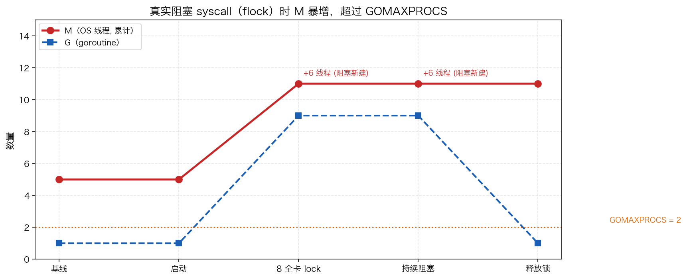
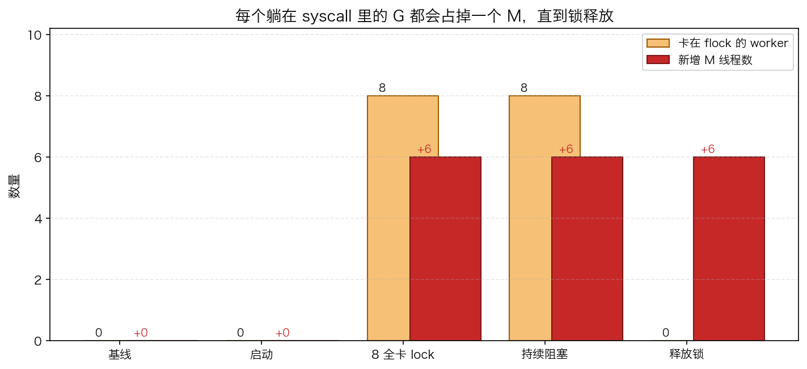

# 19 · 系统调用与阻塞 I/O：M 是怎么涨起来的

> `GOMAXPROCS` 定住的是 P 的数量，但 **OS 线程 M 可以比 P 多**。什么时候多？当 goroutine 阻塞在**真实系统调用**上时。本实验用 8 个 goroutine 同时抢一把 `flock` 文件锁，亲眼看到 M 从 5 涨到 11，远超 `GOMAXPROCS=2`；锁释放后线程也不回落——这是理解"文件 I/O 费线程、网络 I/O 不费线程"的最小可复现实验。

## 1. 为什么需要它

写服务的人都知道 `GOMAXPROCS` 控制"并行度"，于是容易默认"线程数 ≈ GOMAXPROCS"。但 Go 调度器的账本上，P 只限制**同时执行 Go 代码**的并行度，M（OS 线程）是另一种资源：一旦某个 G 陷入**真正阻塞的系统调用**（文件读写、`flock`、部分 DB 驱动的原生调用、`syscall.Exec`），执行它的 M 会被扣在内核里回不来，调度器只能另找或新建 M 来跑剩下的 G——线程数就这样冲出 `GOMAXPROCS`。

反过来，网络连接百万却几乎不涨线程，靠的不是运气，而是 netpoller（kqueue/epoll）把"看起来阻塞"的 socket 读写变成了非阻塞等待。分清这两类 I/O，是排查"线程数为什么失控"的前提。程序演示四件事：8 个 worker 卡文件锁、G/M 数随阶段变化、锁释放后 M 的去向、以及"为什么 `time.Sleep` 和网络 I/O 复现不了这个现象"。

## 2. 总览：核心机制一图看懂


> 🌐 **交互版**：[在线打开（GitHub Pages）](https://<user>.github.io/<repo>/internals/19_syscall/images/syscall.html)
> （或本地打开 [`images/syscall.html`](images/syscall.html)）。

**心智模型一句话**：M 陷入阻塞 syscall 后就"人票分离"——M 留在内核里蹲守，P 被 sysmon 收走交给空闲（或新建的）M 继续跑别的 G；syscall 返回后原来的 M 尝试取回一个空闲 P，取不到就休眠入池。

## 3. 快速开始

```bash
cd internals/19_syscall
go run main.go          # 文本演示：五个阶段的 G/M/卡锁 worker 计数
go run main.go -json    # 输出 JSON 快照，供 viz.py 画图
```

预期输出（本机实测，darwin/arm64，go1.26.5）：

```text
 阶段            G数   M(累计线程)  新增线程  卡锁worker
 baseline          1       5          0         0
 start             1       5          0         0
 blocked-8         9      11          6         8
 blocked+          9      11          6         8
 after-release     1      11          6         0

GOMAXPROCS=2，但 8 个 worker 同时阻塞在 flock → M 撑到 11
```

数据漂移标注：`M` 列来自 `threadcreate` profile，是**累计创建的线程数**。基线 5 与增量 +6 是一次实测值，会随机器、平台与 Go 版本浮动（比如基线可能是 4 或 6）；但"阻塞期线程远超 GOMAXPROCS、释放锁后不回落"这两个定性结论在任何平台都稳定复现。

## 4. 核心概念

### 4.1 handoff：P 为什么必须离开 M

G 调用 `syscall.Flock` 后进入 `_Gsyscall` 状态，M 带着它一起陷入内核。此时最贵的资源不是 M，而是 **P**：P 手里攥着本地 runq、mcache，被一个"短时间回不来"的 M 握着，整个调度槽位就空转。runtime 的 sysmon 线程周期性巡检，发现某 P 停在 syscall 里太久，就执行 handoff——把 P 从该 M 手里收走。P 的下家按优先级找：有空闲 M 就唤醒，没有就**新建一个 OS 线程**（这就是线程数的增量来源）。

### 4.2 syscall 返回后：取回 P，否则休眠

锁释放、`flock` 返回后，M 并不会"迷路"：`exitsyscall` 先尝试快速路径，从全局空闲 P 列表 `pidleget` 取回一个 P，取到就立刻继续跑 G；取不到（比如别的 M 正占着全部 P）就走慢路径，把 G 放回全局队列，自己 `stopm` **休眠进空闲 M 池**。注意实测 `after-release` 阶段线程数仍是 11——**M 不会被销毁**，只是睡着待复用，所以线程数是"峰值保留"的。

### 4.3 实测数据怎么看



上图是五个阶段的 G 数与累计线程数：`blocked-8` 起线程从 5 跳到 11（+6），远超 GOMAXPROCS=2 的虚线；`after-release` 阶段 G 回落到 1，线程却停在 11 不动。下图把"卡锁 worker 数"与"新增线程数"并排：阻塞期两者同峰（8 卡锁 / +6 线程），释放后同时清零/停涨。



为什么 8 个阻塞 worker 只 +6？因为线程账面增量 = **新建**的 M 数，而调度器会先复用空闲 M 池里已有的线程，基线那 5 个里的一部分被直接派去接 P——所以差值不恒等于 worker 数 8，别把它当公式背。

### 4.4 对照组：netpoller 为什么不涨线程

网络 I/O 走的是**非阻塞 fd + netpoller**（macOS 是 kqueue，Linux 是 epoll）：socket 永远不真正阻塞线程，G 被挂在 poller 里睡，M 完全空闲、转身就能从 runq 领下一个 G。`time.Sleep` 同理——G 被 timer 挂起，M 归还空闲池。所以想复现"M 暴涨"，必须用**真正阻塞的系统调用**，`flock` 是最顺手的一个。

## 5. 关键字段与坑清单

`main.go` 里 snapshot 结构的五个字段：

| 字段 | 含义 | 为什么重要 |
|---|---|---|
| `phase` | 阶段名：baseline/start/blocked-8/blocked+/after-release | 五个采样点串出完整时间线 |
| `goroutines` | `runtime.NumGoroutine()` 当前存活 G 数 | 阻塞期 1→9，释放后回落到 1 |
| `threads` | `threadcreate` profile 的 `Count()` | **累计创建**的线程数，不是当前存活数 |
| `threadDiff` | `threads - baseline` | 可观测的"因阻塞新建"信号 |
| `waiting` | 仍卡在 `flock` 上的 worker 数 | 与 threadDiff 同峰同落，构成因果对照 |

坑清单：

- **`threadcreate` 是累计值**：`Count()` 给出进程开跑以来创建过的线程总数，不是"现在活着多少"；必须减掉基线（本机那次是 5，含 main、sysmon、GC 等后台线程）才得到"因阻塞新建"的差值，且基线本身随平台浮动，别背常数
- **`time.Sleep` 和网络 I/O 都不是好教材**：Sleep 会 park G 但把 M 放回池子，网络走 netpoller——都让 M 数不涨；必须用真正阻塞的系统调用，`flock` 最方便
- **BSD flock 的 fd 语义**：macOS 上同一进程两个独立 `open` 的描述符会在同一 inode 上互斥，这才让"主协程锁死 + 8 worker 抢"成立；用同一 fd 重复 `flock` 只会无害升级锁，永远不阻塞
- **worker 里的 EINTR 分支不能省**：`flock` 可能被信号打断返回 `EINTR`，程序里要重试而不是当错误放弃，否则 8 个 worker 会提前退场、阻塞期采不到 8
- **Go 字符串字面量里别嵌裸英文 `"`**：它就是字符串边界，会把字符串劈成两半报语法错误；中文语境用「」或转义 `\"`

## 6. 文件结构

```text
internals/19_syscall/
├── README.md                      # 本文件：原理 + 运行指引 + 面试要点
├── main.go                        # 主教材：8 worker 抢 flock，五阶段快照（-json 输出）
├── viz.py                         # 数据图：go run main.go -json → 两张 PNG 进 images/
└── images/
    ├── syscall.sequence.json      # 图源：M 蹲守/P 移交/取回或休眠时序（Typed JSON IR）
    ├── syscall.html               # 交互版：可缩放/高亮消息的自包含页面
    ├── syscall.svg                # README 内嵌双主题矢量图
    ├── syscall_threads.png        # 数据图：各阶段 G 数 / 累计线程数曲线
    └── syscall_waiting.png        # 数据图：卡锁 worker 数与新增线程数对照
```

## 7. 面试要点

**Q：GOMAXPROCS 限制的到底是线程数吗？**
A：不是。它限制的是 P 的数量，即同时执行 Go 代码的并行度。G 阻塞在真实 syscall 上时 M 会被扣在内核里，P 被移交后新建/唤醒的 M 都不计入 P——本实验 GOMAXPROCS=2 却实测到 11 个线程。

**Q：G 进入阻塞 syscall 后，runtime 怎么处理它占着的 P？**
A：sysmon 周期巡检发现 P 停在 syscall 里太久，就 handoff：把 P 收走，优先唤醒空闲 M，空闲池没货就新建 OS 线程，让 P 继续跑 runq 里的其他 G。原 M 独自留在内核里等 syscall 返回。

**Q：syscall 返回后，那个"迟到"的 M 去哪了？**
A：`exitsyscall` 先走快速路径 `pidleget` 尝试取回一个空闲 P，取到就接着跑 G；取不到就把 G 放回全局队列、自己 `stopm` 休眠进空闲 M 池。M 基本不被销毁，所以实测释放锁后线程数停在峰值 11 不回落。

**Q：为什么"百万并发连接"的 Go 服务线程数却不涨？**
A：因为网络 I/O 是非阻塞 fd + netpoller（kqueue/epoll）：G 睡在 poller 里，M 不蹲守、随时可以跑别的 G。线程暴涨只发生在真实阻塞 syscall 上（文件 I/O、`flock`、部分 cgo/DB 原生调用）。排查信号：GOMAXPROCS 不变、线程数持续上涨 → 有人在打真 syscall。

**Q：怎么用程序证明上面这些？`threadcreate` 的 Count 是当前线程数吗？**
A：不是，它是进程开跑以来**累计创建**的线程数。要用"当前采样 − 基线"的差值说话：本实验 baseline=5、blocked-8 时 11，差值 +6；且差值不恒等于阻塞 worker 数 8，因为调度器会先复用空闲池里的线程。

## 8. 总结

阻塞 syscall 的全部后果都能从"M 与 P 人票分离"推出来：M 蹲内核 → P 被 handoff 给空闲/新建 M → 线程数冲出 GOMAXPROCS → 返回后取回 P 否则休眠入池（峰值保留）。记住验证方法——`go run main.go` 看五个阶段的 G/M 计数，比背结论可靠得多。

下一篇 [20_signal](../20_signal/) 看进程另一类"外部事件"：panic 沿 defer 链的执行序与 recover 的抢救边界，以及 SIGTERM 如何被 os/signal 送进 channel 驱动优雅退出。
