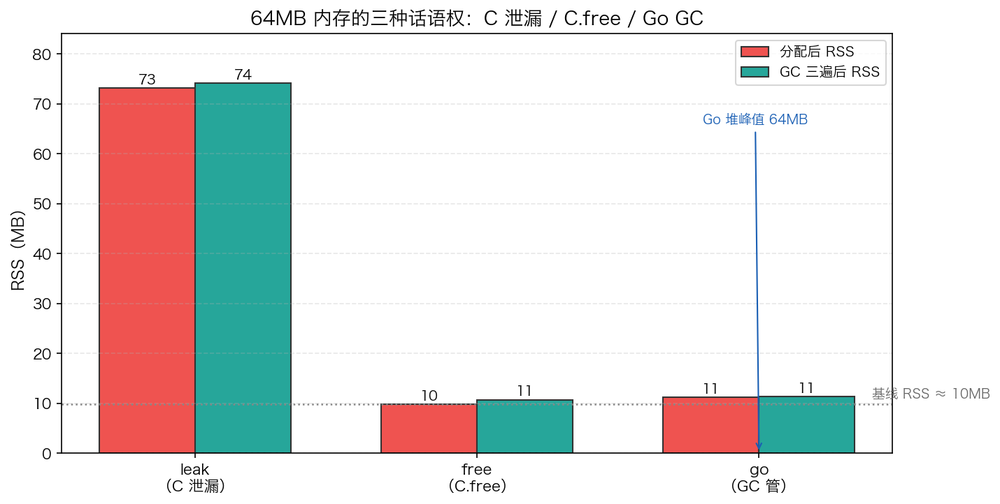

# 21 · CGO 内存归属：C.malloc 出去的内存，GC 管不着

> 只要 `import "C"`，一个进程里就同时住着两套内存管理：Go 的 GC 世界和 C 的 malloc/free 世界。最常见的误会是"C 泄漏了 GC 会兜底"——不会，GC 的考勤表里根本没有 C 的内存。本实验用 64MB 内存做三种对照（leak / free / go），各自跑独立进程采样 RSS，把"GC 看不见 C 内存"变成看得见的数字。

## 1. 为什么需要它

Go 程序接了 cgo 库（图片解码、加密、数据库驱动）之后内存一直涨，`pprof` heap profile 却一切正常——因为 **heap profile 只统计 Go 堆**，而泄漏发生在 C 堆。要诊断这类问题，必须先建立一个基本认知：

1. **GC 只遍历 Go 指针**（扫描栈/寄存器/全局变量 + Go 堆内指针），`C.malloc` 的内存从不登记为 GC 对象，GC 跑三遍也看不见它
2. **进程内存 ≠ Go 堆**：RSS（常驻内存）= Go 堆 + C 堆 + 栈 + runtime 元数据，C 泄漏只会在 RSS 上显形
3. 跨语言的 free 是纯手工活：malloc/free 是对偶操作，GC 没有免费午餐可以替 C 兜底

程序用三种模式做对照实验：`leak`（64 次 `C.malloc` 永不释放）、`free`（用完 `C.free`）、`go`（64 次 `make([]byte, 1MB)` 交给 GC）。

## 2. 总览：核心机制一图看懂


> 🌐 **交互版**：[在线打开（GitHub Pages）](https://<user>.github.io/<repo>/internals/21_cgo/images/ownership.html)
> （或本地打开 [`images/ownership.html`](images/ownership.html)）。

**心智模型一句话**：内存归谁分配就归谁回收——跨过 cgo 边界的只有指针值，不是内存本身。图中 Go 调用方跨过 cgo 边界拿到的是 C 堆上的指针（实线主路径）；GC 的虚线到 `C 堆 malloc 区` 为止：不是不想管，是考勤表外。C 内存的唯一回收出路是 `C.free(p)`。

## 3. 快速开始

```bash
cd internals/21_cgo
go run main.go                     # 三种模式各起独立子进程，汇总对比
go run main.go -mode leak -json    # 单模式 JSON 快照（rssBefore/rssAfter/goHeapMax）
python3 viz.py                     # 重新实测三模式，生成 images/cgo_rss.png
```

预期输出（节选，RSS 每次运行有 ±1MB 左右波动，"新分配数"也随之变化）：

```text
 模式   分配后RSS   GC后RSS   进程堆峰值   新分配数
 leak           73        74            0        82
 free           10        10            0        86
 go             11        11           64       219

单位 MB。RSS = 进程常驻内存（mach task_info）；三模式各自独立进程跑。

1. leak：分配后 RSS 73 MB，GC 三遍后仍 74 MB —— C 内存 GC 看不见
2. free：同样 64MB，正确 C.free 后 RSS 10 MB ≈ 基线 —— 泄漏消失
3. go：GC 管的堆峰值 64 MB，回收后回落；RSS 平稳 — 分配活由 GC 干
```

`goHeapMax` 打印 0 表示堆峰值不足 1MB（取整），与 RSS 73MB 对照就是"进程内存 ≠ Go 堆"的铁证。

## 4. 核心概念

### 4.1 两个世界，两本账

左边的 Go 世界里，`make([]byte, 1MB) × 64` 落在 Go 堆，`HeapInuse` 可见，GC 标记可达对象后回收；右边的 C 世界里，`C.malloc(1MB) × 64` 落在 C 堆，GC 的扫描器从不踏入。`go_main → c_heap` 这条实线就是 cgo 调用边界：Go 侧拿到的是 `unsafe.Pointer`，指着 C 堆上的 64MB——指针跨了线，内存没跨。

### 4.2 GC 为什么看不见 C 内存

Go GC 的根扫描范围是栈、寄存器、全局变量，对象图只沿 Go 指针走。`C.malloc` 的块既不在 Go 堆的 span 里，也不携带 GC 位图，所以"可达性分析"对它完全失明。leak 模式的实测就是这个结论：GC 三遍后 RSS 73→74MB 纹丝不动，而同期 `HeapInuse` 始终不足 1MB。

### 4.3 三种模式对照实测



| 模式 | 分配后 RSS | GC 三遍后 RSS | Go 堆峰值 | 说明 |
|:---|:---:|:---:|:---:|:---|
| leak | 73 MB | **74 MB** | <1MB | C 内存 GC 摸不到，三遍 GC 纹丝不动 |
| free | ≈10 MB | ≈10 MB | <1MB | 用完 `C.free`，RSS 回到基线 ≈10MB |
| go | ≈11 MB | ≈11 MB | **64 MB** | 堆涨又落全部交给 GC，RSS 平稳 |

每次运行 RSS 有 ±1MB 左右波动（如 free 模式分配后实测出现过 9MB 与 10MB 两种取整结果），但三模式的相对关系每次都成立；`python3 viz.py` 每次重新实测生成上图。

### 4.4 边界规则：只读借用 vs 拷贝交接

- **C 指针借给 Go 用是安全的**：本文 `peek(p, 0)` 读第一个字节即是最小演示；Go 侧长期保管 C 指针也不违反 cgo 规则（GC 本来就不管它），真正的问题是忘了 `C.free` 就是永久泄漏
- **Go 指针不能让 C 长期保存**：调用期间可以传，调用返回后 C 不得继续持有；违规可被 `GODEBUG=cgocheck=2`（cgocheck2）揪出来；`-race`/`checkptr` 查的是别的
- **要跨界长期持有就用拷贝交接**：`C.CBytes`（Go→C）/`C.GoBytes`（C→Go）拷贝一次，所有权随之切换，没有后续纠缠

## 5. 关键字段与坑清单

| 字段/函数 | 含义 | 为什么重要 |
|---|---|---|
| `sample.RSSBefore/After` | mach `resident_size`，分配后 / GC 三遍后 | C 内存是否归还，只有 RSS 能看见 |
| `sample.GoHeapMax` | 过程中 `HeapInuse` 峰值（MB 取整） | GC 管辖范围的峰值；leak/free 恒 <1MB |
| `sample.Allocs` | `ms.Mallocs` 差值 | 只数 Go 对象分配，C 的 malloc 不计入 |
| `C.cur_rss()` | `mach_task_basic_info.resident_size` | 当前常驻内存的真实快照 |

坑清单：

- **`ru_maxrss` 是历史峰值，只增不减**：用它看"free 后内存降没降"纯属自欺；macOS 要用 `mach_task_basic_info` 的 `resident_size` 抓当前值
- **free 掉的内存通常不还给 OS**：同进程里"先泄漏 64MB 再 free"对比不出效果，三模式必须拆成三个独立进程（`-mode X -json`）数字才诚实
- **`import "C"` 是隐形的**：包里任一文件 import "C" 就自动拉起 cgo 构建 + C 编译器 + 动态链接，即使 C 前置块为空；构建变慢、交叉编译变麻烦都源于此
- **C 泄漏的排查入口是 RSS 不是 heap profile**：`runtime.MemStats` 全是 Go 堆的数，C 泄漏时 RSS 直线上涨而 heap 纹丝不动

## 6. 文件结构

```text
internals/21_cgo/
├── README.md                        # 本文件：原理 + 运行指引 + 深入要点
├── main.go                          # 主教材：leak/free/go 三模式 + 独立子进程隔离采样
├── viz.py                           # 数据图：实测三模式 RSS → images/cgo_rss.png
└── images/
    ├── ownership.architecture.json  # 图源：C/Go 两个内存世界与 cgo 调用边界
    ├── ownership.html               # 交互版：可缩放/高亮连线的自包含页面
    ├── ownership.svg                # README 内嵌双主题矢量图
    └── cgo_rss.png                  # 数据图：三模式分配后/GC 后 RSS 实测柱状对比
```

## 7. 深入要点

**Q：Go 进程 RSS 一直涨，pprof heap 却显示正常，为什么？**
A：RSS 是整个进程的常驻内存（Go 堆 + C 堆 + 栈 + runtime），heap profile 只统计 Go 堆。cgo 库里忘了 free 的 C 内存只有 RSS 能暴露——先看 RSS 与 HeapInuse 的差值是否持续扩大。

**Q：C.malloc 的内存，Go GC 会回收吗？**
A：不会。GC 只沿 Go 指针做可达性分析，C 堆的块不在其对象集里。实测 leak 模式 GC 三遍后 RSS 73→74MB 不动。唯一出路是配对的 `C.free`，没有兜底。

**Q：Go 指针能传给 C 保存吗？C 指针传给 Go 呢？**
A：Go 指针只能在调用期间交给 C，返回后 C 不得继续持有，`GODEBUG=cgocheck=2` 会拦越界违规。C 指针给 Go 用、存都行，但 GC 对它失明：忘了 free 就是永久泄漏。需要跨界长期持有就用 `C.CBytes`/`C.GoBytes` 拷贝交接。

**Q：为什么本实验三种模式要拆成三个独立进程？**
A：`free()` 一般只把内存还给 C 的 allocator 而不还 OS，同进程先泄漏再 free，RSS 不回落，"free 有效"就对比不出来；独立进程的 RSS 才是可横向对比的诚实数字。

**Q：怎么正确测量"当前"内存？用 `ru_maxrss` 行吗？**
A：不行，`ru_maxrss` 是峰值计数器只增不减。macOS 用 `mach_task_basic_info.resident_size`（本实验的 `C.cur_rss`），Linux 可读 `/proc/self/statm`，采样时机放在 GC 前后各一次。

## 8. 总结

一句话收束：**指针可以跨界，内存和回收责任不能**。C.malloc 的内存在 GC 的考勤表外，配对 C.free 是唯一出路；而监控 C 堆的唯一窗口是 RSS，不是 heap profile。记住验证方法——`go run main.go` 让三种模式的 RSS 差异自己说话。

下一篇 [22_pprof](../22_pprof/) 把"看性能"工具化：怎么用 pprof 采集 CPU profile、定位热点函数，把"感觉慢"变成看得见的火焰图。
