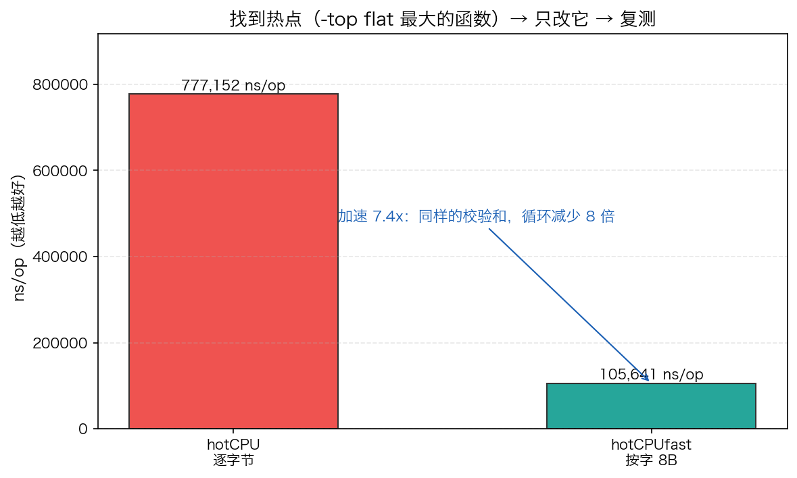

# 22 · pprof 性能分析：热点在哪，优化就从哪下手

> 优化不靠感觉，靠数据。凭直觉"优化"常常花一下午改了个不热的地方，性能纹丝不动。本实验用 `runtime/pprof` 给程序落盘 CPU/heap profile，用 `net/http/pprof` 起在线采集端点，再用 `go tool pprof -top/-list` 把热点钉到具体的函数和代码行，最后完成一次完整闭环：找到热点 → 只改它 → 复测对比——1MB 校验和从逐字节改按字折叠，实测加速 8.1 倍。

## 1. 为什么需要它

程序慢了怎么办？新手靠猜：换 map、加缓存、上 goroutine……改一圈 profile 一拉，90% 的 CPU 还烧在原来那个函数里。**性能优化的第一原则是先测量**：CPU profile 告诉你时间烧在哪，heap profile 告诉你内存被谁占着，而 pprof 就是 Go 官方自带的测量工具链——标准库直接 `import`，零第三方依赖。

程序演示四件事：造两个热点函数（逐字节 vs 按字折叠的校验和）并用 `runtime/pprof` 落盘 profile；造 30 万个对象（一半立刻变垃圾）拍 heap 快照；起 `net/http/pprof` 在线端点自检；最后用 `go tool pprof` 完成定位与优化复测。

## 2. 总览：核心机制一图看懂


> 🌐 **交互版**：[在线打开（GitHub Pages）](https://<user>.github.io/<repo>/internals/22_pprof/images/profile.html)
> （或本地打开 [`images/profile.html`](images/profile.html)）。

**心智模型一句话**：性能优化是闭环不是灵感——埋点采集（本地落盘或线上端点）→ `-top` 看 flat 谁最大 → `-list` 钉到行 → 只改这一个函数 → 再 profile 复测对比。图中主线从 `import` 埋点到复测 8.1x，旁支是生产环境常用的 HTTP 端点采集（`:6160 · seconds=30`）。

## 3. 快速开始

```bash
cd internals/22_pprof
go run main.go          # 文本演示：CPU 热点 → 内存热点 → 端点自检
go run main.go -json    # 输出 JSON 快照（viz.py 画图取数用）
```

预期输出（节选，ns/op 与对象数随机器/负载波动，每次运行不同）：

```text
== CPU 热点（1MB 校验和 ×300 轮，ns/op） ====
  hotCPU(逐字节)   : 768208
  hotCPUfast(按字) : 94695
  加速比：8.1x

== 内存热点（30 万对象，一半保活） ====
  heap profile 写入时：213015 对象 / 12 MB（含待回收垃圾）
  GC 后真正存活   ：150498 对象 / 10 MB

== net/http/pprof =====
  端点 :6160/debug/pprof/ 自检 → true
```

`go run main.go` 会在当前目录写 `cpu.pprof` / `heap.pprof` 两个 profile 文件，用 `go tool pprof` 分析：

```bash
go tool pprof -top cpu.pprof                        # 谁烧的 CPU 最多？
go tool pprof -list hotCPU cpu.pprof                # 热到哪一行？
go tool pprof -top -inuse_space heap.pprof          # 谁占着内存？
```

`-top` 真实输出（节选，采样百分比每次运行不同）：

```text
      flat  flat%   sum%        cum   cum%
     210ms 87.50% 87.50%      220ms 91.67%  main.hotCPU      ← 热点
      20ms  8.33% 95.83%       20ms  8.33%  main.hotCPUfast
      10ms  4.17%   100%       10ms  4.17%  runtime.asyncPreempt
```

`-list` 直接把热点钉到行：`main.go:42` 的 `h = h*31 + uint64(buf[i])` 独占 210ms——优化对象一目了然。

## 4. 核心概念

### 4.1 CPU profile 是"采样"，不是计时

`pprof.StartCPUProfile` 按默认 100Hz 频率中断程序、记录当时栈顶在哪个函数——谁在栈顶的时间多，谁的 flat 就大。本次运行采样 407ms、总样本 240ms，87.5% 的样本落在 `hotCPU`：CPU 时间几乎全烧在这。采样式 profile 的好处是开销低（默认挡位 <1%），可以一直开着。

### 4.2 flat 与 cum：出手 vs 流程

- **flat**：函数自己（不含调用子孙）烧掉的 CPU/内存。flat 87.5% 在 `hotCPU` = 必须动它本身
- **cum**：含它调用的全部子孙。`main.bench`/`main.main` flat 为 0、cum 100%——它们只是流程壳

优化对象只选 **flat 最大**的那一个。`-list` 再把 flat 归属到具体行，`main.go:42` 一行独占 210ms，热点从"函数级"细化到"行级"。

### 4.3 heap profile 是"快门"

`pprof.Lookup("heap").WriteTo` 抓"此刻谁占着堆内存"的快照：`-inuse_space` 看驻留（泄漏/占用），`-alloc_space` 看分配吞吐（GC 压力）。本次实测驻留的 91.65%（5632kB）来自 `hotMemAlloc (inline)`——一半保活对象 + 尚未回收的垃圾；GC 后存活降到 150498 对象 / 10MB，验证"先拍含垃圾的现场，再 GC 对比存活"。

### 4.4 在线端点与优化闭环

`_ "net/http/pprof"` 把处理器注册到 `DefaultServeMux`，绑定 `127.0.0.1:6160` 自检 GET 200。生产环境 `curl http://127.0.0.1:6160/debug/pprof/profile?seconds=30` 拿 30 秒线上 CPU 快照，不需要改任何业务代码。

闭环完整走一遍：`-top` 显示 flat 87.5% 在 `hotCPU` → `-list` 钉到逐字节循环 → 只改这一个函数（按字折叠，循环次数降到 1/8）→ 复测：768208 → 94695 ns/op，**8.1x**，`hotCPUfast` 在 profile 里只剩 8.33%。



## 5. 关键字段与坑清单

| 命令/字段 | 含义 | 为什么重要 |
|---|---|---|
| `flat` / `flat%` | 函数自身的耗时/内存 | 决定"优化谁"，只挑最大的下手 |
| `cum` / `cum%` | 含调用子孙的累计值 | 定位"流程壳"，flat≈0 而 cum 大的别直接优化 |
| `-inuse_space` | 此刻驻留内存 | 查泄漏、查占用 |
| `-alloc_space` | 累计分配量 | 查 GC 压力、分配热点 |
| `?seconds=30` | 线上采集时长 | 太短样本不够，太长错失现场 |
| `-nodecount=N` | 限制 top 输出行数 | 解析输出时先跳过 `Showing nodes…` 行 |

坑清单：

- **heap profile 要赶在 GC 前拍**：GC 之后垃圾对象已被回收，快照里就看不到"待回收垃圾"了——先落盘含垃圾的现场，再 `runtime.GC()`，再对比存活数
- **`runtime.KeepAlive(head)` 放错位置等于没放**：它保证的是"执行到那一刻必活"。要放在 GC **之后**当 `head` 的最后一次使用，放在 GC 前则 GC 时变量活期已过、保活失效
- **解析 `-top` 输出**：`-nodecount` 行之后才是数据行，函数名永远在行尾；`main.`/`runtime.` 前缀要剥掉再配标签
- **`net/http/pprof` 用默认 mux 就行**：空白导入自动注册到 `DefaultServeMux`，别手写 handler；端口绑定 `127.0.0.1`，**绝不暴露公网**（profile 泄露程序内部结构）
- **自计时别和 profile 抢 CPU**：`StartCPUProfile` 本身有开销，先各跑 300 轮到稳态再计时；同一进程内 profile 不是零成本

## 6. 文件结构

```text
internals/22_pprof/
├── README.md                      # 本文件：原理 + 运行指引 + 面试要点
├── main.go                        # 主教材：热点对比 + cpu/heap profile 落盘 + :6160 端点自检（-json 输出快照）
├── viz.py                         # 数据图脚本：跑 main.go -json 取数，画 pprof_speed.png 到 images/
└── images/
    ├── profile.workflow.json      # 图源：pprof 优化闭环工作流（Typed JSON IR）
    ├── profile.html               # 交互版：可缩放/高亮连线的自包含页面
    ├── profile.svg                # README 内嵌双主题矢量图
    └── pprof_speed.png            # 数据图：hotCPU vs hotCPUfast 实测 ns/op 对比
```

注意：`go run main.go` 每次运行都会在实验目录生成 `cpu.pprof` / `heap.pprof`，属分析产物，看完即删，不入库。

## 7. 面试要点

**Q：flat 和 cum 有什么区别？优化该看哪个？**
A：flat 是函数自身消耗，cum 是含调用子孙的累计。流程壳函数（main/bench）flat 为 0 但 cum 100%。优化只挑 flat 最大的函数下手——cum 大说明问题在下游，顺着 cum 找到 flat 集中处即可。

**Q：CPU profile 是怎么工作的？为什么开销很低？**
A：`StartCPUProfile` 起默认 100Hz 的采样定时器，每次中断记录当时栈顶函数。谁在栈顶时间长谁的样本就多。因为是稀疏采样而非逐次计时，默认挡位开销不到 1%，生产可常开。

**Q：`-inuse_space` 和 `-alloc_space` 分别什么时候用？**
A：查内存泄漏/占用看 `-inuse_space`（此刻谁占着没放）；查 GC 压力/分配频率看 `-alloc_space`（一段时间内谁分配得最多）。同一个 profile 文件，两种视角。

**Q：生产环境怎么拿到 profile？**
A：空白导入 `_ "net/http/pprof"`，`curl 127.0.0.1:<port>/debug/pprof/profile?seconds=30` 采 30 秒 CPU 快照，`heap`、`goroutine` 等端点同理。注意只绑内网/本机，不暴露公网。

**Q：profile 显示热点在 `runtime.mallocgc`，怎么办？**
A：mallocgc 只是"现场"不是"元凶"——看它的 cum 调用栈找到分配来源的业务函数，减少分配（对象复用、`sync.Pool`、预分配容量）而不是去"优化"runtime。

## 8. 总结

pprof 把"程序为什么慢"从玄学变成读数：CPU profile 采样告诉你 flat 87.5% 在 `hotCPU`，`-list` 钉到具体一行，改完复测 8.1x 收工。记住闭环五步——**采集 → top → list → 只改热点 → 复测**，每一次优化都应该能拿出前后两次 profile 的对比。

下一篇 [23_inline](../23_inline/) 看 Go 编译器的内联优化：为什么有些函数不写汇编也能零开销，以及 `-gcflags=-m` 怎么告诉你"成本 80 预算内才内联"。
