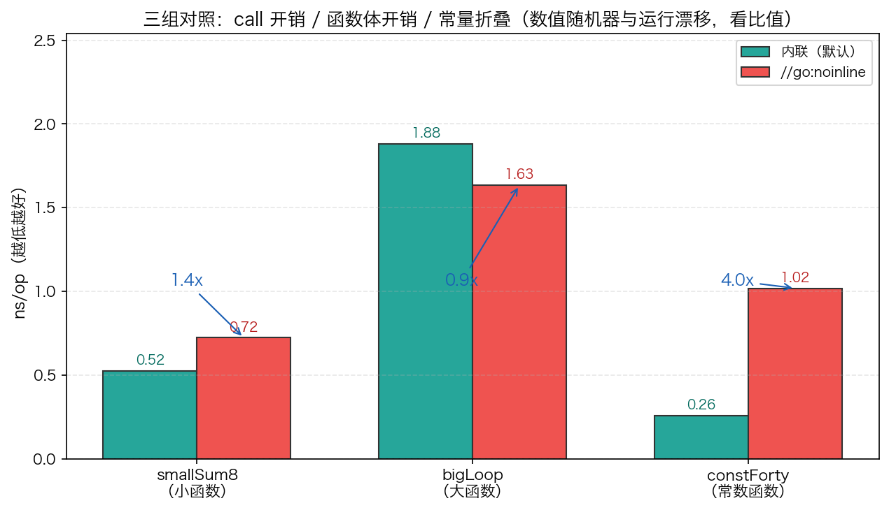

# 23 · 内联优化：编译器怎么决定把函数"抄"进调用点

> 内联是 Go 编译器默认开启的优化：把小函数的函数体直接拷进调用点，省掉 call 的压栈/传参/返回。但编译器只内联"够便宜"的函数——判定标准是一条 **80 分的成本预算**。本实验让编译器自己供词（`-gcflags=-m` 的 `can inline` / `cannot inline` + cost 值），再用三组对照（小函数 / 大函数 / 常数函数）量出内联到底值多少：**~1.1x、~1.0x、~4.3x**——第三组才是内联的真王牌。

## 1. 为什么需要它

函数调用有真实开销：参数入栈/寄存器、call/ret、返回值搬运。内联把被调函数体拷贝到调用点，这笔开销直接消失，更重要的是它打开了跨过程优化的窗口——调用点周围的常量折叠、循环变换、逃逸分析突然能"看穿"函数边界。

但内联不是免费的：函数体会被复制到每一个调用点（二进制膨胀），profile 也难以归属到原函数。所以编译器用成本模型挑三拣四。本项目（`23_inline/`）做两组对照实验回答两个问题：**编译器凭什么收/拒**（用 `-gcflags=-m` 看诊断），以及**内联到底值多少**（用 `//go:noinline` 手动拆掉内联做计时对照）。

## 2. 总览：核心机制一图看懂


> 🌐 **交互版**：[在线打开（GitHub Pages）](https://<user>.github.io/<repo>/internals/23_inline/images/inline.html)
> （或本地打开 [`images/inline.html`](images/inline.html)）。

**心智模型一句话**：编译器扫描每个调用点，给被调函数算一个 cost——**低于 80 预算就拷贝函数体**（`inlining call to …`），随后常量折叠、逃逸分析在调用点上下文里看得更远；超预算（cost 186 > 80）、`//go:noinline` 标记、`defer` 这类硬规则，则保持真调用。整个判定过程可以用 `go build -gcflags=-m` 逐行验证。

## 3. 快速开始

```bash
cd internals/23_inline
go run main.go                          # 文本演示：三组 内联 vs noinline 计时对照
go run main.go -json                    # 输出 JSON 快照（ns/op 与比值）
go build -gcflags=-m main.go            # 看编译器报 can inline / inlining call to
go build -a -gcflags="-m -m" main.go    # -m -m 才报 cannot inline 的完整原因
```

编译器诊断节选（go1.26.5，诊断行是确定的；注意单层 `-m` 只报 `can`，`cannot` 的原因要 `-m -m`）：

```text
./main.go:65:6: can inline constForty
./main.go:37:6: can inline smallSum8
./main.go:43:6: can inline bigLoop
./main.go:74:19: inlining call to smallSum8
./main.go:92:16: inlining call to bigLoop
./main.go:40:6: cannot inline smallSum8NI: marked go:noinline
./main.go:70:6: cannot inline benchSmall: function too complex: cost 186 exceeds budget 80
```

计时对照节选（某次运行的 `-json` 输出；**ns/op 每次运行、每台机器都不同，看比值与趋势**）：

```json
{
  "smallInlineNs": 0.577, "smallNoinlNs": 0.660, "smallRatio": 1.14,
  "bigNs": 1.504, "bigNoinlNs": 1.515, "bigRatio": 1.01,
  "cfInlineNs": 0.221, "cfNoinlNs": 0.946, "cfRatio": 4.28
}
```

## 4. 核心概念

### 4.1 成本预算 80：编译器的斤两秤

内联成本是对函数体 AST 的一次加权估算（近似目标代码指令量），预算 80。本实验各函数的实测 cost：

| 函数 | `-m -m` 诊断 | 结论 |
|---|---|---|
| `constForty` | `can inline … with cost 2` | 极便宜，白送 |
| `smallSum8` | `can inline … with cost 16` | 8 参求和仍在预算内 |
| `bigLoop` | `can inline … with cost 56` | 循环不挡内联，56 < 80 |
| `benchSmall` | `cost 186 exceeds budget 80` | 整段裸循环 benchmark，超预算 |
| `smallSum8NI` | `marked go:noinline` | 显式禁用优先级最高 |
| 含 `defer` 的函数 | `unhandled op DEFER` | 硬规则，直接拒绝 |

注意 cost 不是语句数：一条循环体语句会记好几份（近似 ISA 指令族估算），所以"看着不长"的函数照样可能超 80。

### 4.2 三组实测：内联到底值多少



上图由 `python3 viz.py` 实跑 `go run main.go -json` 生成，数值随机器/运行漂移（±15% 量级），稳定的是三档比值：

1. **小函数 ~1.1x**：call 有真开销，但现代乱序 CPU（OOO）把大部分隐藏了——快，但不神话
2. **大函数 ~1.0x**：函数体本身占满运行时间，call 占比 ≈ 0，内联救不了大函数
3. **常数函数 ~4.3x**：内联的王牌——内联后编译器把 `acc += constForty()` 折叠成 `acc = 42·n`，**整个循环被删掉**

### 4.3 纠正一个常见误解：循环函数也会被内联

很多教材（含本目录旧注释）说"大函数/含循环的函数体量超预算、默认不内联"。实测 go1.26.5 并非如此：`bigLoop` 的 cost 只有 **56 < 80**，诊断明说 `can inline bigLoop`，且在 `benchBig` 里发生了 `inlining call to bigLoop`。"内联救不了大函数"的结论依然成立，但原因是**函数体开销占主导**，而不是"没被内联"——上面 1.01x 的对照正是在"已内联 vs 真调用"之间量出来的。

### 4.4 内联与逃逸/reflect：不是拒绝，而是协作

流传的说法是"参数逃逸、用 reflect 的函数会被拒绝内联"，go1.26 实测（探针程序 + `-m -m`）：

- 返回堆指针的函数照样 `can inline … with cost 11`——**逃逸不挡内联**；关系是反过来的：内联之后逃逸分析在调用点统一判定，小对象更容易留在栈上
- `reflect.ValueOf` 被拒是因为**cost 145 超预算**，属于普通超限而非"reflect 特判"
- 真正的硬规则是少数语法：`defer` → `unhandled op DEFER`，以及 `//go:noinline` 显式禁用

## 5. 关键字段与坑清单

| 命令/标记 | 含义 | 为什么重要 |
|---|---|---|
| `//go:noinline` | 强制该函数不被内联 | 对照实验的开关；也用于保住 profile 归属（见 [22_pprof](../22_pprof/)）、抑制二进制膨胀 |
| `-gcflags=-m` | 编译器优化诊断（单层） | 只报 `can inline` / `inlining call to` |
| `-gcflags="-m -m"` | 两层诊断 | 才会报 `cannot inline` 的完整原因 |
| `-a` | 强制全部重编 | 构建缓存命中时诊断为空，必须加它才稳定复现 |
| `cost … budget 80` | 内联成本与预算 | 判定的唯一硬门槛（defer 等硬规则除外） |

坑清单：

- **别用 `bench(fn)(...)` 泛型/函数值测内联**：函数值调用 ≈ 间接调用，内联直接被掐断，测出来的全是噪音；必须像 `main.go` 这样给每组写裸循环
- **`-gcflags=-m` 的输出会缓存**：第二次构建缓存命中、诊断为空；加 `-a` 强制重编
- **预算单位别数错**：cost 是指令量级估算不是语句数，把整个 benchmark 函数包进去当然超 80
- **看比值不看绝对值**：OOO 流水线会吞掉大部分 call 成本，ns 差异远没有教科书夸张，±15% 的运行间波动是常态
- **fmt 字符串里的裸 `%`** 会变成 `%!`+动词报错占位（如 `%!(MISSING)`）；图表标题写 `ns/op` 就干净

## 6. 文件结构

```text
internals/23_inline/
├── README.md                  # 本文件：原理 + 运行指引 + 面试要点
├── main.go                    # 主教材：三组 内联 vs noinline 的裸循环对照（-json 输出快照）
├── viz.py                     # 数据图脚本：实跑 go run -json → images/inline_ns.png
└── images/
    ├── inline.workflow.json   # 图源：编译器内联决策流程（Typed JSON IR）
    ├── inline.html            # 交互版：可缩放/高亮连线的自包含页面
    ├── inline.svg             # README 内嵌双主题矢量图
    └── inline_ns.png          # 数据图：三组 ns/op 实测对照（matplotlib）
```

## 7. 面试要点

**Q：怎么验证一个函数有没有被内联？**
A：`go build -a -gcflags="-m -m" main.go`。报 `can inline f with cost N` 说明够便宜，调用点出现 `inlining call to f` 才是真的内联了；`cannot inline` 会给出原因（cost 超预算 / marked go:noinline 等）。不加 `-a` 可能因构建缓存什么都不打印。

**Q：哪些函数内联不了？**
A：三类。cost 超过 80 预算（大函数、reflect 这类重操作）；显式 `//go:noinline`；少数硬规则如含 `defer`（`unhandled op DEFER`）。注意"参数逃逸"不在其列——逃逸分析在内联之后进行，内联反而帮助更多对象留在栈上。

**Q：内联明明只是"复制代码"，为什么能带来 4 倍加速？**
A：复制本身省的 call 开销有限（小函数实测 ~1.1x）。数倍加速来自内联解锁的后续优化：函数边界消失后，常量折叠能把 `acc += 42` 的整个循环折叠成 `acc = 42·n`（实测 ~4.3x）。内联是"放大器"不是"加速器"。

**Q：为什么内联不是越多越好？**
A：函数体在每个调用点复制会膨胀二进制、伤害指令缓存；内联后函数在 profile 里"消失"，热点归因变难。所以 `//go:noinline` 是正经调优工具，不是摆设。

**Q：为什么 benchmark 框架/泛型 `bench(fn)` 测不出内联收益？**
A：把函数当值传参后，调用点只能间接调用，编译器无法内联。要测内联必须让调用点静态可见——每组写一段裸循环（`main.go` 的做法）。

## 8. 总结

内联的全部行为可以从"80 成本预算 + 拷贝函数体"推出来：够便宜就内联，省下 call 并解锁跨过程优化；超预算或硬规则就保持真调用。实测三档比值（~1.1x / ~1.0x / ~4.3x）说明它真正的价值在于**给后续优化喂信息**，而不是省那几次压栈。验证方法比结论更值钱：`go build -a -gcflags="-m -m"` 让编译器逐函数供词，比背规则可靠得多。

下一篇 [24_closure](../24_closure/) 看内联的近亲问题：闭包本质上是一个 `funcval` 指令指针加被捕获变量的引用，被捕获的变量为什么会逃逸到堆上。
