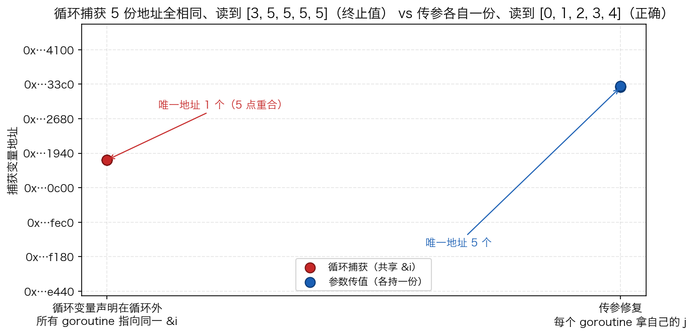

# 24 · 闭包与函数捕获：闭包抓的是「引用」，不是一个拷贝

> Go 闭包捕获变量是**引用捕获**（共享一个盒子），不是值快照。这个语义设计导致两个必学现象：循环里起 goroutine 捕获 `&i` 时所有协程共享同一个盒子（经典 bug），以及被捕获变量被迫逃逸到堆。本实验用 `unsafe.Pointer(&i)` 把"共享 vs 独立"量化成**唯一地址数**（1 个 vs 5 个），再用 `go build -gcflags=-m` 看编译器的逃逸供词——两个数字比讲一百遍概念都管用。

## 1. 为什么需要它

写并发 Go 时几乎人人踩过这个坑：循环里起 5 个 goroutine，每个都打印循环变量，结果输出全是终止值。根源在于闭包捕获的永远是**变量本身**（引用），不是创建那一刻的值——闭包和外部代码共享同一个"盒子"，`x = 99` 之后闭包读到的是 99，不是 10。

这个语义直接推出两个后果：其一，被捕获的变量可能比创建它的栈帧活得久（goroutine 还在跑，函数已返回），栈上无处安放，编译器只能把它 **moved to heap**；其二，循环变量若声明在循环外，整个循环只有这一个盒子，所有闭包共享。程序演示三件事：循环捕获的地址塌缩成 1 个、参数传值修复后变回 5 个、引用捕获让闭包看到外层的后续修改。

## 2. 总览：核心机制一图看懂


> 🌐 **交互版**：[在线打开（GitHub Pages）](https://<user>.github.io/<repo>/internals/24_closure/images/capture.html)
> （或本地打开 [`images/capture.html`](images/capture.html)）。

**心智模型一句话**：闭包是一个 `funcval{fn 指令指针, env 捕获变量引用}` 结构——函数体只有一份，被捕获的变量变成堆上的"盒子"，闭包里存的只是盒子的引用。图中场景一：5 个闭包都存 `&i`，边全部汇聚到同一个堆盒子（唯一地址 1 个，读到 `[5 5 5 5 5]`）；场景二：`go func(j int){…}(i)` 把 i 拷贝进各自的 j，每条边指向自己的盒子（唯一地址 5 个，读到 `[0 1 2 3 4]`）。

## 3. 快速开始

```bash
cd internals/24_closure
go run main.go          # 文本演示：循环捕获 → 传参修复 → 引用捕获
go run main.go -json    # 输出 JSON 状态快照（地址/唯一数/读到值）
```

预期输出（节选；地址每次运行不同，此处用 `0x…` 缩写，程序原样打印十进制 uintptr）：

```text
== 1. 循环变量捕获（声明在循环外，整个循环一个盒子） ====
   地址 [0x…c040 0x…c040 0x…c040 0x…c040 0x…c040] → 唯一 1 个（全共享 &i）
   读到值 [5 5 5 5 5]（大概率重复/终止值）

== 2. 参数传值修复 ==========================
   地址 [0x…4fb8 0x…47b8 0x…3fb8 0x…37b8 0x…57b8] → 唯一 5 个（各持一份）
   读到值 [0 1 2 3 4]（正确）

== 3. 引用捕获 / 共享盒子 ===================
   创建时 x=10 → 之后 x=99 → 闭包读到 99
   两个闭包指向同一盒子：true
```

配套验证逃逸诊断：

```bash
go build -gcflags=-m main.go 2>&1 | grep "moved to heap"
# ./main.go:34: moved to heap: wg
# ./main.go:35: moved to heap: i
# ./main.go:38: moved to heap: mu
# ./main.go:39: moved to heap: next
```

每一步"在看什么"都写在 `main.go` 的注释里；`-json` 快照给出与文本演示一致的机器可读数值。

## 4. 核心概念

### 4.1 闭包 = funcval{指令指针, 捕获变量引用}

编译器把 `func(){ return x }` 编译成一个普通函数（指令指针）加一个 `funcval` 结构头，被捕获的变量不在结构里复制一份，而是以**引用**（地址）挂在环境里。所以闭包和外部代码看到的是同一个盒子：`get := func() int { return x }` 创建时 `x=10`，随后外层 `x=99`，调用 `get()` 返回 **99**；两个闭包捕获同一个 `v`，`&v` 地址相等判定为 **true**。

### 4.2 经典坑：循环变量只有一个盒子

`var i int; for i = 0; i < 5; i++` ——变量声明在循环外，整个循环只有这一个盒子。每个 goroutine 存下的都是 `&i`，等它们真正被调度执行时 `i` 已自增到 5，于是 5 份地址全部相同、读到的全是终止值 `[5 5 5 5 5]`（若调度交错也可能读到 `[3 5 5 5 5]` 这类中途值——这正是数据竞态的现场）。

**Go 1.22 语义变更**：`:=` 在循环内声明的变量（range 与三段式 for 都算）已改为**每迭代一个新变量**，"全部看到终止值"的经典现象在 `:=` 写法下不复存在。但坑没有消失——**声明在循环外**（`var i int; for i = 0; …`）或手动改写循环变量时仍是同一个盒子，老代码迁移时这是真实雷区。本实验特意用"循环外声明"复现经典坑。

### 4.3 修复：参数传值，各自持有一份

`go func(j int) { … }(i)` 把 `i` 的当前值**拷贝**进本迭代的 `j`，5 个 goroutine 各拿一份。实测 5 个地址互不相同（相邻常差 `0x800`，每次运行会变），读到的值正是各自的 `[0 1 2 3 4]`。等价写法还有循环体内 `i := i` 遮蔽拷贝，或直接依赖 Go 1.22+ 的新语义。



上图是 `viz.py` 跑 `go run main.go -json` 后画的实测散点：左列 5 个红点重合成 1 个地址，右列 5 个蓝点各自独立——"共享 vs 独立"就这样变成肉眼可见的数字。纵轴只截取地址末 4 位十六进制，每次运行重新生成、数值都会不同。

### 4.4 逃逸到堆是结果，不是选择

闭包体可能比创建它的栈帧活得久：goroutine 还在跑，外层函数已经返回，栈帧随之销毁——`&i` 无处可搁。编译器的选择只有一个：`moved to heap`。本实验的供词是 `i`、`wg`、`mu`、`next` 全部上堆（`captureFixed` 里被捕获的 `wg` 同样上堆）。逃逸意味着每次这样的闭包创建都伴随堆分配，闭包密集的代码路径就是分配热点。

## 5. 关键字段与坑清单

| 表达式 | 含义 | 为什么重要 |
|---|---|---|
| `func() { … &i }` | 闭包捕获变量引用 | 与外层共享同一盒子，看到后续修改 |
| `go func(j int){…}(i)` | 参数传值拷贝 | 每迭代一份独立变量，是标准修复 |
| `unsafe.Pointer(&i)` | 读变量的真实地址 | 把"共享 vs 独立"量化成唯一地址数 |
| `go build -gcflags=-m` | 逃逸分析诊断 | `moved to heap: i` = 这轮多了一次堆分配 |

坑清单（每条都交过学费）：

- **并发往共享 slice append 会丢更新**：demo 早期让 5 个 goroutine 同时 `append` 到同一切片，数据竞争导致偶发只记下 3-4 个地址（险些误判成"栈复用"）；改成每个 goroutine 写自己的槽位（`slots[j]=…`）数字才稳定——本身就是一个小竞态教训
- **别跨 goroutine 打印地址拼顺序**：多个 goroutine 各自打印 `&i` 时到达顺序随机，判断"共享"只能靠唯一地址数，不能靠排列
- **`-m` 诊断不要 grep 全量**：`go build -gcflags=-m` 的完整输出会把闭包逐行展开淹没重点，聚焦 `moved to heap` + 变量名即可；`-m -m` 才能看到 cost 预算（见实验 23）
- **`sync.WaitGroup` 也会被捕获上堆**：它同样 `moved to heap`，如果让迭代共享并乱序 `Done`，偶发 deadlock；收尾只在循环外 `wg.Wait()` 一次

## 6. 文件结构

```text
internals/24_closure/
├── README.md                      # 本文件：原理 + 运行指引 + 面试要点
├── main.go                        # 主教材：循环捕获 vs 传参修复 vs 引用捕获（-json 输出快照）
├── viz.py                         # 数据图：跑 main.go -json 实测地址散点 → images/closure_addr.png
└── images/
    ├── capture.architecture.json  # 图源：funcval 结构 + 共享盒子 vs 独立拷贝（Typed JSON IR）
    ├── capture.html               # 交互版：可缩放/高亮连线的自包含页面
    ├── capture.svg                # README 内嵌双主题矢量图
    └── closure_addr.png           # 数据图：实测地址分布（matplotlib，每次运行重生成）
```

## 7. 面试要点

**Q：Go 闭包捕获的是值还是引用？**
A：变量（引用捕获）。创建闭包后外层修改变量，闭包读到新值：demo 里创建时 `x=10`，改 99 后闭包读到 99，两个闭包捕获同一变量时地址相等。想拍快照必须显式传参拷贝。

**Q：循环里起 goroutine 打印循环变量，为什么全是最后一个值？怎么修？**
A：变量声明在循环外，整个循环共享一个盒子，所有闭包存的都是 `&i`，执行时 `i` 已是终止值。修复：传参 `go func(j int){}(i)`、循环内 `i := i` 拷贝，或依赖 Go 1.22+ 对 `:=` 循环变量的 per-iteration 语义。

**Q：Go 1.22 之后这个坑还在吗？**
A：`:=` 声明的循环变量已每迭代一份，坑修复了；但**声明在循环外**再 `for i = …` 复用的老代码、或手动改写循环变量的代码仍共享同一个盒子——迁移老代码时要警惕。

**Q：为什么被捕获的变量会逃逸到堆？**
A：闭包可能比创建它的栈帧活得久（被 goroutine 引用、被返回），栈分配的变量随帧销毁就悬空了，编译器只能把它移到堆上。`go build -gcflags=-m` 里 `moved to heap` 是直接证据，也是闭包密集路径的分配热点信号。

**Q：怎么用实验证明"多个闭包共享同一个变量"？**
A：在各闭包内打印 `uintptr(unsafe.Pointer(&i))` 并去重计数：共享时 5 份地址唯一数 = 1，传参拷贝后 = 5。比任何文字描述都硬。

## 8. 总结

闭包的全部行为都能从"funcval + 捕获变量引用"推出来：引用语义是共享盒子的自然结果，逃逸是"闭包比栈活得久"的必然代价，循环变量坑是"整个循环一个盒子"的特例。记住验证方法——`go run main.go` 把唯一地址数打印出来（1 vs 5），`go build -gcflags=-m` 让编译器亲口供认 `moved to heap`，比背结论可靠得多。

下一篇 [25_defer](../25_defer/) 看另一个"延迟但有序"的机制：defer 的 LIFO 执行序，以及它如何改写命名返回值。
