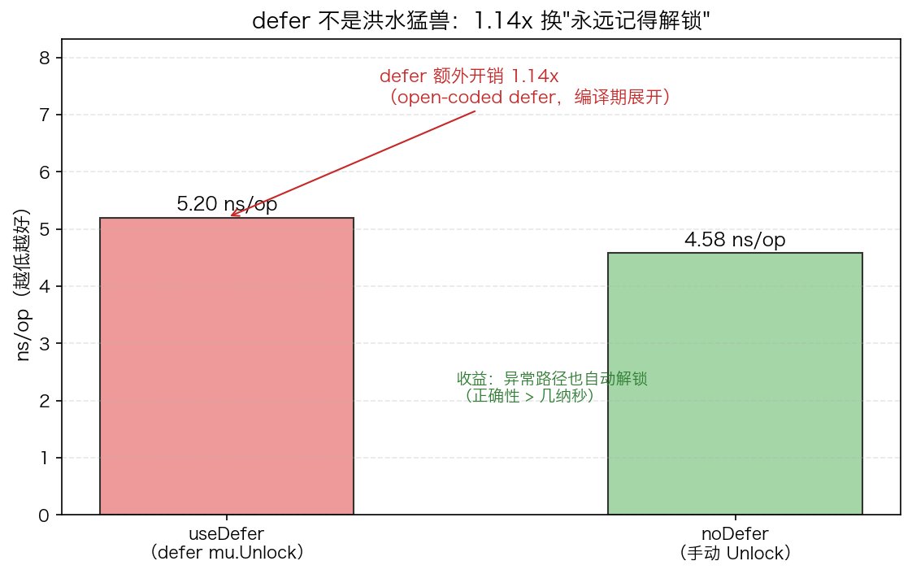

# 25 · defer 底层实现与性能：LIFO 收拢、立即求值、几乎白送的开销

> defer 是 Go 里"看起来最简单、面试最爱问"的关键字：它到底按什么顺序执行？参数是什么时候求值的？每用一次要付多少代价？本实验用 5 条 defer 的求值证据 + defer 与手动 Unlock 的对照实测，把这三个问题变成看得见的输出与数字。

## 1. 为什么需要它

写资源型代码的第一原则是"谁申请谁释放"，但手动释放有两个死角：提前 `return` 会跳过释放语句，panic 更是直接绕过。defer 把"释放"登记在申请处、保证在函数退出时执行，是 Go 处理锁、文件、连接的标准姿势。

但 defer 的行为有三个常见想当然：以为参数是执行时才读（其实是注册时快照）；以为 defer 在 `return` 之后才拿到控制权所以改不了返回值（命名返回值改得到）；以为 defer 很贵所以不敢用（open-coded defer 下几乎白送）。本实验的程序把这三件事全部实证一遍。

## 2. 总览：核心机制一图看懂


> 🌐 **交互版**：[在线打开（GitHub Pages）](https://<user>.github.io/<repo>/internals/25_defer/images/order.html)
> （或本地打开 [`images/order.html`](images/order.html)）。

**心智模型一句话**：defer 语句只是"注册"——三条 defer 依序进栈、参数当场求值；`return` 先把返回值写进返回槽，然后 defer 栈按 LIFO 出栈（C→B→A，最后注册的先执行），此刻才允许改写命名返回值；出栈完毕函数才真正返回。图中 A/B/C 对应 demo 里登记的 1/2/3（demo 实际登记 1→5）。

## 3. 快速开始

```bash
cd internals/25_defer
go run main.go          # 文本演示：LIFO 顺序 → 参数立即求值证据 → 性能对照
go run main.go -json    # 输出 JSON 快照（ns/op 与比值）
```

预期输出（节选，耗时数值每次运行不同）：

```text
  （函数体先打这行；mark 已在登记时执行，值快照进 defer）
  执行(5): 登记时求出 5
  执行(4): 登记时求出 4
  执行(3): 登记时求出 3
  执行(2): 登记时求出 2
  执行(1): 登记时求出 1

== 性能 =============
  useDefer (defer) :     4.97 ns/op
  noDefer (手动)   :     4.40 ns/op
  defer 额外开销   : 1.13x（open-coded defer，几乎白送）
```

注意第一行是**函数体**先打印的，5 条"执行"在它之后才逆序出现——顺序证据和求值证据都在这 6 行里。

## 4. 核心概念

### 4.1 LIFO：后开先关

登记顺序 1→2→3→4→5，返回时打印顺序 5→4→3→2→1，严格逆序。这就是"开连接→开锁→开文件，释放天然反着收"的根据：先申请的资源后释放，依赖关系不会乱。

### 4.2 参数立即求值 = 快照语义

`mark()` 在 `defer` 语句出现的那一刻就执行（log 立即拼满 5 条），真正打印发生在函数返回时。所以 `defer f(x)` 存进栈的是 x 的**快照**，不是执行时才去读；想延迟读变量得包一层闭包 `defer func(){ f(x) }()`。`defer file.Close()` 捕获的是"当前那个 file"，也是同一语义。

### 4.3 return 不是原子操作：命名返回值可被 defer 改写

`return x` 实际分三步：把 x 写入返回槽 → 执行 LIFO 的 defer → 真正返回。命名返回值 `func f() (ret int)` 的 ret 就是返回槽本身，defer 改它有效；匿名返回值在 return 时已拷出，defer 改局部变量改不到返回值。main.go 没演示这段，用最小程序单独验证过（go1.26）：

```go
func anonymous() int { x := 1; defer func(){ x++ }(); return x }  // 返回 1
func named() (ret int) { ret = 1; defer func(){ ret++ }(); return } // 返回 2
```

### 4.4 open-coded defer：为什么"几乎白送"

Go 1.14+ 绝大多数 defer 走 open-coded：编译器在函数返回点直接内联展开要执行的代码（带条件判断哪个 defer 触发），没有堆上链表、没有运行期遍历，开销 ≈ 一个分支判断。只有 defer 出现在 for 循环里（动态数量）、或与 panic/recover 交互等边界场景才退回慢速的 heap defer（运行期 `deferproc`/`deferreturn`）。

实测对照（500 万次循环，mu.Lock + Unlock）：



机器空闲时 defer 额外开销约 1.09–1.13x；首次编译/高负载时会飘到 1.4x 以上——**数据漂移**，但结论稳定：这点代价换"异常路径也一定解锁"是纯赚。

## 5. 关键语义与坑清单

| 写法 | 语义 | 为什么重要 |
|---|---|---|
| `defer f(x)` | x 在注册那一刻求值并快照 | "以为读的是最终值"这类 bug 的根源 |
| `defer func(){ f(x) }()` | 执行时才读 x | 想要"最终值"就包这层闭包 |
| 命名返回值 `(ret int)` | defer 可改写返回槽 | 实测 1 → 2，配合 recover 改错误码常用 |
| 匿名返回值 | 已拷出的副本，改不到 | 与上一行对比是高频考题 |
| `defer p.Close()` | p 是注册时拷贝的指针值 | 之后 `p = nil` 不影响 defer 已捕获的指针 |

坑清单：

- **"逆序"是相对登记顺序**：登记写 1→5，执行才是 5→1。把 defer 顺序写反（5→1），"LIFO" 打出来变成 1→5，看着像违背语义——判断顺序先确认登记顺序
- **输出第一行是函数体打的**：`go run main.go` 里"函数体先打这行"先于全部"执行"行出现，别把首行当成第一条 defer
- **热循环里别放 defer**：不只慢一点——循环内 defer 会退化为 heap defer，且资源积压到整个函数返回才释放（句柄可能爆）
- **benchmark defer 别连着 panic**：open-coded defer 只在无 panic 路径展开；panic 才走的 `deferproc` 链是另一物种，量出来吓自己
- **ns/op 数值会漂移**：多次运行 1.09–1.54x 都见过，结论看比值不看绝对值

## 6. 文件结构

```text
internals/25_defer/
├── README.md                      # 本文件：原理 + 运行指引 + 深入要点
├── main.go                        # 主教材：LIFO + 参数立即求值 + defer vs 手动 Unlock 基准（-json 输出快照）
├── viz.py                         # 数据图脚本：go run main.go -json → images/defer_perf.png
└── images/
    ├── order.sequence.json        # 图源：defer 注册→return→LIFO 收拢时序（Typed JSON IR）
    ├── order.html                 # 交互版：可缩放/高亮连线的自包含页面
    ├── order.svg                  # README 内嵌双主题矢量图
    └── defer_perf.png             # 实测数据图：defer vs 手动 Unlock 对照（matplotlib）
```

## 7. 深入要点

**Q：defer 的执行顺序是什么？参数什么时候求值？**
A：LIFO，后注册的先执行；参数在 `defer` 语句执行那一刻求值并存快照，函数返回时才真正执行函数体。要读"最终值"就包闭包。

**Q：defer 能修改返回值吗？**
A：命名返回值可以——`return` 先赋值返回槽，defer 后执行，实测 `(ret int)` 从 1 改成 2；匿名返回值是已拷出的副本，改不到。recover 改写错误返回就靠这个机制。

**Q：defer 到底多贵？**
A：Go 1.14+ 走 open-coded defer，编译期展开，实测约 1.1x 于手动 Unlock（差值≈一个分支判断）。只有循环内动态 defer 等场景退化成 heap defer 才明显变贵。

**Q：为什么循环体里不该写 defer？**
A：defer 绑定的是函数而不是循环轮次：资源要等整个函数返回才释放，循环大了句柄直接积压；同时退化为 heap defer，更慢。

**Q：手动释放性能更好，为什么还坚持用 defer？**
A：正确性优先——提前 return 和 panic 路径只有 defer 能保证解锁。百万 QPS 的 handler 里一次 defer ≈ 每请求 1ns，无感；真正的热循环才值得手抠。

## 8. 总结

defer 的全部行为都能从"注册即快照 + return 后 LIFO 出栈"推出来：顺序、求值时机、命名返回值改写、open-coded 的白送开销，本实验全部用真实输出验证过。记住方法——`go run main.go` 把证据打出来，比背结论可靠。

下一篇 [26_iface](../26_iface/) 看接口调用的另一笔账：itab 方法表间接寻址为什么挡住了内联，以及直接调用快在哪里。
