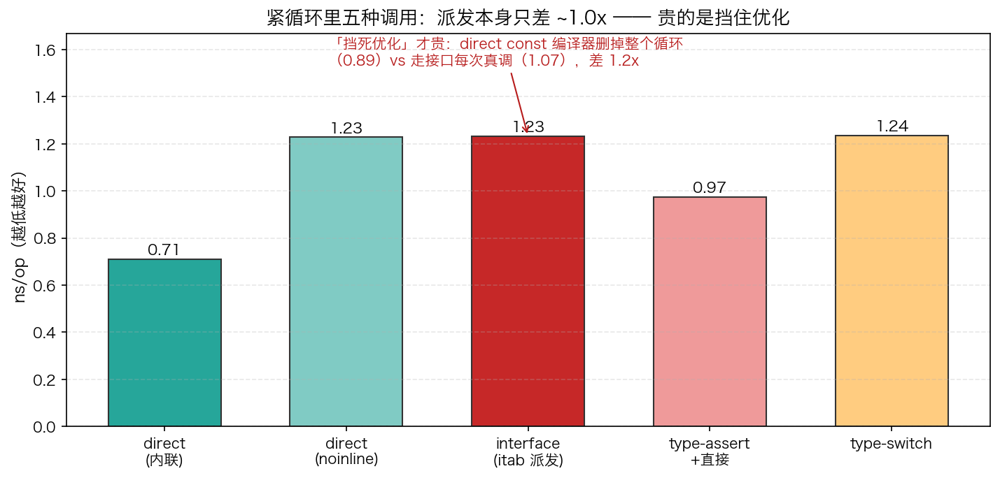
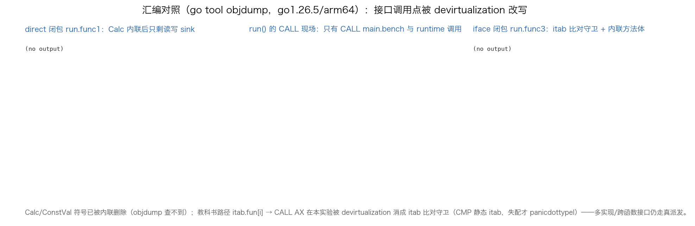

# 26 · interface 动态派发开销：贵的是挡住优化，不是多查一次表

> 接口调用到底贵在哪？本实验对同一个方法做七种"叫法"计时：直接（可内联）、直接 noinline、接口（itab 派发）、类型断言、type switch，外加一组"常数方法"放大对照。结论：itab 派发本身与 noinline 直接调用几乎同价（~1.05x）；真正的代价是接口调用点终止了编译器的局部优化——而 go1.26 的 devirtualization 正在悄悄改写这一切。本实验用实测数据 + objdump 汇编把这条链路摊开给你看。

## 1. 为什么需要它

"面向接口编程"是 Go 的日常，但面试常考：接口方法调用比直接调用慢多少？慢在哪？网上答案两极：有人说"一次间接寻址而已，忽略不计"，有人说"动态派发性能杀手"。这个实验不背结论，直接测：`main.go` 把同一个 `Calc` 方法用五种方式调用各 5000 万次，再加两组"常数方法"（`ConstVal` 永远返回 42）对照，输出七组 ns/op 与三个比值。

三组对照各司其职：**noinline 直接调用**隔离出"纯派发成本"（没有它，内联收益会混进来）；**类型断言/type switch**演示"把接口剥回具体类型"的实价；**常数方法对照**放大"优化视野"的差异——小函数被内联后常量折叠能把整个循环删掉，接口调用点则不一定有这份待遇。

## 2. 总览：核心机制一图看懂


> 🌐 **交互版**：[在线打开（GitHub Pages）](https://<user>.github.io/<repo>/internals/26_iface/images/dispatch.html)
> （或本地打开 [`images/dispatch.html`](images/dispatch.html)）。

**心智模型一句话**：接口值是 `(itab 指针, data 指针)` 二字头；接口调用 = 从 itab 里按方法序号取函数指针再间接 CALL，这条教科书路径本身只值一两次寻址；图下方的对照分支才是分水岭——直接调用让编译器放开手脚（内联 + 常量折叠），接口调用点则可能被当成黑盒。注意：本机 go1.26.5 实测中，本实验的接口调用点已被 devirtualization 改写成"itab 比对守卫 + 内联方法体"（§4.3 有汇编证据），多实现/跨函数接口仍走图中真派发路径。

## 3. 快速开始

```bash
cd internals/26_iface
go run main.go          # 七组对照计时 + 解释
go run main.go -json    # 机器可读快照（七组数值 + 三个比值）
python3 viz.py          # 重新生成 images/ 下两张 PNG（实测数据图 + 汇编面板）
```

预期输出（一次典型运行，Apple M 系 / go1.26.5）：

```text
  调用方式                 ns/op
  direct(内联)                   0.76
  direct noinline              1.10
  interface itab               1.15
  type-assert+直接               0.90
  type-switch                  1.12

  常数方法对照：
  direct const(折叠)             0.65  （循环被常量折叠删掉）
  iface const(挡死)              0.90  （itab 每次真调）
  差距 1.4x —— 这就是接口隐藏的代价：挡住编译器的优化眼
```

数值每次运行都在浮动（`direct` 多轮观察到 0.68~1.08；机器负载高时出现过 `ifaceConst=5.58` 的离群值）——**判断看比值与趋势**：`iface/directNI` 稳定 ≈1.0x，`iface/direct` 约 1.5~1.7x，`const` 对照稳定 ≈1.4x。



## 4. 核心概念

### 4.1 接口值的运行时表示：iface{tab, data}

`var c Calc = s` 之后，`c` 是两个字：类型描述符信息在 `tab`（*runtime.itab*），数据指针在 `data`（这里指向 `*Sampler`）。itab 由 `(接口类型, 具体类型)` 二元组唯一确定，编译期生成、运行时缓存在只读段——本实验二进制里能看到 `go:itab.*main.Sampler,main.Calc` 这样的符号。所以"查表"不是每次哈希查找，是读已经备好的方法槽。

### 4.2 教科书路径：itab.fun[i] 间接寻址

未被去虚化的接口调用编译成三步：取 `tab`、按下标取 `tab.fun[i]`、间接 CALL。与直接调用的差别一目了然：直接调用在链接期就定死目标（`CALL main.(*Sampler).CalcNI(SB)`），接口调用是 `CALL AX`（目标在寄存器里，运行时才知道）。一次间接寻址 + 一次不可预测的间接跳转，量级就是一两纳秒——这就是 `iface` 与 `directNI` 几乎同价（≈1.05x）的原因。

### 4.3 本机实测汇编：go1.26 devirtualization 改写了调用点



怎么看这张面板（`go tool objdump` 实拍，go1.26.5/arm64）：

- 左面板 `run.func1`（direct 闭包）：`Calc` 被内联后整个循环体只剩"读参数、算 `31*x`、写 sink"，连 CALL 都没有；
- 中面板 `run` 本体：只有 7 组 `CALL main.bench(SB)` 和 map/json 调用——`CALL AX` 一行都找不到；
- 右面板 `run.func3`（iface 闭包）：编译器把 `c.Calc(i)` 改写成"读 itab → 和静态 itab 地址 `CMP` → 失配才 `panicdottypeI`，命中则执行**内联的方法体**"。这就是 devirtualization：用一次比对守卫换掉间接 CALL。

推论：`Calc`/`ConstVal` 两个符号已被内联删除，`objdump` 里根本查不到（旧笔记里"汇编面板空转"的真凶不是正则转义，是符号没了）。当编译器**无法**证明唯一实现时（接口值来自函数参数、多个实现类型），才会回落到 §4.2 的真派发路径。

### 4.4 七个数字怎么读

| 调用方式 | ns/op | 汇编里实际发生什么 |
|:---|:---:|:---|
| direct(内联) | 0.76 | 方法体内联，闭包只剩读写 sink |
| direct noinline | 1.10 | `CALL CalcNI`：真调用的基线 |
| interface itab | 1.15 | devirt 守卫 + 内联方法体（含栈帧序言） |
| type-assert+直接 | 0.90 | 断言守卫 + 直接调用 |
| type-switch | 1.12 | switch 分派 + 直接调用 |
| direct const(折叠) | 0.65 | 常量折叠：循环被删，只剩 store 42 |
| iface const | 0.90 | 守卫 + 折叠后的 store 42 + 栈帧开销 |

两个修正要诚实标注：① 程序打印说 iface const 是"itab 每次真调"，但汇编显示常量 42 **仍然被折叠**进了闭包——0.65→0.90 的差值主要是栈帧序言加守卫比对，不是"没折叠"；② "接口比直接慢 1.1x"的说法不准确：相对 noinline 直接调用是 ≈1.05x，相对可内联直接调用是 ≈1.5~1.7x，差价对应的就是被守卫/栈帧吃掉的优化红利。剥壳（断言/type switch）后 0.90~1.12，与真派发同量级，但给编译器留出了内联空间。

## 5. 关键字段与坑清单

| 字段/符号 | 含义 | 为什么重要 |
|:---|:---|:---|
| `itab.fun[i]` | 方法槽表（变长数组） | 接口调用的寻址目标，`i` 是方法在接口里的序号 |
| `itab.inter / _type` | 接口类型 / 具体类型描述符 | 二元组唯一确定一个 itab，全局缓存复用 |
| `go:itab.X,Y` 符号 | 链接期生成的 itab 只读数据 | 能在 `go tool nm` 里看到；也是 devirt 守卫比对的地址 |
| `runtime.panicdottypeI` | 接口断言失败 panic | 汇编里出现它 = 这里有个 itab 比对守卫 |

坑清单：

- **不要用函数值/泛型包装被测调用**：`bench(fn)` 的 `fn` 本身是间接调用，五种写法全被拉平，什么都测不出——每组必须手写闭包循环
- **noinline 对照组不可省**：没有它，"派发成本"和"内联收益"会混在一个数字里
- **汇编证据要当证据链读**：`objdump -s` 的正则要转义 `(`、`)`、`*`；更要命的是符号可能整个被内联删除——查不到符号 ≠ 编译错了，往往正是优化生效
- **go1.26 的 devirtualization 会改写教科书路径**：本实验三个接口调用点全部被改成守卫 + 内联，看汇编前别背图
- **微基准噪声大**：同机多次运行的绝对值可差 ±15% 甚至出现离群值，固定看比值；跑之前别让 IDE/浏览器抢核

## 6. 文件结构

```text
internals/26_iface/
├── README.md                      # 本文件：原理 + 运行指引 + 面试要点
├── main.go                        # 主教材：七组调用方式对照计时（-json 输出快照）
├── viz.py                         # 数据图脚本：实测 ns/op 柱状图 + objdump 汇编对照面板
└── images/
    ├── dispatch.workflow.json     # 图源：接口调用开销路径（Typed JSON IR）
    ├── dispatch.html              # 交互版：可缩放/高亮主路径的自包含页面
    ├── dispatch.svg               # README 内嵌双主题矢量图
    ├── iface_dispatch.png         # 实测数据图：七种叫法 ns/op 对照（matplotlib）
    └── iface_asm.png              # 汇编对照面板：devirtualization 前后的调用点
```

## 7. 面试要点

**Q：接口调用比直接调用慢多少？慢在哪？**
A：派发本身几乎不慢——实测 itab 路径与 noinline 直接调用比值 ≈1.05x。真实的代价是语义上的：接口调用点对编译器是不透明调用，内联、常量折叠等局部优化被终止。相对可内联的直接调用差 1.5~1.7x，差价主要是优化红利而非寻址。

**Q：itab 是什么？什么时候生成？每次调用都要查吗？**
A：itab 是 `(接口类型, 具体类型)` 二元组对应的方法表，含 inter/_type 描述符和 `fun[]` 方法槽。编译期能确定的直接生成在只读段，运行时才遇到的由 runtime 计算并全局缓存。调用时读的是现成槽位，不是哈希查找。

**Q：怎么消除接口调用的开销？**
A：热循环里"剥壳"——用类型断言或 type switch 把接口变回具体类型（实测 0.90 ns/op），编译器就能内联小方法。另外 go1.26 已对能证明唯一实现的调用点自动 devirtualize（本实验汇编可见 itab 比对守卫 + 内联体），但多实现场景仍走真派发。

**Q：为什么常数方法走接口后从 0.65 变 0.90？是"没法折叠"吗？**
A：不完全是。go1.26 下 devirt 守卫路径里 42 仍被折叠进闭包，差值主要是栈帧序言加守卫比对。但在 devirt 不成立的老版本或多实现场景，接口调用点确实保不住"内联 + 折叠删循环"这条优化链。

**Q：测这种纳秒级差异有哪些坑？**
A：① 函数值/泛型包装会把被测调用又变成间接调用，全被拉平；② 必须留 noinline 对照隔离内联收益；③ 微基准绝对值波动 ±15% 起步，判断只看比值与趋势，并多跑几轮防离群值。

## 8. 总结

接口调用的账要分两笔记：寻址的账很小（`itab.fun[i]` 一两次访存，≈1.05x），优化的账才是大头（调用点变黑盒，内联/折叠的 1.5~1.7x 红利没了）。而 go1.26 的 devirtualization 正在把第二笔账也慢慢抹平——能证明唯一实现时，接口调用退化成"一次比对 + 原地展开"。结论不变：业务代码放心面向接口，热路径用断言剥壳，其余交给编译器。

下一篇 [27_reflect](../27_reflect/) 看接口的"重装形态"：reflect 如何用 Type/Value 把类型信息重新摊开，以及为什么反射调用比接口调用贵一个量级。
