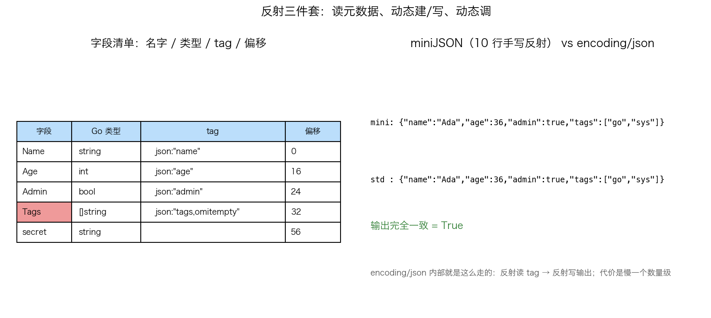

# 27 · reflect 底层：Type 与 Value 的一次动态调用闭环

> 序列化库为什么能"一份代码吃所有类型"？答案是反射：`reflect.Type` 是类型元数据、`reflect.Value` 是运行时值容器。但它有两堵墙——只读的 Value 写不进数据、未导出的字段完全不可见。本实验用一份 `User` 结构体把 TypeOf → New/Set → Call → 手写 miniJSON 对拍串成闭环，让每一堵墙都撞得明明白白。

## 1. 为什么需要它

`encoding/json` 能把任意 struct 变成 JSON，你却写不出一个"接受任意类型"的函数——因为标准库用的是反射，而大多数人只背过"反射慢"，没见过它到底慢在哪、边界在哪。本实验回答三个问题：**反射能读到什么**（字段/tag/偏移）、**能改什么**（只有可寻址的 Value）、**代价是什么**（每步边界检查 + 装箱拆包）。最后手写 10 行 mini JSON 序列化器与 `encoding/json` 对拍，输出逐字节一致——原理不神秘。

## 2. 总览：核心机制一图看懂


> 🌐 **交互版**：[在线打开（GitHub Pages）](https://<user>.github.io/<repo>/internals/27_reflect/images/flow.html)
> （或本地打开 [`images/flow.html`](images/flow.html)）。

**心智模型一句话**：Type 线只读（读说明书），Value 线分两层（`ValueOf` 只读、`New→Elem` 才可写），两线在 miniJSON 汇合——Type 给字段名和 tag，Value 给字段值。图中红色节点是反射到不了的地方：未导出字段。

## 3. 快速开始

```bash
cd internals/27_reflect
go run main.go          # 文本演示：TypeOf → New+Set → Call → 对拍
go run main.go -json    # 输出 JSON 快照（字段表/调用结果/两份 JSON）
python3 viz.py          # 重新生成数据图 images/reflect_json.png
```

预期输出（节选）：

```text
User, Kind=struct, 5 字段
  Name     string   tag=json:"name"            off=0
  Age      int      tag=json:"age"             off=16
  secret   string   tag=                       off=56
  未导出字段 secret：CanInterface=false，反射看不到
== MethodByName.Call =====
  Dr. Ada
  mini: {"name":"Ada","age":36,"admin":true,"tags":["go","sys"]}
  std : {"name":"Ada","age":36,"admin":true,"tags":["go","sys"]}
  一致：true
```

## 4. 核心概念

### 4.1 Type：编译期布局的运行时投影

`TypeOf(u)` 返回的 `Name=User, Kind=struct, 5 字段` 全部来自编译器生成的类型描述符——反射只是"读说明书"。`StructField.Offset` 原样暴露内存布局：Name=0 / Age=16 / Admin=24 / Tags=32 / secret=56（string 16 字节、bool 占 1 再被下一个 8 对齐，与 [17_align](../17_align/) 互为印证）。

### 4.2 Value 的两层：只读与可寻址

`ValueOf(u)` 拿到的是"只读快照"，`CanSet=false`，写不进任何字段。想写必须走指针链：`reflect.New(T)` 得到指针 Value，`.Elem()` 解引用后才**可寻址**，`SetString/SetInt/Set` 才有意义——图里 `New → Elem` 那条主干边。

### 4.3 动态调用与方法表

`MethodByName("FullName").Call([]Value{"Dr. "})` 返回 `Dr. Ada`：运行时按名字查方法表 → 构造调用帧 → 装箱参数、拆包返回值（内含 recover 转 panic，语义与直接调用等价）。这就是"慢一个数量级"的来源：一次反射调用 ≈ 一整个调用帧的构造加拆包。

### 4.4 miniJSON 对拍：原理不神秘



10 行手写的 `miniJSON` 按同样的三板斧工作：`NumField` 遍历 → `Tag.Lookup("json")` 取键名 → 按 `Kind` 分派写出。与 `encoding/json` 输出逐字节一致（`一致：true`）。注意 `secret` 被跳过——先判 `CanInterface()` 是生死线。

## 5. 关键字段与坑清单

| 字段/方法 | 含义 | 为什么重要 |
|---|---|---|
| `t.Field(i).Offset` | 字段在 struct 内的字节偏移 | 编译期定死，反射白送的内存布局信息 |
| `v.CanSet()` | 是否可写 | 只有 `New→Elem` 链条上的 Value 才为 true |
| `v.CanInterface()` | 能否安全取回 interface | 未导出字段的门禁，强取会 panic |
| `Tag.Lookup("json")` | 安全读 tag | `Get` 遇空 tag 无法区分"没写"和"写空" |

坑清单：

- `Field(i)` 拿到未导出字段后直接 `.Interface()` 会 panic——miniJSON 里第一个踩中的就是它
- Slice 字段要整块 `Set(reflect.ValueOf(...))`，不能逐个 `Index().Set`（非可寻址容器）
- `Lookup` 而非 `Get` 读 tag，并自己拆 `,omitempty`（`strings.Split(tag, ",")[0]`）
- 批量数据别用 `Call` 逐元素调：宁可构一个切片一次反射，或干脆代码生成

## 6. 文件结构

```text
internals/27_reflect/
├── README.md                 # 本文件：原理 + 运行指引 + 面试要点
├── main.go                   # 主教材：TypeOf → New/Set → Call → miniJSON 对拍（-json 快照）
├── viz.py                    # 数据图：字段表 + 对拍结果（实测绘制，输出到 images/）
└── images/
    ├── flow.workflow.json    # 图源：reflect Type/Value 双线流水线（Typed JSON IR）
    ├── flow.html             # 交互版：自包含单文件，可缩放/切换主题
    ├── flow.svg              # README 内嵌双主题矢量图
    └── reflect_json.png      # 实测数据图：字段/tag/偏移表 + 两份 JSON 对拍
```

## 7. 面试要点

**Q：为什么 `ValueOf(u)` 写不了字段，`New+Elem` 就能写？**
A：`ValueOf(u)` 持有的是 u 的拷贝且不可寻址，写它没有意义；`New` 分配了真实内存，`Elem()` 解引用后 Value 记录了地址，`CanSet` 才为 true。

**Q：反射能访问未导出字段吗？**
A：读结构信息（名字/类型/偏移）可以，但 `Interface()`/`Set` 都被 `CanInterface`/`CanSet` 双重拦截——语言级围墙，没有合法后门。

**Q：反射慢在哪？**
A：每步带边界检查（Kind 分派/CanSet/CanInterface），参数装箱成 `[]reflect.Value`、返回值拆包，一次 `Call` 约等于构造一整个调用帧；所以编码库常慢一个数量级。

**Q：miniJSON 与 encoding/json 的差距说明什么？**
A：说明 json 包没有魔法——就是"反射读 tag + 按 Kind 写输出"；差别在健壮性（嵌套/循环指针/自定义 Marshaler）与性能优化。

**Q：怎么降低反射的代价？**
A：缓存 `Type`/字段信息复用、批量一次反射、或用代码生成在编译期展开（做不到运行时动态时优先选后者）。

## 8. 总结

反射 = 读 Type 的说明书 + 操作受门禁看管的 Value：读便宜、写要可寻址、调用要建帧、未导出进不去。10 行 miniJSON 对拍证明 encoding/json 的核心循环你也能写——理解边界比记住"反射慢"有用得多。

下一篇 [28_trace](../28_trace/) 不再猜调度行为：用 `runtime/trace` 的时间线亲眼看 goroutine 卡在哪。
