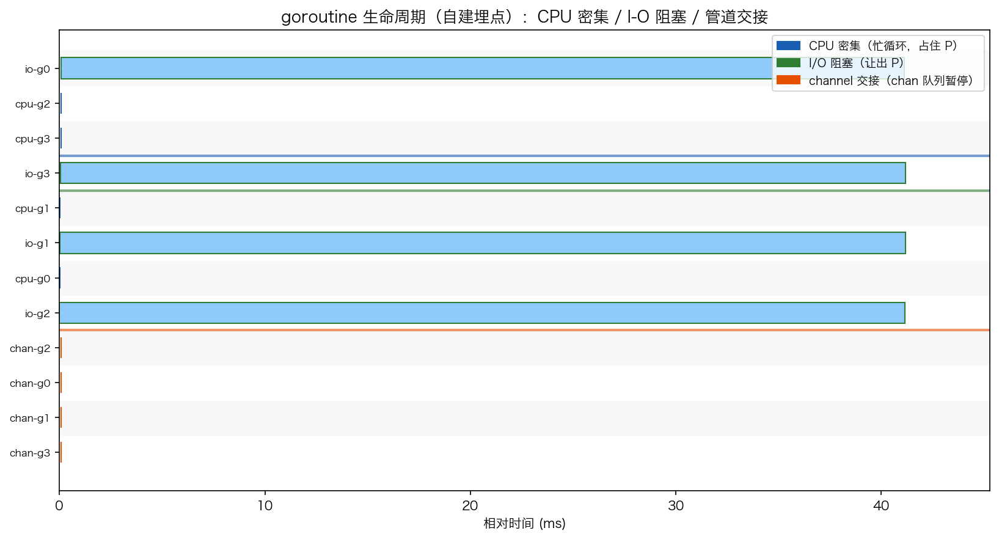
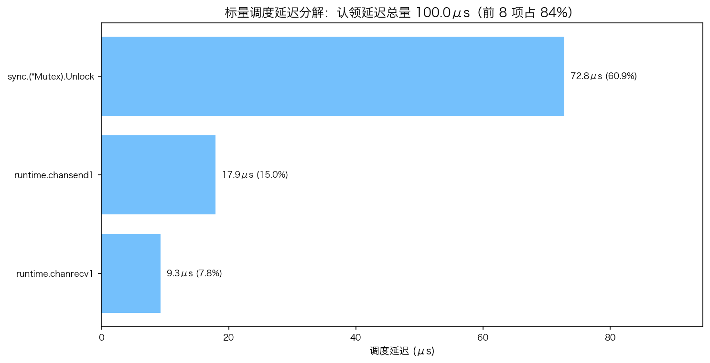

# 28 · 调度器 Trace 分析：用 runtime/trace 看清三类 goroutine 到底卡在哪

> `top` 和 CPU profile 只能告诉你"谁在烧 CPU"，回答不了"谁在等、等多久、被谁卡住"。`runtime/trace` 记录一次运行里所有 goroutine 的创建、就绪、阻塞、运行、退出，形成完整调度轨迹，是调度器的"事后心电图"。本实验录一段混合工单：4 个 CPU 密集 goroutine + 4 个模拟 I/O（真读文件+睡眠）+ 4 对 producer/consumer 用 channel 交接，再用 `go tool trace` 出调度延迟画像，同时用自建埋点把 goroutine 生命周期画成泳道图。

## 1. 为什么需要它

CPU profile 对"等待"几乎是盲的：一个 goroutine 阻塞在 channel 上时，它根本不在采样栈里，profile 只显示"没人用 CPU"。要回答"这 40ms 到底花在哪"，需要调度器视角的事件流——谁何时就绪、何时真正上 P、阻塞原因是什么。`runtime/trace` 就是这份数据的官方出口：`trace.Start` 后每个调度事件都带（时间戳, goroutine, P, 原因）记进 buffer，`trace.Stop` 落盘成 trace 文件。

## 2. 总览：核心机制一图看懂


> 🌐 **交互版**：[在线打开（GitHub Pages）](https://<user>.github.io/<repo>/internals/28_trace/images/trace.html)
> （或本地打开 [`images/trace.html`](images/trace.html)）。

**心智模型一句话**：`trace.Start(f)` 到 `trace.Stop` 之间是一段"带时间戳的行车记录仪"，中间所有 goroutine（CPU 忙循环、I/O 阻塞、chan 交接）的调度事件全部进 buffer，Stop 后用 `go tool trace` 离线回放成时间线 / GC / 阻塞视图。注意 Stop 必须排在 `wg.Wait` 之后，否则任务没跑完文件就不完整。

## 3. 快速开始

```bash
cd internals/28_trace
go run main.go          # 录制 trace 并打印埋点统计（trace 文件写入系统临时目录）
go run main.go -json    # 输出 JSON 快照（埋点事件 + trace 文件路径）
go tool trace <打印出的 trace 路径>   # 浏览器交互式时间线/GC/阻塞视图
```

预期输出（节选，路径每次运行不同）：

```text
trace 文件：/var/folders/.../trace3411224687.out
goroutine 事件数：32（4 类 × 8 个 goroutine × 2 个相位）
提示：go tool trace /var/folders/.../trace3411224687.out（浏览器交互式）
```

`-json` 快照里的自建埋点（相对时间）：io 任务单次历时 ~40.8ms（读文件 + Sleep 40ms），cpu/chan 任务的埋点历时都接近 0——因为埋点只量"墙钟在任务里"的时间，chan 交接的等待发生在 `<-ch`/`ch <-` 阻塞点内部，这正是要用 trace 才能拆开的部分。

## 4. 核心概念

### 4.1 录制边界：Start/Stop 之间的才是你的

`trace.Start` 后所有调度事件都进 buffer，包括不相关的；`trace.Stop` 落盘。所以要圈定业务区间：Start → `wg.Wait` → Sleep(10ms) 让尾部事件落袋 → Stop。写文件用 `os.CreateTemp` 拿可写路径（直接写 `/tmp` 固定路径在 macOS 沙箱会 EACCES）。

### 4.2 三类任务的调度形态



自建埋点画的墙钟泳道：io 条带长约 40ms 且错峰（睡 40ms 让出 P）；cpu 与 chan 的条带短到几乎看不见——不是它们快，而是它们的"卡"发生在埋点看不见的调度事件里。trace 时间线视图里三者形态完全不同：CPU 任务是连成片的绿色 Running 块；I/O 是"拉起-就绪-睡下"的锯齿；chan 任务频繁在 Runnable/阻塞间切换。

### 4.3 调度延迟画像：-pprof=sched



`go tool trace -pprof=sched` 把 trace 里 goroutine 从"就绪到被调度"的等待时间按栈聚合成二进制 pprof，再喂 `go tool pprof -top` 解析。本次实测（总量 ~110μs，每次运行波动）：

```text
      flat  flat%   sum%        cum   cum%
   50.75us 45.97%        runtime.chanrecv1     <- 消费者接收侧，最大单项
   38.02us 34.43%        sync.(*Mutex).Unlock  <- hchan 锁
    6.47us  5.86%        runtime.chansend1     <- 生产者发送侧
```

channel 相关合计 ~86%：send/recv 都要先抢 `hchan` 锁再入队/出队，无缓冲交接还必须唤醒对端才能继续——所以 chan 是调度延迟一号位，但这通常是"正确的慢"（交接语义的固有代价），想降就减少交接次数（批量/缓冲）。CPU 密集任务全程 `Runnable→Running` 自占 P，在 sched profile 里近乎为 0；真正能逼停它的是 sysmon 的 ~10ms 抢占。

### 4.4 自建埋点补 trace 的盲区

trace 工具告诉你"调了谁、等了谁"，自建时间戳告诉你"每件事墙钟花了多久"。两者互补：sched profile 对 I/O 睡眠近乎盲视（它不产生"就绪等待"，直接让出 P），40ms 的墙钟只有埋点能量出来；反过来 chan 内部的等待分布只有 trace 能拆。

## 5. 关键字段与坑清单

| 命令/字段 | 含义 | 为什么重要 |
|---|---|---|
| `trace.Start(f)/Stop` | 录制边界 | Stop 必须在 `wg.Wait` 之后，否则文件不完整 |
| `go tool trace <file>` | 浏览器交互式 UI | 直接跑会弹浏览器；纯脚本要走 `-pprof=` 离线模式 |
| `go tool trace -pprof=sched` | 调度延迟 profile（二进制） | 输出不是文本表，要再喂 `go tool pprof -top` |
| `os.CreateTemp` | 临时文件可写路径 | 写 `/tmp` 固定路径在 macOS 沙箱会 EACCES |
| 埋点 `{kind,id,phase,tsMs}` | 自建生命周期事件 | `UnixNano()/1e6` 得 ms；锁保护 append 防并发写乱序 |

坑清单：

- pprof `-top` 的 flat 列带单位 `us`（如 `28.54us`），直接 `float()` 会 ValueError——先去掉单位再转（本实验 viz.py 已处理）
- `trace.Start` 之后所有调度都被记录，`go run` 子进程也要等 Stop 落盘才退出，不然文件不完整
- 埋点墙钟只量"在任务函数里"的时间：chan 交接的等待在 `<-ch` 内部，埋点显示 0 不代表没等
- main.go 打印的"4 类 × 8 个 goroutine"是笔误：实际是 3 类共 16 个 goroutine、32 个相位事件（cpu×4 + io×4 + producer/consumer×8）
- 地址/路径/延迟数值每次运行都变，对比实验要用同一台机器多次取趋势，别抠单次数字

## 6. 文件结构

```text
internals/28_trace/
├── README.md                  # 本文件：原理 + 运行指引 + 面试要点
├── main.go                    # 主教材：三类任务 + runtime/trace 录制 + 自建埋点（-json 输出快照）
├── viz.py                     # 数据图：读 -json 快照与 sched profile，生成两张 PNG
└── images/
    ├── trace.workflow.json    # 图源：trace 使用流（录制→落盘→分析，Typed JSON IR）
    ├── trace.html             # 交互版：可缩放/高亮连线的自包含页面
    ├── trace.svg              # README 内嵌双主题矢量图
    ├── trace_timeline.png     # 实测数据图：goroutine 生命周期泳道（自建埋点）
    └── trace_sched.png        # 实测数据图：sched profile 调度延迟分解
```

## 7. 面试要点

**Q：runtime/trace 和 pprof 有什么区别？什么时候用哪个？**
A：pprof 采样"谁在占 CPU"（等待中的 goroutine 不在样本里）；trace 记录调度事件流，能回答"谁在等、等多久、被谁阻塞"。CPU 热点用 pprof，延迟/卡顿归因用 trace，两者互补。

**Q：`-pprof=sched` 输出的调度延迟是什么？**
A：goroutine 从"就绪（如 chan 对端唤醒它）"到"真正被放上 P 执行"的等待时间，按调用栈聚合。它衡量调度系统的认领延迟，不是任务本身的耗时。

**Q：为什么本实验里 channel 是调度延迟的大户？这是坏事吗？**
A：无缓冲 chan 的 send/recv 要抢 `hchan` 锁，且交接必须双方会合、唤醒对端后对方还要排队等 P——实测 chan 相关占 ~86%。这是交接语义的"正确的慢"；要降延迟就减少交接次数（批量、加缓冲）而不是换掉 chan。

**Q：为什么 CPU 密集任务在 sched profile 里延迟近乎 0？**
A：它一直在 Running，从不进入就绪队列等待别人唤醒；唯一的打断来自 sysmon 约 10ms 的抢占。所以"没有调度延迟"≠"没有卡顿"，要看它是不是把 P 占死了。

**Q：怎么量化一个 I/O 型 goroutine 的耗时？sched profile 能看到吗？**
A：看不到——I/O 阻塞是直接让出 P 的系统调用，不产生"就绪等待"，对 sched profile 近乎盲视。要用墙钟埋点或 trace 时间线视图里 goroutine 的阻塞段来量。

## 8. 总结

trace 是调度器的行车记录仪：Start/Stop 圈定区间，事件流回放成时间线；`-pprof=sched` 把"谁制造了等待"按栈排名——本实验实测 channel 交接占绝对大头，CPU 任务零延迟，I/O 睡眠藏在墙钟里。配一套自建埋点，"调了谁"与"花了多久"两个视角就齐了。

下一篇 [29_leak](../29_leak/) 看调度的反面教材：goroutine 泄漏——发送方永久阻塞在无人读的 channel 上，GC 为什么救不了它。
