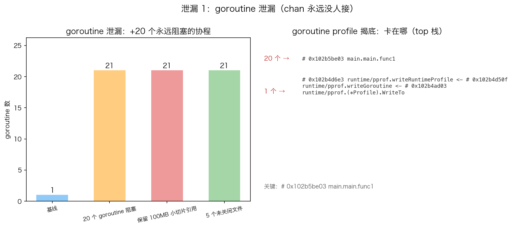

# 29 · 内存泄漏检测：Go 没有"真泄漏"，只有"该回收却收不回"

> Go 有 GC，但照样有"泄漏"——准确说是**该被回收的对象被一个还活着的引用钉住**：一个永久阻塞的 goroutine、一块被 16 字节小切片背刺的 100MB 数组、5 个忘了 Close 的文件。本实验把这三种泄漏亲手造出来，再用 `runtime.NumGoroutine`、`MemStats`、`runtime/pprof` 三件取证武器让它们现形。

## 1. 为什么需要它

GC 只回收**不可达**的对象。只要引用链上有一个"永不满足的阻塞点"或一个被遗忘的引用，内存和 goroutine 就永远下不去——而且 `heap`、goroutine 数、fd 各自只暴露其中一种泄漏，单看一个指标会完全漏判。程序演示三件事：造出三种典型泄漏、逐阶段快照对比、写 profile 文本快照拿到"现场"。

## 2. 总览：核心机制一图看懂


> 🌐 **交互版**：[在线打开（GitHub Pages）](https://<user>.github.io/<repo>/internals/29_leak/images/leak.html)
> （或本地打开 [`images/leak.html`](images/leak.html)）。

**心智模型一句话**：goroutine 泄漏 = 协程永久阻塞在无人接的 channel 上，阻塞点让"协程 + 栈 + 引用对象"整条引用链保持可达，GC 只能标记存活、无法回收。图中主路径是泄漏成因，下方三个节点是三种解除方式（close / 带缓冲 / ctx 取消），右下是 pprof 取证结果。

## 3. 快速开始

```bash
cd internals/29_leak
go run main.go          # 文本演示：四个阶段快照 + profile 路径
go run main.go -json    # 输出 JSON 快照（phases/leakedChans/leakedFiles）
```

预期输出（节选；HeapAlloc 每次运行有零点几 MB 浮动，profile 路径每次不同）：

```text
基线                     goroutine=1   HeapAlloc=   0.3MB
20 个 goroutine 阻塞      goroutine=21  HeapAlloc=   0.3MB
保留 100MB 小切片引用        goroutine=21  HeapAlloc= 100.3MB
5 个未关闭文件               goroutine=21  HeapAlloc= 100.3MB

goroutine profile: /var/folders/.../leak_*.prof_goroutine.pprof
heap profile: /var/folders/.../leak_*.prof_heap.pprof
```

## 4. 核心概念

### 4.1 泄漏一：goroutine 卡在没人接的 channel

```go
ch := make(chan struct{})   // 无缓冲，也永远没人发送/关闭
go func() { <-ch }()        // main.go:65，永久阻塞
```

`<-ch` 在无缓冲 channel 上等待一个永不到来的发送方，goroutine 卡死在 `runtime.gopark`。20 个这样的协程把 `NumGoroutine` 从 1 顶到 21，且每个协程的栈和它引用的对象全部随之钉死。解除方式三种：`close(ch)`（接收方读到零值后退出）、`make(chan T, N)` 带缓冲（发送不阻塞）、`select { <-ctx.Done() }`（取消信号可控退出）。

### 4.2 泄漏二：小切片背景引用大数组

`keep := big[0:16]` 只留 16 字节的切片头，但它和 `big` 共享同一块 100MB 底层数组——`big` 变量没了，`keep` 还握着整块内存。切片头（ptr/len/cap）小，**它指向的东西大**。GC 后 HeapAlloc 纹丝不动 100.3MB，就是这块数组退不了堆。

### 4.3 泄漏三：未关闭资源（fd）

5 个 `os.Open` 后故意不 `Close` 的文件不进堆、不进 goroutine 数——前两项指标全然不见，得靠 `lsof -p <pid>` 数文件描述符。这是第三种泄漏维度。

### 4.4 取证数据：两张实测图



goroutine 数在"20 个 goroutine 阻塞"阶段从 1 跳到 21 并不再回落；右图为 profile 文本快照的 top 栈。


堆在"保留 100MB 小切片引用"阶段跳到 100.3MB 后不再下降——GC 前后都一样，因为引用链可达。

## 5. 关键字段与坑清单

| 工具/字段 | 用法 | 为什么重要 |
|---|---|---|
| `runtime.NumGoroutine()` | 各阶段快照对比 | goroutine 泄漏最直接的计数证据 |
| `runtime.ReadMemStats(&m)` → `m.HeapAlloc` | `runtime.GC()` 后再读 | 强制 GC 排除"还没来得及收"的干扰 |
| `pprof.Lookup("goroutine").WriteTo(f, 1)` | debug=1 是文本 | 直接给出"多少协程卡在哪个栈" |
| `runtime.KeepAlive(x)` | 放在所有快照**之后** | 只保活到调用点之前，位置错了测量全废 |

坑清单：

- **编译器 DCE 会删掉"只写不读"的 100MB**：`big[i] = byte(i)` 后无人读，整个分配消失——必须 `sink = big[7]` 真读一次，再用全局/引用钉住，否则堆统计全是 0
- **`KeepAlive(keep)` 必须在最后一个快照之后**：放前面，末尾快照时引用已被判定死亡，HeapAlloc 又掉回 0.3MB
- **`WriteTo(f, 0)` 是 gzip 的 protobuf 不是文本**：按字节当文本读会 `UnicodeDecodeError`，文本必须 `debug=1`
- **profile 文本栈含 tab 和 `0x…` 地址前缀**：渲染前要 `\s+`→空格归一并剥地址
- **`/usr/share/dict/words` 不存在时 `os.Open` 直接失败**，fd 泄漏不会发生（本机该文件存在，实测 `leakedFiles=5`）

## 6. 文件结构

```text
internals/29_leak/
├── README.md                      # 本文件：原理 + 运行指引 + 深入要点
├── main.go                        # 主教材：三种泄漏 → 阶段快照 → 写 goroutine/heap profile（-json 输出快照）
├── viz.py                         # 数据图脚本：go run -json 取数，真实运行生成 images/ 下两张 PNG
└── images/
    ├── leak.architecture.json     # 图源：goroutine 泄漏机制 + 三种解除方式（Typed JSON IR）
    ├── leak.html                  # 交互版：可缩放/高亮连线的自包含页面
    ├── leak.svg                   # README 内嵌双主题矢量图
    ├── leak_goroutine.png         # 实测数据图：goroutine 数随阶段变化 + pprof top 栈
    └── leak_memory.png            # 实测数据图：HeapAlloc 随阶段变化
```

## 7. 深入要点

**Q：Go 有 GC，为什么还会内存泄漏？**
A：GC 只回收不可达对象。泄漏的共同点是"一个活着的引用"：阻塞的 goroutine 持有栈、小切片持有大底层数组、全局 map/缓存握着旧数据——引用链可达，GC 就永远不收。

**Q：goroutine 泄漏怎么发生、怎么排查？**
A：典型是发送/接收阻塞在无人的 channel、`for range` 一个永不 close 的 channel、死锁的锁。排查用 `pprof.Lookup("goroutine")` 的文本快照：直接给出"多少个协程卡在哪个函数哪一行"，本实验 20 个全部指向 `main.main.func1`（main.go:65 的 `<-ch`）。

**Q：怎么防止 channel 导致的 goroutine 泄漏？**
A：三选一：谁发送谁负责 `close`，接收方用 `v, ok := <-ch` 判断退出；给 channel 加缓冲让发送不阻塞；用 `select` 同时监听 `ctx.Done()`，超时/取消时保证退出路径。

**Q：`m.HeapAlloc` 和 `pprof` heap profile 有什么区别？**
A：HeapAlloc 是瞬时堆字节数，适合前后对照看"涨了不跌"；heap profile 按分配点聚合，回答"谁分配的"。定位泄漏先用前者确认现象、再用后者归因，goroutine 泄漏则直接看 goroutine profile。

**Q：fd 泄漏为什么用堆和 goroutine 数都看不出来？**
A：文件描述符由内核持有，不占 Go 堆、不涉及协程。要 `lsof -p <pid>` 数 fd 或看 `ulimit` 报错；Go 侧唯一线索是 `os.File` finalizer 会在 GC 时尝试关闭，但这依赖 GC 时机，不可靠，必须显式 `Close`。

## 8. 总结

三种泄漏、一个共性：**引用链上有个不该活着却活着的东西**。goroutine 泄漏看 `NumGoroutine` + goroutine profile，堆泄漏看 GC 后的 `HeapAlloc`，fd 泄漏看 `lsof`——三个指标各管一维，合起来才是完整的泄漏画像。记住验证方法：`go run main.go` 亲手让泄漏现形，比背结论可靠得多。

下一篇 [30_runtime](../30_runtime/) 换个视角看内存：`runtime.MemStats` 里 TotalAlloc/HeapAlloc/HeapSys/Sys 各自在数什么，以及它们与 mcache/mcentral/mheap 层级的对应关系。
