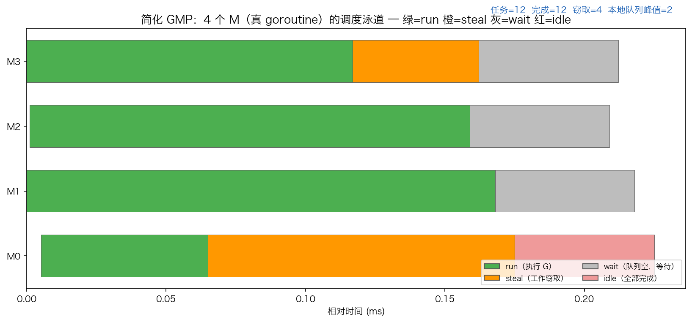
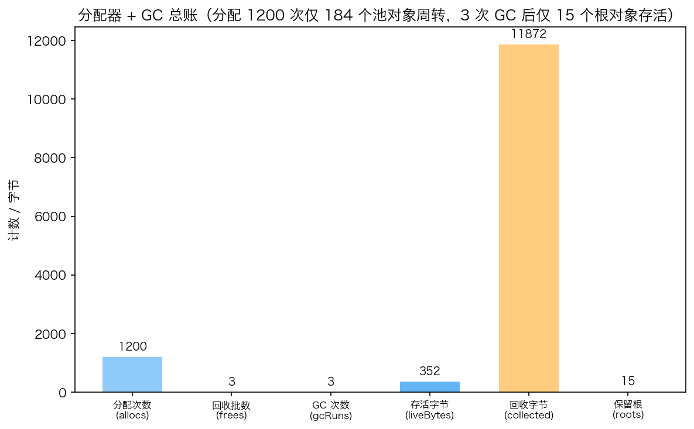

# 30 · 最小 Go 运行时模拟：GMP 调度器 + 两级分配器 + 标记清扫 GC

> 收官之作：不碰真实 runtime 源码里的指针位运算和汇编，而是把三大件的核心机制"翻译"成 200 行可读 Go 代码——**M 用真 goroutine 扮演**，P 带本地队列，G 是带状态（runnable/running/done）的闭包任务；分配器走 mcache→mcentral→arena 两级；GC 是简化版标记-清扫。跑 12 个任务、1200 次分配，完整验证"调度、分配、回收"能一起工作。

## 1. 为什么需要它

读完调度（GMP）、分配器（size class）、GC（三色标记）之后，知识点是散的：调度器怎么和内存分配器协作？GC 触发时分配器在干什么？本实验把三者放进同一个程序里跑起来——用一个"玩具 runtime"把它们的接口对上：**M 从队列取 G 执行，G 里调 alloc，完成数过阈值就触发 GC**。机制 1 小时就能讲清楚，比背源码可靠得多。

## 2. 总览：核心机制一图看懂


> 🌐 **交互版**：[在线打开（GitHub Pages）](https://<user>.github.io/<repo>/internals/30_runtime/images/memstats.html)
> （或本地打开 [`images/memstats.html`](images/memstats.html)）。

**心智模型一句话**：分配永远先走每 P 无锁的 mcache，不够才去按 class 加锁的 mcentral 补一批，内存最终来自 mheap/arena 向 OS 预取——`runtime.MemStats` 的四个关键字段就是这条链路的四个观测点：`TotalAlloc` 只增不减（累计计数）、`HeapAlloc` 当前存活、`HeapSys` 向 OS 要的堆总量、`Sys` 进程预留总内存。图中数值来自本实验的模拟分配器实测。

## 3. 快速开始

```bash
cd internals/30_runtime
go run main.go          # 文本演示：调度统计 + 分配器/GC 总账
go run main.go -json    # JSON 快照（viz.py 画图用的就是它）
```

预期输出（节选；**窃取次数与回收字节数随调度时序浮动**）：

```text
== 调度器 ================
  GMP=4  任务=12  完成=12  窃取=6  本地队列峰值=2
== 分配器 + GC ===========
  分配=1200  回收对象批=3  GC 次数=3  存活字节=120  回收字节=13976  根对象=15
```

多次实测：窃取 6~7 次、回收字节 12112~13976 B 在浮动；任务数、完成数、GC 次数、分配次数、存活字节、根对象数稳定不变。

## 4. 核心概念

### 4.1 调度器 = 队列 + 窃取 + 让出

本地队列空时先看全局队列，再随机偷别的 P 的本地队列尾；都空就小睡让步（模拟 sysmon）。任务按 `taskCount%3` 分流——约 1/3 进全局队列，其余轮询进各 P 本地队列，跨 P 窃取才有戏。



泳道图是 `go run main.go -json` 输出的事件序列按时间画的：绿色段在执行 G，橙色是窃取成功的那一次取任务，灰色是队列空等待。这是**实测数据图**，每次运行的窃取时刻都不同。

### 4.2 分配器 = 两级缓存降锁争

每 P 一个无锁 mcache 快取（free list），空了才拿 mcentral 的锁补一批 8 个：把"每次分配都加锁"变成"每 8 次才加一次锁"。真实 runtime 的 mcache/mcentral/mheap 就是这个套路——本实验的 arena 预建对象池对应真实 runtime 里 mheap 向 OS 批量要内存的那一步（对应关系见 §2 的图）。

### 4.3 GC = 标记可达、清扫其余

完成数每越过阈值 4/8/12 触发一次（用 `lastGC` 去重，防多个 M 并发重复触发）。从 roots DFS 标记所有可达对象，未标记的当场退回 central 的 free list。3 次 GC 后仅 15 个根对象存活。



### 4.4 为什么能一直分配不爆池

池总共只有 184 个对象（5 类：8/16/32/64/128 B，各 64/48/32/24/16 个），靠 GC 在跑批中途回收才能支撑 1200 次 alloc——"分配→用→丢→GC 回收→再分配"闭环成立。这也解释了 MemStats 里 `TotalAlloc`（累计 1200 次）远大于 `HeapAlloc`（存活 120 B）的日常现象。

## 5. 关键字段与坑清单

| 字段/结构 | 含义 | 为什么重要 |
|---|---|---|
| `Scheduler.global` / `P.local` | 全局队列 / P 本地队列 | 多级队列分摊锁；全进全局就没有"窃取" |
| `steals` | 窃取计数（实测 6~7，浮动） | 负载不均衡被自动修复的证据 |
| `mcache.free[c]` | 每 P 每 class 的无锁快取 | 命中即分配，不加锁 |
| `mcentral.free[c]` + `sync.Mutex` | 每 class 一把锁的中央池 | refill 批量 8，摊薄锁成本 |
| `allocs` / `liveBytes` | 累计分配 / 当前存活 | 对应 `TotalAlloc` / `HeapAlloc` 口径 |
| `lastGC` | 上次触发的完成数 | 防止多个 M 在同一阈值重复触发 GC |

坑清单：

- **别用 Python 的命名实参语法**：`spawnWorkers(allocs=1200, ...)` 在 Go 里直接语法错误
- **map 值不能取地址**：事件收集想存 `map[int][]Mev` 再 `&map[id]` 传下去——Go 不允许对 map 元素取址，改成 `events []*[]Mev` 存指针切片
- **只有全局队列就没有"窃取"**：第一版全进全局队列，steals 等于任务数、本地队列峰值恒 0——要约 1/3 任务直接塞本地队列
- **GC 阈值别用 `done%4==0` 裸判断**：多个 M 并发到达同一阈值会重复触发，要记 `lastGC` 去重
- **根对象要真活到最后**："保留根"和"丢弃"逻辑用共享计数 + mutex 保护，不然最终活的不是预期的 15 个

## 6. 文件结构

```text
internals/30_runtime/
├── README.md                        # 本文件：原理 + 运行指引 + 深入要点
├── main.go                          # 主教材：GMP 调度 + 两级分配器 + 标记清扫 GC（-json 输出快照）
├── viz.py                           # 只画两张实测数据 PNG（机制图已交给架构图三件套）
└── images/
    ├── memstats.architecture.json   # 图源：MemStats 字段 × 分配层级（Typed JSON IR）
    ├── memstats.html                # 交互版：可缩放/高亮连线的自包含页面
    ├── memstats.svg                 # README 内嵌双主题矢量图
    ├── runtime_sched.png            # 实测：4 个 M 的调度泳道（每次运行不同）
    └── runtime_alloc.png            # 实测：分配器 + GC 总账柱状图
```

## 7. 深入要点

**Q：`runtime.MemStats` 里 `TotalAlloc`、`HeapAlloc`、`HeapSys`、`Sys` 有什么区别？**
A：`TotalAlloc` 是累计分配字节数，只增不减，用来算吞吐；`HeapAlloc` 是当前存活堆字节（= HeapInuse 减去可释放部分，约等于 runtime 里 `heap_live`），GC 就看它涨没涨过 `HeapSys` 的 GOGC 比例；`HeapSys` 是向 OS 申请的堆总量（含已归还但未归还 OS 的）；`Sys` 是进程从 OS 预留的全部内存，堆之外还有栈、元数据等。

**Q：mcache / mcentral / mheap 三级各自解决什么问题？**
A：mcache 是每 P 的无锁快取，让绝大多数分配零锁；mcentral 按 size class 全局管理、一把锁，mcache 空了批量补货摊薄锁成本；mheap 管页级内存，向 OS 缺页。微小对象走 mcache 的 tiny allocator，大对象（>32KB）直接走 mheap。

**Q：为什么你的模拟里窃取次数每次运行不一样？**
A：M 是真 goroutine，被 OS 线程以不确定的节奏调度，谁先跑空本地队列、谁抢到锁都随时间序浮动——这正是并发程序"统计稳定、时序浮动"的典型表现，也是不能对并发输出做逐字断言的原因。

**Q：GC 为什么用"完成数过阈值"触发，真实 Go 也是这样吗？**
A：模拟里用完成数当水位；真实 Go 用 `HeapAlloc` 相对上次存活堆的比例（GOGC，默认 100% 即翻倍）触发，外加 2 分钟强制 GC 和 `runtime.GC()` 手动触发——本质相同：堆涨到"再不收就浪费"的水位就收。

**Q：work stealing 为什么偷本地队列尾？**
A：偷一半（真实 runtime `runqsteal` 偷一半）且从尾部拿，减少与队列属主的竞争——属主从头消费、小偷从尾拿走，天然分工；本实验简化为偷一个，机制相同。

## 8. 总结

运行时三大件的公共主题是"分摊"：调度用多级队列分摊锁，分配用两级缓存分摊锁，GC 用标记分摊"知道谁活着"。工作窃取让负载不均衡自动修复；池内 184 个对象靠 GC 周转撑起 1200 次分配。"模拟运行时"是理解运行时最好的方式——验证方法永远是 `go run main.go` 把真实数字打印出来。

internals 系列到此收官。接下来去 [patterns/01_lru_cache](../../patterns/01_lru_cache/) 用这些底层知识手写常用组件：LRU 缓存。
