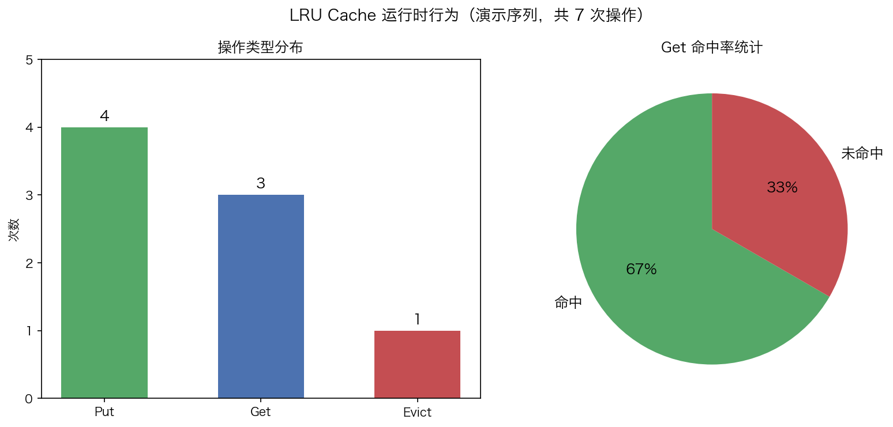

# 01 · LRU Cache：map + 双向链表的 O(1) 淘汰艺术

> LRU（Least Recently Used）是面试出现频率最高的数据结构设计题：容量满时淘汰**最久未使用**的条目，且 `Get`/`Put` 都必须 **O(1)**。单靠哈希表查得快但无序，单靠链表有序但查得慢——本题的考点正是把两者的长处拼起来。本实验用 `container/list` + `map` 实现完整 LRU，跑真实输出看清每一步的淘汰与移动。

## 1. 为什么需要它

缓存容量有限，满了必须淘汰。随机淘汰、FIFO 都会误伤"其实很热"的数据；LRU 依据时间局部性——**最近用过的大概率还会用**——淘汰最久未被访问的条目。难点在于两条硬性要求同时成立：

- `Get`/`Put` 都是 O(1)：查找要靠哈希表；
- O(1) 内维护"谁最久没用"：顺序要靠链表，且删除任一节点不能遍历找前驱，所以必须是**双向**链表。

## 2. 总览：核心机制一图看懂


> 🌐 **交互版**：[在线打开（GitHub Pages）](https://<user>.github.io/<repo>/interview/01_lru_cache/images/lru.html)
> （或本地打开 [`images/lru.html`](images/lru.html)）。

**心智模型一句话**：`map[int]*list.Element` 负责"按 key 一跳找到节点"，双向链表负责"维护使用顺序"——链表头（Front）是最近使用的 MRU，链表尾（Back）是最久未使用的 LRU。命中/写入都把节点移到头部；容量满时把尾部节点从链表 Remove、再从 map 里 delete，两步都是 O(1)。

## 3. 快速开始

```bash
cd interview/01_lru_cache
go run lru_cache.go
python3 viz.py    # 重新生成 images/lru_runtime.png（真实解析 go run 输出）
```

预期输出（节选；前半为固定演示，随机测试部分每次运行不同——源码里的 `rand.Seed(42)` 在 Go 1.20+ 已不再生效，下述随机段为一次示例）：

```text
1. Put:
  Put(1,10)    Cache: [1:10]
  Put(2,20)    Cache: [2:20] [1:10]
  Put(3,30)    Cache: [3:30] [2:20] [1:10]

2. 淘汰:
  Put(4,40) → 淘汰key=1    Cache: [4:40] [3:30] [2:20]

3. Get:
  Get(2)=20 (命中)    Cache: [2:20] [4:40] [3:30]
  Get(4)=40 (命中)    Cache: [4:40] [2:20] [3:30]
  Get(1)=0 (未命中)    Cache: [4:40] [2:20] [3:30]

4. 随机测试:
  Cache: [1:78] [4:9] [2:43]
```

注意第 3 步的细节：`Get(2)` 命中后 `[2:20]` 立刻跳到链表头；`Get(4)` 命中后又把 `[4:40]` 提到头——**每次读都会改变顺序**，这正是 LRU 与 FIFO 的分水岭。

## 4. 核心概念

### 4.1 为什么两种数据结构缺一不可

| 需求 | 哈希表 | 双向链表 | 组合 |
|------|--------|----------|------|
| O(1) 查找 | ✅ map[key] | ❌ 需遍历 | map 查 |
| O(1) 移到最前 | 无序 | ✅ MoveToFront | 链表移 |
| O(1) 插入 | ✅ | ✅ PushFront | 两者都做 |
| O(1) 删最旧 | ❌ 无序 | ✅ Remove(Back) | 链表删 + map 删 |

### 4.2 数据结构定义

```go
type entry struct{ key, value int }

type LRUCache struct {
    cap   int
    m     map[int]*list.Element // key → 链表节点指针
    order *list.List            // 双向链表：Front=MRU, Back=LRU
}
```

`entry` 里必须存 `key`：淘汰尾部时要从节点反查 key 才能删除 map 里的映射，这是最容易漏的一点。

### 4.3 Get：命中即移动

```go
func (c *LRUCache) Get(key int) (int, bool) {
    if e, ok := c.m[key]; ok {
        c.order.MoveToFront(e) // 标记为最近使用
        return e.Value.(*entry).value, true
    }
    return 0, false
}
```

哈希查找 O(1)，`MoveToFront` 是纯指针摘链/重挂也是 O(1)。未命中返回 `(0, false)`，调用方靠 `ok` 区分"存的值就是 0"和"不存在"。

### 4.4 Put：三步走

```go
func (c *LRUCache) Put(key, value int) {
    if e, ok := c.m[key]; ok {          // 1. 已存在：更新值 + 移到头
        e.Value.(*entry).value = value
        c.order.MoveToFront(e)
        return
    }
    if c.order.Len() >= c.cap {         // 2. 容量满：淘汰尾部
        b := c.order.Back()
        c.order.Remove(b)
        delete(c.m, b.Value.(*entry).key)
    }
    e := c.order.PushFront(&entry{key, value}) // 3. 头插并登记 map
    c.m[key] = e
}
```

**更新已有 key 不算新容量**：直接改值 + 移到头就返回，不触发淘汰（演示第 4 节随机测试里大量走这条路径）。

## 5. 关键字段与坑清单

| 字段/操作 | 含义 | 为什么重要 |
|---|---|---|
| `m map[int]*list.Element` | key → 节点 | 存的是**指针**，才能 O(1) 拿到节点去 MoveToFront/Remove |
| `order *list.List` | 双向链表 | 方向约定：Front=MRU、Back=LRU，面试要主动说清 |
| `entry.key` | 节点反存 key | 淘汰时 `delete(c.m, key)` 全靠它 |
| `e.Value.(*entry)` | 类型断言 | `list.Element.Value` 是 `any`，每次读写都要断言 |
| `MoveToFront` | 摘链 + 头插 | O(1) 的前提是节点已有 `Prev` 指针——单向链表做不到 |

坑清单：

- **忘了在 entry 里存 key**：淘汰时删不掉 map 映射，缓存"越删越脏"，之后 Get 到已淘汰 key 的旧节点
- **更新 key 时误走淘汰分支**：先查存在性再判断容量，顺序不能反
- **cap ≤ 0 未防护**：LeetCode 约束 1 ≤ capacity，生产实现要显式处理
- **线程安全**：本实现非并发安全，多 goroutine 需外层加 `sync.Mutex`（Get 也是写操作——MoveToFront，不能只用 RWMutex 的读锁）
- **数值漂移**：`viz.py` 的统计来自真实 `go run` 输出（Put=4、Get=3、Evict=1、命中 2/未命中 1），若改动 main 的演示序列，PNG 需重新生成



## 6. 文件结构

```text
interview/01_lru_cache/
├── README.md                      # 本文件：原理 + 运行指引 + 面试要点
├── lru_cache.go                   # 主教材：LRU 实现 + 四段演示（Put/淘汰/Get/随机）
├── viz.py                         # 数据图脚本：跑 go run 解析输出 → lru_runtime.png
└── images/
    ├── lru.architecture.json      # 图源：map + 双向链表架构（Typed JSON IR）
    ├── lru.html                   # 交互版：可缩放/高亮连线的自包含页面
    ├── lru.svg                    # README 内嵌双主题矢量图
    └── lru_runtime.png            # 数据图：操作分布 + 命中率（matplotlib）
```

## 7. 面试要点

**Q：Get/Put 为什么能 O(1)？分别靠哪个结构？**
A：查找靠 map 的哈希 O(1)；移动顺序靠双向链表 O(1)（MoveToFront/Remove 都是纯指针操作）；淘汰是 Remove(Back) + delete(map)，两步都 O(1)。

**Q：为什么必须双向链表，单向链表行不行？**
A：MoveToFront 和 Remove 都要改节点**前驱**的后继指针。单向链表找前驱要从头遍历 O(n)；双向链表节点自带 `Prev`，O(1) 完成。这也是手写时最容易写错的地方：摘链要同时接好 `prev.next` 和 `next.prev` 四根指针（`container/list` 帮你封装好了，手写版要自己防漏）。

**Q：手写时有哪些易错点？**
A：① entry 忘存 key，淘汰时无法删 map；② Put 已存在 key 时误触发淘汰；③ 哨兵头尾节点能把"空缓存/单节点"的边界统一成同一套指针逻辑，不设哨兵则每个操作都要特判空表；④ Get 里 MoveToFront 别忘了——只查不动就是 FIFO 了。

**Q：边界条件怎么验证？**
A：cap=1 时每次 Put 不同 key 都淘汰唯一旧元素；重复 Put 同一 key 不应增加链表长度、不应触发淘汰；Get 已淘汰 key 返回 miss 且不改变链表。演示第 2、3 节覆盖了淘汰与 miss。

**Q：如何实现线程安全的 LRU？**
A：整体加一把 `sync.Mutex` 最简单。注意 **Get 内含 MoveToFront 写操作**，不能用 RWMutex 只加读锁。高并发场景改用分 shard（每 shard 独立锁 + 独立 LRU），把竞争打散——本系列 [20_concurrent_lru](../20_concurrent_lru/) 专门演示这个方案。

## 8. 总结

LRU 的全部行为都能从"map 定位 + 链表定序"推出来：命中即 MoveToFront，满容量即 Remove(Back)+delete(map)，每个操作的两半分别由两个结构各承担一半。验证方法就是 `go run lru_cache.go`——看着 `[2:20]` 在每次 Get 后跳到队头，比背结论可靠得多。

想继续深挖，看 [02_lfu_cache](../02_lfu_cache/)：把"时间维度"换成"频率维度"后，数据结构要如何升级为频次桶 + 双向链表的组合。
