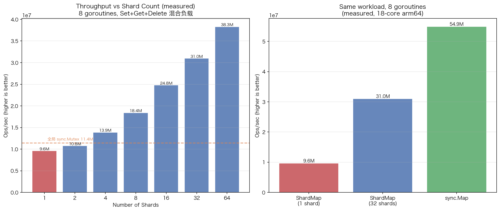

# 10 · Shard Map：分片锁并发安全 Map

> Go 的 map 不是并发安全的，并发读写会直接 `fatal error`（不可 recover）。保护它的手段有全局锁、`sync.RWMutex`、标准库 `sync.Map`，以及本实验的主角——**分片锁 ShardMap**：把一个大 map 拆成 N 个小 map，每个 shard 独立加锁，写并行度上限就是 shard 数。本实验实现一个完整的 ShardMap，并用真实基准回答面试高频追问：分片数怎么选？跨 key 操作怎么办？和 `sync.Map` 到底谁快？

## 1. 为什么需要它

并发读写原生 map 会触发 `fatal error: concurrent map writes`——它不走 panic 通道，`recover` 救不回来，进程直接死。常见的四种替代方案：

| 方案 | 锁粒度 | 读并发 | 写并发 | 适用场景 |
|------|--------|--------|--------|----------|
| `sync.Mutex` | 全局一把锁 | 无 | 无 | 低并发、逻辑简单 |
| `sync.RWMutex` | 全局读写锁 | 读共享 | 写独占 | 读多写少 |
| **ShardMap** | 每 shard 一把锁 | 同 shard 共享 | 跨 shard 并行 | 高并发读写、可控 key 分布 |
| `sync.Map` | 内部 read/dirty 双 map | 高 | 中 | key 稳定、读多写少 |

ShardMap 的核心思想是**缩小锁粒度**：8 个 goroutine 用全局锁同一时刻只有 1 个能写；拆成 4 个 shard 后最多 4 个写并行。这是经典的空间换时间——但实测会看到，它并不是免费的午餐（见 §4.4）。

## 2. 总览：核心机制一图看懂


> 🌐 **交互版**：[在线打开（GitHub Pages）](https://<user>.github.io/hands-on-go/interview/10_shard_map/images/shard.html)
> （或本地打开 [`images/shard.html`](images/shard.html)）。

**心智模型一句话**：每个 key 先过 FNV-32a 哈希再对 shard 数取模，落进一个自带 `RWMutex` 的小 map；不同 shard 的操作完全并行，同 shard 内读走 `RLock` 共享、写走 `Lock` 独占。图中分片归属是 `go run shard_map.go` 的真实路由输出（N=4：alpha→3、beta→3、gamma→2、delta→1、epsilon→1、zeta→3）。

## 3. 快速开始

```bash
cd interview/10_shard_map
go run shard_map.go     # 基本 API demo + 并发基准 + 分片路由分布
python3 viz.py          # 生成 images/shard_map_scaling.png（实测数据图）
```

预期输出（节选，耗时与倍数每次运行不同）：

```text
ShardMap: 4 shards created
Get("name") = gopher (ok=true)
Len() = 3
After Delete("version"): Len() = 2
--- Concurrent Benchmark ---
ShardMap:  8 goroutines x 100000 ops = 107.911167ms
sync.Map:  8 goroutines x 100000 ops = 47.098292ms
sync.Map is 2.3x faster than ShardMap
--- Shard Distribution ---
  key=alpha    -> shard[3]
  key=beta     -> shard[3]
  key=gamma    -> shard[2]
```

注意最后几行：这份混合负载（Set+Get+Delete 各一次）下 **sync.Map 反而更快**——本机 18 核上约快 1.8~2.3 倍。ShardMap 的收益要看负载形状，别背"分片一定更快"的结论。

## 4. 核心概念

### 4.1 数据结构：shard 数组

```go
type shard struct {
    mu   sync.RWMutex
    data map[string]interface{}
}

type ShardMap struct {
    shards     []shard
    shardCount uint32
}
```

每个 shard 自带锁和 map，`ShardMap` 本身没有任何锁——锁全部下沉到 shard。

### 4.2 路由：FNV-32a + 取模

```go
func (sm *ShardMap) getShard(key string) *shard {
    h := fnv.New32a()
    h.Write([]byte(key))
    idx := h.Sum32() % sm.shardCount
    return &sm.shards[idx]
}
```

选 FNV-32a 而非 MD5/SHA：非加密哈希计算极快，雪崩效应足够，32 位空间对"几十个 shard"绰绰有余。两个 key 落同一 shard 不影响正确性，只是竞争同一把锁。

### 4.3 读写与遍历

`Get` 用 `RLock`（同 shard 多读并发），`Set`/`Delete` 用 `Lock`（独占该 shard），不同 shard 之间零互相影响。`Range` 逐 shard 加读锁遍历——**不提供快照一致性**，遍历期间其他 goroutine 可能改 map。`Len()` 逐 shard 取 `len()` 后求和，代价是 O(shardCount) 次加锁，不是 O(1)。

### 4.4 实测扩展性与"不如 sync.Map"的真相



- **左图**：shard 数从 1 → 64，吞吐从 9.6M → 38.3M ops/s 持续上升（18 核，8 goroutine），但仍明显次线性——shard=8 时只有 18.4M，远没到 8 倍
- **右图**：同一负载下 `sync.Map`（54.9M）> ShardMap 32 分片（31.0M）> shard=1（9.6M）
- 一个反直觉的细节：**shard=1 的 ShardMap（9.6M）比一把裸 `sync.Mutex`（11.4M）还慢**——RWMutex 比 Mutex 更重，分片救不了"只有一个 shard"的退化设计

数据来自 8 goroutine 混合负载（Set+Get，每 10 次 1 次 Delete），每档 5 次取中位数；本实验 key 每次都不同、写密集，恰好是 `sync.Map` 的 read-only 优化失效的场景，但它的无锁读路径仍然占优。ShardMap 的翻身仗在需要 `Len()`、类型安全（可泛型化）或更大 key 空间时。

## 5. 关键字段与坑清单

| 字段/方法 | 含义 | 为什么重要 |
|---|---|---|
| `shard.mu RWMutex` | 每 shard 独立锁 | 锁粒度 = 竞争面；绝不能提成 ShardMap 级字段 |
| `shardCount uint32` | 分片数，取模的模数 | 决定写并行度上限；`NewShardMap(≤0)` 兜底为 1 |
| `getShard` | key → shard 的唯一入口 | 所有读写必须先路由，漏路由 = 数据竞争 |
| `Range(fn)` | 逐 shard 读锁遍历 | 无快照一致性；fn 返回 false 提前终止 |

坑清单：

- **shard 数太少退化**：N=1 就是一把 RWMutex，还额外付了 hash 与 RWMutex 的开销（实测比裸 Mutex 慢）
- **跨 key 原子操作没有**：两个 key 常落不同 shard，无法"加一次锁"保证多 key 一致性；需要时按下标升序依次加两把锁防死锁，或退化为单 map
- **Range/Len 遍历期间锁是逐个拿放的**：读到的是"移动中的快照"，别拿它做一致性判断
- **`fatal error: concurrent map ...` 不可 recover**：这才是换并发 map 的根本动机，而不是 panic
- **value 用 `interface{}` 丢类型**：生产实现应泛型化 `ShardMap[K comparable, V any]`

## 6. 文件结构

```text
interview/10_shard_map/
├── README.md                        # 本文件：原理 + 运行指引 + 深入要点
├── shard_map.go                     # 主教材：ShardMap 实现 + 基准 + 路由分布 demo
├── viz.py                           # 数据图：实测分片数-吞吐曲线（输出到 images/）
└── images/
    ├── shard.architecture.json      # 图源：key→hash→取模→shard 架构（Typed JSON IR）
    ├── shard.html                   # 交互版：可缩放/高亮连线的自包含页面
    ├── shard.svg                    # README 内嵌双主题矢量图
    └── shard_map_scaling.png        # 实测数据图：分片数与吞吐量、三方案对比
```

## 7. 深入要点

**Q：分片数怎么选？**
A：经验起点是 `runtime.NumCPU()` 或 32。太少（1~2）接近全局锁；太多（>128）白白占内存、初始化变慢，收益递减。实测（8 goroutine）吞吐随 shard 数单调升但次线性，因为瓶颈还有 hash 计算、内存带宽和调度。常取 2 的幂，把 `% N` 换成 `& (N-1)`。

**Q：为什么不直接用 sync.Map？**
A：本机实测同一混合负载 `sync.Map` 反而快约 1.8~2.3 倍。但 ShardMap 有三张牌：可泛型化（类型安全）、`Len()` 只需 O(shardCount) 次锁而非 O(n) 遍历、写路径只锁一个 shard 而不涉及 read/dirty 提升逻辑。`sync.Map` 官方定位是"key 稳定、读多写少"（如缓存）；key 高频增删时它的 dirty 重建代价大。

**Q：两个 key 的原子更新（跨 key 事务）怎么做？**
A：ShardMap 没有"一把锁锁全部"的能力。方案：① 按 shard 下标升序依次 `Lock` 两个 shard（全局固定顺序防死锁）；② 退化成单锁 map；③ 把关联 key 设计成落在同一 shard（如用同一前缀参与哈希）。

**Q：手写 ShardMap 最容易错在哪？**
A：① 忘了所有访问都先 `getShard` 路由，绕过路由直接摸 map 就是数据竞争；② `Range` 回调里再调本 shard 的 `Set` 会重入死锁（RWMutex 不可重入）；③ `Len` 竞态下只是近似值，别当精确值用；④ `NewShardMap(0)` 要兜底为 1，否则取模除零 panic。

**Q：Range 遍历时其他 goroutine 在写，会崩吗？**
A：不会。遍历持有当前 shard 的读锁，写者被挡在锁外；但 shard 之间是逐个拿放的，整体上看到的是"移动中的快照"，需要一致性就整体加锁或做 Copy-on-Write。

## 8. 总结

ShardMap = **N 个 shard + FNV-32a 取模路由 + 每 shard 独立 RWMutex**，把锁粒度从全局缩到单 shard，写并行度上限 = shard 数。但实测告诉我们三件事：吞吐随分片数次线性增长；shard=1 时它连裸 Mutex 都跑不过；同负载下 `sync.Map` 仍可能更快——选型看负载形状与是否需要类型安全/`Len()`，而不是无脑分片。

下一篇 [11_pubsub](../11_pubsub/) 继续并发模式：发布/订阅 Broker 如何用"每订阅者一个 channel"实现扇出，并让慢订阅者不阻塞发布者。
