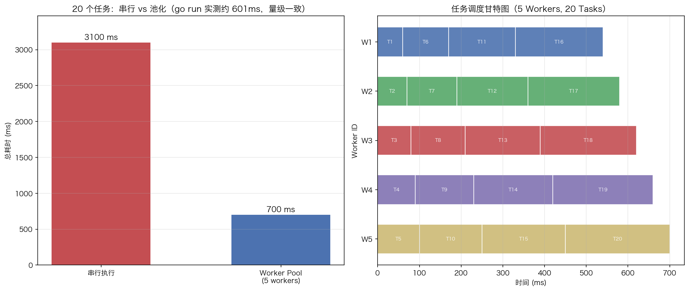

# 08 · Worker Pool：固定 worker 扇出消费，channel 背压限流

> 无限制地 `go func()` 处理海量任务，轻则内存暴涨，重则把下游打挂。Worker Pool 用固定数量的 worker goroutine 消费同一个任务 channel：并发度恒定、资源可控、错误可收集。本实验用纯标准库手写一个完整的池，并顺着它讲清扇出/汇合、背压、优雅关闭三个必考机制。

## 1. 为什么需要它

并发控制的核心矛盾：goroutine 很便宜，但**不免费**——每个都有栈、有调度开销，且任务本身可能压垮下游（DB 连接、外部 API 限流）。三种方案对比：

| 方案 | 优点 | 缺点 |
|------|------|------|
| 无限制 goroutine | 实现简单 | 内存不可控、无法限制并发度、错误难收集 |
| **Worker Pool** | 并发数固定、可排队、可收集错误 | 需要协调 channel 与 WaitGroup |
| `sem.Weighted` | 代码最少 | 无内置队列，每任务创建销毁 goroutine |

Worker Pool 本质是**生产者-消费者**模型：`Submit` 是生产者，worker 是消费者，`tasks` channel 是有界队列。demo 参数：5 workers、20 tasks，任务 `i` 耗时 `50+i*10` ms，其中 7 和 14 号故意失败。

## 2. 总览：核心机制一图看懂


> 🌐 **交互版**：[在线打开（GitHub Pages）](https://<user>.github.io/<repo>/patterns/08_worker_pool/images/pool.html)
> （或本地打开 [`images/pool.html`](images/pool.html)）。

**心智模型一句话**：所有 worker 挤在同一个 `tasks chan` 前抢任务（扇出），各自把结果写回同一个 `results chan`（汇合）；队列满时 `Submit` 阻塞，背压由带缓冲任务队列天然提供。

## 3. 快速开始

```bash
cd patterns/08_worker_pool
go run worker_pool.go
```

预期输出（节选，总耗时每次运行不同，实测约 0.6s）：

```text
Worker Pool: 5 workers, 20 tasks

  [OK]   task 1 completed
  ...
All tasks submitted, waiting for completion...
  [OK]   task 20 completed

Done in 601.355541ms. Errors: 2
  [ERR]  task 7: simulated failure (divisible by 7)
  [ERR]  task 14: simulated failure (divisible by 7)
```

注意：失败任务**不在**执行流里打印——worker 只把 `err` 装进 result，所有错误由 drain goroutine 汇总后在结尾统一输出。

## 4. 核心概念

### 4.1 扇出：N 个 worker 抢一个 channel

```go
for i := 0; i < wp.workers; i++ {
    wp.workerWg.Add(1)
    go func(workerID int) {
        defer wp.workerWg.Done()
        for t := range wp.tasks {          // channel 关闭后 range 自动退出
            err := t.fn()
            wp.results <- result{taskID: t.id, err: err}
            wp.taskWg.Done()
        }
    }(i)
}
```

多个 goroutine 从同一 channel 接收，channel 自带锁保证每个任务只被一个 worker 领走——扇出不需任何额外同步。同时执行的任务数 ≤ worker 数（demo 中为 5）。

### 4.2 背压：带缓冲任务队列

```go
tasks:   make(chan task, workers*2)   // 缓冲 10
results: make(chan result, workers*2)
```

20 个任务连续 `Submit`：前 10 个填满缓冲（期间 worker 陆续领走），队列再满时 `tasks <- task` 阻塞生产者——**这就是背压**，不需要任何显式限流代码。缓冲=0 时背压最强（Submit 必须等空闲 worker），缓冲越大吞吐越平滑但内存占用越高。

### 4.3 汇合与错误收集

`Wait()` 启动一个 drain goroutine `for r := range wp.results` 收集非 nil 的 err；主流程等任务全部完成后关闭 channel 收尾（见 §4.4）。

### 4.4 优雅关闭：Wait 内部的固定顺序

```go
wp.taskWg.Wait()      // 1. 所有任务执行完
close(wp.tasks)       // 2. 关任务队列 → worker 的 range 退出
wp.workerWg.Wait()    // 3. 等 worker 全部退出（不再有新 result）
close(wp.results)     // 4. 关结果队列 → drain 的 range 退出
<-done                // 5. drain 收完所有错误
```

顺序不可乱：先 `close(results)` 会丢 worker 还没写入的结果；不 `close(tasks)` worker 的 `range` 永远不退出。这就是"谁发送谁关闭、关完再等收尾"。

### 4.5 数据视角：串行 vs 池化



左图：20 个任务按 demo 的耗时模型串行需 3100ms，池化后（模拟调度）约 700ms，`go run` 实测约 601ms——同量级，差异来自调度细节与计时方式。右图甘特图展示任务如何被分派到 5 个 worker：先空闲的 worker 领下一个任务，长任务（大 id）成为尾部瓶颈。图由 `viz.py` 按真实任务耗时模型推算生成（模拟值，非实测逐任务时间戳）。

## 5. 关键字段与坑清单

| 字段/原语 | 作用 | 为什么重要 |
|---|---|---|
| `tasks chan task` | 有界任务队列 | 缓冲 `workers*2`，满则 Submit 阻塞 = 背压 |
| `results chan result` | 结果汇合通道 | 错误经此回传，drain 统一收集 |
| `taskWg` | 已提交任务计数 | `Submit` 时 +1，worker 完成 -1；归零即全部做完 |
| `workerWg` | worker 存活计数 | 保证 `close(results)` 前所有 worker 已退出 |
| `counter` | 任务 ID 发生器 | 只有 Submit 单写者，无需加锁 |

坑清单：

- **两个 WaitGroup 不能合并**：只用一个的话，"任务完成"和"worker 退出"两种事件混在一起，无法判断何时能安全 `close(results)`
- **忘写 `close(tasks)`**：worker 的 `for range` 永不退出，`workerWg.Wait()` 死锁
- **在 worker 里关 results**：多 worker 竞争下会对已关闭 channel 再 close，直接 panic——只由 `Wait()` 单点关闭
- **Submit 与 close(tasks) 并发**：向已关闭 channel 发送会 panic；本实现 Submit 全部完成后才 Wait，生产环境需用 `sync.WaitGroup`/`Done` 或 `context` 协调"停止接单"
- 任务失败不影响其他任务：err 只装进 result，worker 循环继续

## 6. 文件结构

```text
patterns/08_worker_pool/
├── README.md                      # 本文件：原理 + 运行指引 + 深入要点
├── worker_pool.go                 # 主教材：task/result 定义 → 池实现 → demo（5 workers, 20 tasks）
├── viz.py                         # 数据图：串行 vs 池化 + 调度甘特图 → images/worker_pool_scaling.png
└── images/
    ├── pool.architecture.json     # 图源：扇出/汇合架构（Typed JSON IR）
    ├── pool.html                  # 交互版：可缩放/高亮连线的自包含页面
    └── pool.svg                   # README 内嵌双主题矢量图
```

## 7. 深入要点

**Q：如何控制并发数？**
A：固定 worker 数量，每个 worker 一个 goroutine 从同一 channel 消费。channel 的多接收者语义保证每个任务只被一个 worker 领走，同时在执行的任务数不超过 worker 数。

**Q：背压是怎么实现的？**
A：`tasks` 是容量 `workers*2` 的带缓冲 channel。队列满时 `Submit` 里的 `tasks <- task` 阻塞，生产者被天然限流，不需要额外限流代码。缓冲为 0 背压最强，缓冲大则平滑但允许任务积压。

**Q：优雅关闭的步骤？为什么这个顺序？**
A：`taskWg.Wait()` 等任务全部完成 → `close(tasks)` 让 worker 的 range 退出 → `workerWg.Wait()` 等 worker 退出 → `close(results)` 让 drain 退出。乱序的后果：先关 results 会丢结果/panic；不关 tasks 会死锁。原则：只由发送方关 channel、单点关闭。

**Q：手写 Worker Pool 最容易错的地方？**
A：①只用一个 WaitGroup，分不清"任务完成"与"worker 退出"；②忘 `close(tasks)` 导致 `workerWg.Wait()` 死锁；③多个 worker 都去 close results panic；④Submit 与关闭并发时向已关 channel 发送 panic。

**Q：任务失败怎么处理？和 `sem.Weighted` 的区别？**
A：err 通过 results channel 回传，`Wait()` 收集后统一返回；也可改成快速失败（首个 err 触发 cancel context）或在 worker 内重试。与 `sem.Weighted` 相比：池的 goroutine 持久复用、自带队列与结果通道，适合持续批量处理；信号量只限并发数，适合简单限流。

## 8. 总结

Worker Pool = **固定 worker 扇出消费 + 有界任务队列背压 + 双 WaitGroup 收尾**。channel 同时承担通信与同步，缓冲提供天然限流；优雅关闭只需要背熟那五步顺序。验证方法很简单：`go run worker_pool.go`，观察错误在结尾统一出现、总耗时约 0.6s——比背结论可靠。

下一篇 [09_producer_consumer](../09_producer_consumer/) 把视角反过来：多生产者对多消费者，看"channel 满了生产者阻塞"这一最朴素的背压形态还能玩出什么花样。
